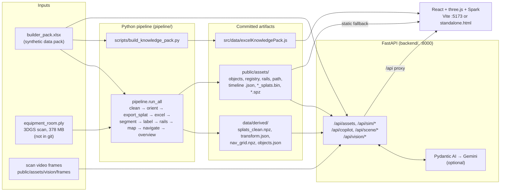

# Valmet DNA SpatialSense

Valmet DNA Spatialsense won third place in the Valmet Company Challenge at SinceAI Hackathon 2026!

A prototype 3D digital twin of an industrial equipment room, built for the **Valmet × Since AI 2026** hackathon.

SpatialSense takes a Gaussian-splat scan of a real equipment room and the hackathon's Excel *Synthetic Industrial Metaverse Builder Data Pack* (30 assets, telemetry, alarms, maintenance history, SOP documents) and joins them in the browser. A maintenance technician can walk the photoreal scan, click a machine to see its health, telemetry and history, ask a copilot why it is alarming (with every claim citing a row in the pack), and plan a collision-checked route to it. Field service usually means carrying the plant model, the CMMS and the manuals separately. This prototype shows them as one spatial view.

> All asset, telemetry, alarm and work-order data comes from the **synthetic** data pack. The links between pack assets and objects in the scan are mostly heuristic (see [Known limitations](#known-limitations)).

---

## Contents

- [Key features](#key-features)
- [Architecture](#architecture)
- [Repository layout](#repository-layout)
- [Tech stack](#tech-stack)
- [Quick start](#quick-start)
- [Configuration](#configuration)
- [Data](#data)
- [Tests and build](#tests-and-build)
- [Known limitations](#known-limitations)
- [Credits](#credits)

---

## Key features

All of these are on the `main` branch.

| Area | What it does | Where |
|---|---|---|
| Splat viewport | Renders the scan as 3D Gaussian splats (`.spz`) with Spark. If Spark fails it falls back to a coloured point cloud (`*_splats.bin`). Two areas: *Equipment Room* and *Boiler House*. | [`BoilerRoomViewport.jsx`](src/components/BoilerRoomViewport.jsx) |
| Two UI modes | **Technical Console** (drawers for alerts, assets, CV review, visual AI, scene edit, navigation, work orders, copilot, settings) and **Consumer Mode** (clean walk/orbit tour). Both modes have an AR HUD. | [`App.jsx`](src/App.jsx) |
| Asset HUD | Click a bounding box to see that asset's rows from the Excel sheets, a part image, live telemetry sliders and fault injection. | [`HolographicArAssetMenu.jsx`](src/components/HolographicArAssetMenu.jsx), [`AssetInspectorPanel.jsx`](src/components/AssetInspectorPanel.jsx) |
| Pump cutaway | A 31-part centrifugal pump GLB with an explode slider, per-part moves and an illustrative "mechanical seal leak" animation on P-002. | [`PumpGlbInspector.jsx`](src/components/PumpGlbInspector.jsx), [`modelCatalog.js`](src/data/modelCatalog.js) |
| Diagnostic Assistant | Runs in the browser with no LLM. It does keyword routing and decision-tree diagnosis over a JS snapshot of the Excel pack, and every citation resolves to a pack ID. | [`diagnosticEngine.js`](src/utils/diagnosticEngine.js), [`excelKnowledgePack.js`](src/data/excelKnowledgePack.js) |
| Grounded copilot (backend) | `POST /api/copilot/query` builds an evidence pack from the Excel store and checks the IDs it cites (`EVT-*`, `WO-*`, `CASE-*`, `DQ-*`, `DOC-*`). It uses an LLM through Pydantic AI when one is configured, and a deterministic answer otherwise. | [`backend/ai/`](backend/ai/) |
| Work-order drafts | `POST /api/work-orders/draft` returns a `WO-DRAFT-*` for human review. Nothing is sent to a CMMS. | [`backend/app.py`](backend/app.py) |
| Scene edits | Move or remove freestanding objects by panel or by typed command ("move the ladder 1 m left"). Splats are shifted on the GPU with Spark `SplatEdit` SDF boxes. The backend checks that the new position is safe and replans the rails and route. | [`src/sceneEdit/`](src/sceneEdit/), [`backend/scene_edit/`](backend/scene_edit/) |
| Navigation | A* routing on the floor occupancy/ESDF grid with human-technician and wheeled-robot profiles, a minimap and simulated workers. | [`pathfinding.js`](src/utils/pathfinding.js), [`exerciseEngine.js`](src/utils/exerciseEngine.js), [`FloorMinimap.jsx`](src/components/FloorMinimap.jsx) |
| CV review | Browse the 441 segmented objects (oriented boxes, class, confidence) and override labels. | [`CvReviewPanel.jsx`](src/components/CvReviewPanel.jsx), [`cvEngine.js`](src/utils/cvEngine.js) |
| Visual inspection | 18 still frames from the scan video with hand-drawn regions. A vision model (Gemini via Pydantic AI) reports what state is visible and cross-checks it against the Excel state. | [`backend/vision/`](backend/vision/), [`SceneInspectorPanel.jsx`](src/components/SceneInspectorPanel.jsx) |
| Offline fallback | The frontend tries `/api/*` first and falls back to JSON in `public/assets/`, so the 3D scene runs without Python. | [`src/api.js`](src/api.js), [`src/sceneApi.js`](src/sceneApi.js) |

---

## Architecture



- **The pipeline runs offline.** It needs the raw scan, which is not in the repo. Its outputs are committed, so you do not need to run it to use the app.
- **The backend** loads the Excel pack into memory at startup ([`pipeline/excel.py`](pipeline/excel.py), `PackStore`) and reads the scene JSON from `public/assets/`.
- **The frontend** calls the backend through Vite's `/api` proxy ([`vite.config.js`](vite.config.js)). Scene data falls back to static JSON. Live asset data, the backend copilot, scene-edit replanning and vision need the backend.

---

## Repository layout

| Path | Contents |
|---|---|
| [`src/`](src/) | React app. `components/` holds the viewport, HUDs, panels and copilot. `data/` holds the Excel-derived catalogues, knowledge pack, playbooks and process topology. `utils/` holds pathfinding, the CV loader, the diagnostic engine and the worker simulation. `sceneEdit/` holds the Spark splat mover. `viewer/` is a separate lightweight scan viewer. |
| [`backend/`](backend/) | FastAPI app ([`app.py`](backend/app.py)). `ai/` is the copilot agent and its fallback. `scene_edit/` covers move/remove commands, safety checks and replanning. `vision/` covers the frame inspection agent, cache and cross-check. |
| [`pipeline/`](pipeline/) | Scan + Excel processing. [`run_all.py`](pipeline/run_all.py) is the main staged pipeline. [`run.py`](pipeline/run.py) is an alternative segmentation pipeline (`tab2-segmentation-1`). `detect2d.py`, `semantic.py` and `label_vlm.py` are experimental vision labelling steps. |
| [`scripts/`](scripts/) | Helpers: knowledge-pack generator, PLY preprocessor (Node), frame extraction/picking (ffmpeg), region contact sheet. |
| [`tests/`](tests/) | pytest suite (API, pipeline outputs, scene edit/command, vision) and a Node test for the diagnostic engine. |
| [`data/`](data/) | `raw/builder_pack.xlsx` and the derived arrays the backend loads. |
| [`public/assets/`](public/assets/) | Everything the browser loads: `.spz` splats, `.bin` point clouds, web PLYs, scene JSON, `derived/` CV outputs, `evidence/` crops, `vision/` frames, `parts/` PNGs, `models/pump.glb`, `vendor/` (vendored three.js + Spark for the standalone page). |
| [`docs/`](docs/) | Engineering notes: `kt/` (vision labelling, evidence-based mapping) and `remediation/` (mapping and navigation fixes, handoff). |
| [`_analysis/`](_analysis/) | Scratch analysis scripts, logs and an evidence handoff note. |
| [`web/`](web/) | A partial second web tree (a few scene/inspector modules, check scripts, derived data). It is not wired into the build, and its check scripts do not run on `main` (see limitations). |
| [`standalone.html`](standalone.html), [`instant_server.mjs`](instant_server.mjs) | Zero-install path: in-browser Babel transpile plus a tiny Node static server. |
| [`index.html`](index.html), [`viewer.html`](viewer.html) | Vite entry points (main app, scan viewer). |
| [`run.bat`](run.bat), [`run_full.bat`](run_full.bat), [`start_prototype.ps1`](start_prototype.ps1), [`instant_run.bat`](instant_run.bat) | Windows launchers. |
| [`context.md`](context.md) | Design notes for the HUD and iPad performance work. |

---

## Tech stack

Built from `package.json`, `package-lock.json`, `pyproject.toml`, `uv.lock`, the import maps in `standalone.html`, and an import grep across `src/`, `backend/`, `pipeline/`, `scripts/`, `tests/` and `web/`.

### Frontend

| Technology | Used for |
|---|---|
| React 18.3 + react-dom | The whole app UI ([`src/main.jsx`](src/main.jsx), [`src/App.jsx`](src/App.jsx)). |
| lucide-react 0.460 | Icons in the panels and toolbars. |
| Vite 5.4 + @vitejs/plugin-react | Dev server on :5173 with an `/api` proxy to :8000. Two-page build (`index.html`, `viewer.html`). |
| @babel/standalone 7.26.2 (CDN, unpkg) | Transpiles the JSX in the browser for `standalone.html` only. |
| esm.sh (CDN) | Serves React, react-dom and lucide-react to `standalone.html`. |
| Google Fonts (Inter, JetBrains Mono) | UI typography in `index.html`, `standalone.html` and `viewer.html`. |
| Plain CSS | [`src/index.css`](src/index.css), [`sceneInspector.css`](src/components/sceneInspector.css), [`viewer.css`](src/viewer/viewer.css). |

### 3D / rendering

| Technology | Used for |
|---|---|
| three.js 0.181 | Scene, camera, bounding boxes, rails, workers, minimap overlays. Addons used: `OrbitControls`, `TransformControls`, `PLYLoader`, `GLTFLoader`, `CSS2DRenderer` (viewer only), `BufferGeometryUtils` and `Pass` (vendored for the standalone page). |
| @sparkjsdev/spark 2.4 | Renders the `.spz` Gaussian splats (`SplatMesh`, `SparkRenderer`) and moves objects with `SplatEdit`/`SplatEditSdf` displacement. |
| @mkkellogg/gaussian-splats-3d 0.4.7 | `DropInViewer` in the separate scan viewer ([`src/viewer/main.js`](src/viewer/main.js)), which loads `equipment_room.splat`. |
| Vendored bundles in [`public/assets/vendor/`](public/assets/vendor/) | Prebuilt three.js (0.181-era, r181 header) and Spark modules, served by `instant_server.mjs` so the standalone page skips npm. |

### Backend

| Technology | Used for |
|---|---|
| Python 3.12 (pinned `>=3.12,<3.13`, [`.python-version`](.python-version)) | Backend and pipeline runtime. |
| FastAPI 0.162 | REST API in [`backend/app.py`](backend/app.py) plus the `/api/scene` and `/api/vision` routers. |
| uvicorn[standard] | ASGI server (`uv run uvicorn backend.app:app`). |
| Pydantic 2 | Request/response models and the structured output schemas the LLM must fill. |
| python-dotenv | Loads `.env` for the LLM settings. |
| httpx | Declared dependency. It is used by FastAPI's `TestClient` in the tests. |

### Data pipeline / CV / AI

| Technology | Used for |
|---|---|
| NumPy 2 | Memory-mapped PLY reading, splat filtering, voxel grids, `.npz` outputs. |
| SciPy | `ndimage` connected components and distance transforms for segmentation, ESDF and rails. |
| scikit-image | Watershed segmentation, skeletonised medial-axis rails, and cost-path routing (`skimage.graph`) in `map`/`navigate`. |
| pandas + openpyxl | Reading every sheet of `builder_pack.xlsx` into the backend store and the knowledge pack. |
| Pillow | Pipeline PNG renders, vision frame crops (`backend/vision`), frame picking and contact sheets. |
| pydantic-ai-slim[google,openai] | The copilot, scene-command intent parser and vision agent ([`backend/ai/agent.py`](backend/ai/agent.py), [`backend/scene_edit/intent.py`](backend/scene_edit/intent.py), [`backend/vision/agent.py`](backend/vision/agent.py)). Its extras pull in `google-genai` and `openai`. |
| openai (Python SDK) | Used directly only by the optional crop labeller [`pipeline/label_vlm.py`](pipeline/label_vlm.py). |
| scikit-learn *(not declared)* | DBSCAN/HDBSCAN in [`pipeline/instances.py`](pipeline/instances.py) and [`pipeline/semantic.py`](pipeline/semantic.py) (alternative pipeline `pipeline.run`). |
| matplotlib *(not declared)* | Diagnostic plots in [`pipeline/export.py`](pipeline/export.py) and [`pipeline/navigation.py`](pipeline/navigation.py) (alternative pipeline `pipeline.run`). |
| PyTorch + Hugging Face transformers *(not declared)* | Grounding DINO, OWLv2 and CLIP 2D detection in [`pipeline/detect2d.py`](pipeline/detect2d.py). Meant for a separate `.venv-vision`. |
| OpenCV `cv2` *(not declared)* | One step in [`pipeline/semantic.py`](pipeline/semantic.py). |
| COLMAP outputs | `semantic.py` reads camera poses through a `colmap_io` module that is not in the repo. |

### Tooling & testing

| Technology | Used for |
|---|---|
| Node.js (`run_full.bat` asks for 20+; verified on 26) | Vite, `instant_server.mjs`, `scripts/preprocess_ply.mjs`, Node tests. |
| npm + `package-lock.json` | JS dependencies. |
| uv + `uv.lock` | Python environment and dependency install (`uv sync`). The project is not packaged (`package = false`). |
| pytest 8 | [`tests/`](tests/) (configured in `pyproject.toml`). |
| `node:test` | [`tests/diagnosticEngine.test.mjs`](tests/diagnosticEngine.test.mjs). |
| ffmpeg | Frame extraction in [`scripts/extract_frames.sh`](scripts/extract_frames.sh) and [`scripts/pick_frames.py`](scripts/pick_frames.py). |
| Windows batch / PowerShell | `run.bat`, `run_full.bat` (installs uv, runs `uv sync`, starts both servers), `start_prototype.ps1`, `instant_run.bat`. |

### External services

| Service | Used for |
|---|---|
| Google Gemini (AI Studio API key) | Optional LLM for the copilot, typed scene commands and visual inspection, through Pydantic AI (`LLM_MODEL=google:...`, `VISION_MODEL`). |
| OpenAI-compatible endpoint (e.g. Featherless) | Backup LLM option mentioned in `.env.example` (`openai-chat:` model). Its tool calling is marked "not yet verified" there. |
| OpenAI API | Optional, `pipeline/label_vlm.py` only (`OPENAI_API_KEY`). |
| esm.sh, unpkg, Google Fonts | CDNs the standalone page needs at runtime. |
| astral.sh | `run_full.bat` downloads uv from here if it is missing. |

### Data formats

| Format | Where |
|---|---|
| PLY (binary little-endian, 3DGS) | Raw scan input. Smaller vertex-coloured `*_Web.ply` in `public/assets/`. |
| SPZ | `equipment_room.spz`, `boiler_room.spz`, rendered by Spark. |
| `.splat` (antimatter15 layout) | `equipment_room.splat`, written by `pipeline.export_splat` for `viewer.html`. Gitignored. |
| Custom `.bin` | `*_splats.bin`: int32 count + 16-byte records (xyz float32, RGBA uint8), the point-cloud fallback. |
| XLSX | `data/raw/builder_pack.xlsx`. |
| JSON | Scene, registry, rails, path, timeline, CV objects, vision frames, edit store. |
| NPZ | `splats_clean.npz`, `nav_grid.npz` (backend scene edit / replanning). |
| PGM + YAML, PNG, JPG | Occupancy map (`nav_map.pgm/.yaml`), minimap, evidence crops, video frames, part images. |
| GLB | `public/assets/models/pump.glb`. |

---

## Quick start

### Prerequisites

| Path | Needs |
|---|---|
| Vite dev app | Node.js 20+ and npm |
| Backend + pipeline | [uv](https://docs.astral.sh/uv/). uv downloads Python 3.12 itself if needed. |
| iPad / standalone | Node.js (or Python 3) to serve files, a modern browser, and **internet access** for the CDNs |

```bash
git clone https://github.com/B017-12/industrialhegemony.git
cd industrialhegemony
```

### 1. Vite dev app (frontend only)

```bash
npm install
npm run dev
```

Open <http://localhost:5173>. The 3D scene, CV review, minimap and in-browser Diagnostic Assistant work without the backend. The `/api` proxy returns errors until the backend is running, and the app falls back to static JSON.

The scan viewer is at <http://localhost:5173/viewer.html>.

> With npm 11+ you may see `install scripts blocked ... esbuild`. On a clean install this was harmless: the dev server and the build still worked.

### 2. Backend + pipeline

```bash
uv sync                                                    # creates .venv with Python 3.12
uv run uvicorn backend.app:app --host 127.0.0.1 --port 8000 --reload
```

Then start the frontend (`npm run dev`) in a second terminal. Check the backend:

```bash
curl http://127.0.0.1:8000/api/health
# {"ok":true,"assets":30,"llm_model":null,"scene_loaded":{"objects":true,...}}

curl -X POST http://127.0.0.1:8000/api/copilot/query \
  -H 'content-type: application/json' \
  -d '{"asset_id":"ASSET-014","question":"Why is P-002 alarming?"}'
```

`llm_model: null` means no LLM is configured and the deterministic fallback is in use. FastAPI's interactive docs are at <http://127.0.0.1:8000/docs>.

**Windows one-click:** [`run_full.bat`](run_full.bat) checks for Node, installs uv if missing, runs `uv sync` and `npm install`, starts the backend in its own window, waits for `/api/health`, then starts Vite. [`run.bat`](run.bat) and [`start_prototype.ps1`](start_prototype.ps1) start only the frontend. *(The `.bat`/`.ps1` scripts were not run while writing this README. The commands they wrap were.)*

**Re-running the pipeline** (optional, needs the raw scan; see [Data](#data)):

```bash
uv run python -m pipeline.excel                 # Excel only: works with what is in git
uv run python -m pipeline.run_all               # full run, needs data/raw/equipment_room.ply
uv run python -m pipeline.run_all --from rails  # resume from a stage
curl -X POST http://127.0.0.1:8000/api/admin/reload-scene   # make a running backend pick up new JSON

uv run python scripts/build_knowledge_pack.py   # regenerate src/data/excelKnowledgePack.js
```

### 3. iPad / standalone (no npm install)

```bash
node instant_server.mjs        # or: node instant_server.js   (Windows: instant_run.bat)
```

Open <http://localhost:5173>. The server maps `/` to [`standalone.html`](standalone.html) and serves `/assets/*` and `/data/*` from `public/`. The page fetches each `src/` file, rewrites its imports, transpiles it with Babel in the browser, and loads three.js and Spark from `public/assets/vendor/`.

On an iPad: run `node instant_server.mjs` in iSH, then open `http://localhost:5173` in Safari. The page still needs internet for React, lucide-react and Babel (esm.sh / unpkg). *(Verified on desktop Chromium. Not re-tested on an iPad for this README.)*

The standalone page talks only to its own origin, so `/api` calls fail and the app uses its static fallbacks. Backend features are not available on this path.

---

## Configuration

Copy [`.env.example`](.env.example) to `.env` in the repo root. `.env` is gitignored. Every variable is optional. Without them the backend uses rule-based and deterministic fallbacks.

| Variable | Required? | Used by | Notes |
|---|---|---|---|
| `LLM_MODEL` | Optional | Copilot ([`backend/ai/agent.py`](backend/ai/agent.py)), scene-command intent ([`backend/scene_edit/intent.py`](backend/scene_edit/intent.py)) | Pydantic AI model string, e.g. `google:<model-id>`. Check the current Gemini model ID in AI Studio. |
| `GEMINI_API_KEY` or `GOOGLE_API_KEY` | Required if `LLM_MODEL`/`VISION_MODEL` starts with `google` | Same as above + vision | Without a key a `google:` model is ignored and the fallback is used. |
| `VISION_MODEL` | Optional | Visual inspection ([`backend/vision/agent.py`](backend/vision/agent.py)) | Must accept images. Falls back to `LLM_MODEL`. With neither, `/api/vision/inspect` returns a "No vision model available" finding. |
| `OPENAI_API_KEY`, `OPENAI_BASE_URL` | Optional | `openai-chat:` backup model; [`pipeline/label_vlm.py`](pipeline/label_vlm.py) | `label_vlm.py` exits cleanly without a key. |

The frontend has no environment variables. Ports are fixed: Vite and the instant server on **5173**, the backend on **8000**. CORS allows only `localhost:5173` / `127.0.0.1:5173`.

---

## Data

| What | Location | In git? |
|---|---|---|
| Excel data pack (synthetic) | [`data/raw/builder_pack.xlsx`](data/raw/builder_pack.xlsx) | Yes |
| Raw 3DGS scan, Equipment Room (~378 MB) | `data/raw/equipment_room.ply` | **No** (over GitHub's 100 MB limit, gitignored) |
| Raw boiler-room scan and video | `Industrial Boiler Room (1).ply/.mp4` | **No** |
| Cleaned splats, floor transform, nav grid, objects | [`data/derived/`](data/derived/) | Yes (the files the backend needs) |
| Browser splats | `public/assets/*.spz`, `*_splats.bin`, `*_Web.ply` | Yes |
| Scene JSON (objects, registry, rails, path, timeline, pack_assets) | [`public/assets/`](public/assets/) | Yes |
| CV segmentation (441 objects), overrides, nav map | [`public/assets/derived/`](public/assets/derived/) | Yes |
| Video frames + regions for visual inspection | [`public/assets/vision/`](public/assets/vision/) | Yes (18 frames) |
| Vision findings cache | `public/assets/vision/findings_cache.json` | No. It is created on first inspection. |
| `.splat` file for `viewer.html` | `public/assets/equipment_room.splat` | No (gitignored, written by `pipeline.export_splat`) |
| Scene edits | `data/derived/scene_edits.json` | No (created at runtime) |
| Challenge brief | [`Valmet_x_SinceAI_2026_Challenge_Brief_FINAL_updated (1).docx`](<Valmet_x_SinceAI_2026_Challenge_Brief_FINAL_updated (1).docx>) | Yes |

**Getting the raw scan:** it is not distributed with this repo. It comes from the hackathon organisers' materials. Place the Equipment Room scan at `data/raw/equipment_room.ply` (binary little-endian float PLY) to re-run `pipeline.run_all`. You only need it to regenerate the derived files.

**What the pack itself is missing:** `pipeline.excel` reports that the workbook refers to `telemetry_full_14d_30min.csv` and 30 `DOC-ASSET` cards that are not included in the pack.

---

## Tests and build

```bash
uv run pytest -q                          # 36 tests: API, pipeline outputs, scene edit/command, vision
node --test tests/diagnosticEngine.test.mjs   # 5 tests: in-browser diagnostic engine
npm run build                             # production build to dist/
npm run preview                           # serve dist/ on :5173
```

Results on a clean clone of `main`: **36 passed** (pytest, about 60 s), **5 passed** (Node), and the build succeeded with a chunk-size warning (main bundle ≈ 3.7 MB, 1.2 MB gzipped). The tests use the committed derived data and do not need an API key.

---

## Known limitations

**Data and claims**
- **The data is synthetic.** Assets, telemetry, alarms, maintenance history, cases and documents all come from the hackathon's *Synthetic* data pack. Tags such as `P-002` are not real plant equipment.
- **The asset-to-scan mapping is mostly heuristic.** In [`public/assets/registry.json`](public/assets/registry.json), 29 of 30 assets are bound by `procedural_class_compatible` (geometry class match) and one is pinned as the faulty target (`pinned_faulty_target`). A box labelled with a tag does not prove that box is that machine. [`docs/kt/12-evidence-based-mapping.md`](docs/kt/12-evidence-based-mapping.md) discusses this.
- **Some content is illustrative.** The pump GLB is a generic model, not the scanned pump. The "mechanical seal leak" animation, HUD analytics values (for example downtime cost and remaining life) and some part visuals are demo content and do not come from the pack or the scan.
- **The backend copilot defaults to the pinned target.** `POST /api/copilot/query` without `asset_id` answers for the registry target (P-005), whatever the question says. Pass `asset_id` explicitly.
- **There is no offline vision replay.** The findings cache is not committed, so visual inspection needs a configured vision model the first time.

**Setup and code**
- **The raw scan is not in the repo**, so the full pipeline cannot be re-run from a clone.
- **The alternative pipeline does not run as installed.** `pipeline/run.py` imports scikit-learn and matplotlib, which are not in `pyproject.toml`, so it fails after `uv sync`. `detect2d.py` (torch, transformers) and `semantic.py` (OpenCV, a missing `colmap_io` module, `_analysis/sfm_full/` COLMAP data) are experimental and need a separate environment.
- **`backend/tests/test_mapping_review.py` is broken.** It imports `app.evidence`, which does not exist. It sits outside the configured `testpaths`, so `uv run pytest` skips it.
- **`web/scripts/check-*.mjs` are broken.** They import `web/src/review/overrides.js` and `web/src/scene/mission.js`, which are not on `main`. Overall, `web/` is a partial tree and is not used by the build.
- **`viewer.html` lacks its splat file.** It expects the gitignored `public/assets/equipment_room.splat`. [`public/assets/splat-manifest.json`](public/assets/splat-manifest.json) is not read by any code on `main`.
- **`scripts/extract_frames.sh` has a hard-coded default video path.** Pass the video path as the first argument.
- **The standalone path has two constraints.** It needs internet (esm.sh, unpkg), and its import rewriting relies on a fixed, ordered file list in `standalone.html`. A new `src/` file must be added there too.
- **`instant_server.mjs` is for local demo use only.** It serves files from the repo directory with no path sanitising and listens on all interfaces.
- **`npm audit` reports 2 vulnerabilities** (1 moderate, 1 high) in the dev dependency tree.
- **The Windows scripts assume Windows** (`npm.cmd`, PowerShell). There are no equivalent shell scripts for macOS or Linux. Use the commands above.

---

## Credits

- **Hackathon:** Valmet × Since AI 2026 Challenge. The challenge brief is in the repo.
- **Data:** *Valmet x Since AI 2026 – Synthetic Industrial Metaverse Builder Data Pack* (`builder_pack.xlsx`) and the equipment-room / boiler-room Gaussian-splat scans, provided for the challenge.
- **3D model:** *Centrifugal Pump (31 parts)* by Engine-X / Parth Parmar, [engx3d.com](https://engx3d.com/3d-models/centrifugal-pump), licensed **CC BY-NC 4.0** (see [`model_catalog.json`](public/assets/models/model_catalog.json)).
- **Main libraries:** [three.js](https://threejs.org), [Spark](https://sparkjs.dev) (`@sparkjsdev/spark`), [GaussianSplats3D](https://github.com/mkkellogg/GaussianSplats3D), React, Vite, lucide, FastAPI, Pydantic / Pydantic AI, NumPy, SciPy, scikit-image, pandas, openpyxl, Pillow, uv.

This repository has no LICENSE file.
