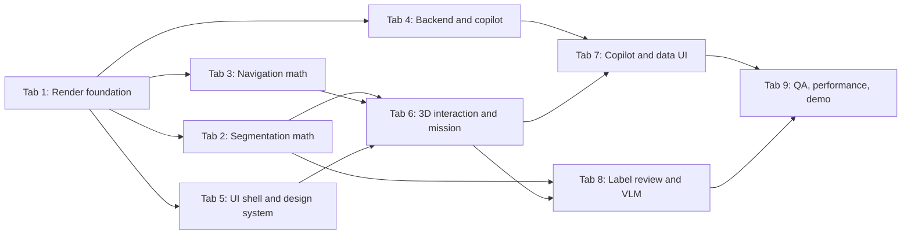

# Valmet Challenge: Knowledge Transfer and Tab Execution Prompts

This file is the single entry point for every new Cursor chat. Part 1 is the knowledge transfer (KT) summary of the work so far, with an honest list of what is broken. Part 2 is the execution system: one prompt per Cursor tab, run in order, each ending with a KT note for the next tab.

---

# Part 1: KT summary (state as of Fri 6 Nov 2026, 23:00)

## 1.1 The challenge in one paragraph

Valmet supplied an unlabelled Gaussian-splat scan of a boiler room (`Industrial Boiler Room (1).ply`) and a synthetic Excel data pack with 30 assets (valves, pumps, motors, transmitters, vibration sensors), telemetry, events, work orders, historical cases and knowledge documents. The judges score:

| Weight | Criterion |
|---|---|
| 30% | How many assets are extracted and framed in 3D |
| 25% | A collision-free robot or avatar path, showing nearby assets as it moves |
| 20% | Grounded AI diagnosis when the robot reaches the faulty device |
| 15% | Backend quality |
| 10% | Demo clarity |

Deliverables: a working demo, a repo with a README, 5–8 slides, a video of at most 5 minutes, and a short technical note. No mobile front end.

## 1.2 Facts every tab must know

- **Resolved 2026-11-07:** the organisers supplied the intact `Equipment Room.ply` (1,676,481 splats, full room), and the app now runs on it. See `docs/kt/10-equipment-room-ply.md`. Historical note: **most of the original PLY was corrupt.** Only the first 502,482 of 1,506,136 splats are valid; the rest is random bytes. The clean slice is `_analysis/boiler_room_valid.ply` (118.6 MB). Our raw-file SHA-256 is `117195366421b07aa6738415e94609d96cd41993a0c5b8e8b730849f6b7f1b03`. The valid slice is part of the room, so the walkable floor is small (about 2.6 square units).
- **Coordinate frame.** The scene is y-down (floor at y ≈ +1.086, ceiling at y ≈ −0.87). All generated files use raw PLY coordinates. In three.js, put the splat **and every overlay** under one parent group rotated 180° about X.
- **The header's quaternion order is `rot_1, rot_2, rot_3, rot_0`.** Read properties by name, never by position.
- **Scale is assumed.** We use 1.25 metres per unit, from an assumed 2.0 m door height. It has not been calibrated.
- **Excel scene coordinates are placeholders.** Asset-to-object mapping must be procedural and labelled as such.
- **Demo target:** `ASSET-014` / `P-002`, a process pump, `attention_required`, `CAVITATION_RISK`.
  - Vibration rose from 2.42 to 4.57 mm/s; the healthy-pump average is 2.08.
  - Flow fell from 83.1% to 76.2%; pressure from 4.52 to 4.04 bar.
  - Open events `EVT-00136` and `EVT-00893`. Matching cases `CASE-022`, `CASE-026`, `CASE-049`. Data-quality issue `DQ-0098`.
- **Workbook sheets:** START_HERE, Public_Research, Asset_Master, Scene_Anchors, Current_State, Telemetry_Sample_3d, Alarms_Events, Maintenance_History, Historical_Service_Cases, Knowledge_Docs, RAG_Corpus_Index, Data_Quality, Builder_Questions, API_Contract, Dashboard, Change_Log.
- **Python environment:** the user's `python3` (pyenv 3.10.13) has numpy, scipy, scikit-image, matplotlib, pandas, openpyxl, fastapi and uvicorn, but **not scikit-learn**. `_analysis/.venv` has scikit-learn but no fastapi or pandas. Install anything missing with pip rather than assuming.
- **The folder is not a git repo yet.**

## 1.3 What exists and works

| Area | Files | Status |
|---|---|---|
| Shared docs | `README.md`, `docs/context.md`, `docs/contracts.md`, `docs/runbook.md` | Done; contracts describe the JSON and API shapes |
| PLY validation | `_analysis/validate_ply.py` | Works; writes the clean slice |
| Geometry pipeline | `pipeline/run.py` (single file) | Works. About 30–50 s. Writes `data/derived/scene_objects.json` (71 objects: 4 structure planes + 67 DBSCAN clusters), `nav.json` (56-point path, 3.67 m), `floor_occ.png`, `diagnostics/boxes_front.png`. Binds all 30 Excel assets procedurally; `OBJ-0037` is the P-002 target |
| Backend | `backend/app/main.py` | Works. Imports all 16 sheets into `data/valmet.db`. Routes: `GET /api/health`, `/api/assets`, `/api/assets/{id}`, `/api/scene/objects`, `/api/scene/nav`, `POST /api/copilot/query`, `/api/work-orders/draft`. The copilot is a deterministic template with an evidence-ID check |
| Frontend | `web/` (Vite + React 19 + three 0.181 + `@sparkjsdev/spark` 2.4.0), `web/src/main.jsx`, `web/src/styles.css`, `web/scripts/sync-public.mjs` | Builds and runs, but the 3D view is broken (see 1.4) |
| Labels | `data/derived/labels_override.json` (40 entries), `docs/labeling.md` | Exists, but a script generated it from the automatic labels. **No person has reviewed it** |
| Submission docs | `docs/demo_script.md`, `docs/slides_outline.md`, `docs/technical_note.md`, `docs/submission_checklist.md` | First drafts |

### How to run it now

```bash
# from the repo root
python3 -m pipeline.run                                             # only if the PLY or pipeline changes
cd backend && python3 -m uvicorn app.main:app --reload --port 8000  # terminal 2
cd web && npm run dev                                               # terminal 3, open http://localhost:5173
```

## 1.4 Why the current UI looks hollow (root causes)

The user's screenshot shows only orange/green wireframe boxes, a red line and a blue dot. This is what is wrong:

1. **The splat never renders.** `makeSplatObject` in `web/src/main.jsx` creates a Spark `SplatMesh`, but Spark only draws splats through a `SparkRenderer` that has been added to the scene (`const spark = new SparkRenderer({ renderer }); scene.add(spark);`, from `web/node_modules/@sparkjsdev/spark/README.md`). We never create one. The point-cloud fallback only runs if the Spark import throws, so neither shows. This is the main reason the scene looks empty.
2. **The whole 3D scene is rebuilt on every interaction.** The `useEffect` in `Scene` depends on `selectedId`, `running` and the callbacks. Every click or pause destroys the WebGL renderer and downloads the 118 MB PLY again, so the splat could never finish loading even with fix 1.
3. **There is no mission.** The robot index is `Math.floor(frame) % pathLength`, so it loops forever. There is no dispatch → en route → arrived state, no automatic diagnosis on arrival, no heading, and no easing.
4. **The overlays carry no information.** 71 identical wireframe boxes, no 3D labels, no hover state, no status colours tied to Excel health, and no camera fly-to. Many clusters are fragments: pipe pieces, signs, splat noise.
5. **The camera is placed by hand.** The start position and target were guessed rather than fitted to the scene bounds.
6. **Segmentation is crude.** Class labels come from colour and size heuristics, so most objects are `scene_object`. Boxes are axis-aligned, not oriented, and there is no merge or split step.
7. **The navigation is minimal.** The path runs from the left-most to the right-most free cell, not to an approach pose next to the target. Smoothing is weak and the speed is fixed.
8. **The copilot has gaps.**
   - It cites the three *newest* events (`EVT-00425`, `EVT-00893`, `EVT-00900`) instead of the *open* ones, so `EVT-00136` is missing.
   - There is no check that numbers in the answer appear in the evidence.
   - There is no LLM call, no chat and no telemetry endpoint for charts.
9. **The splat file is too heavy.** The raw 118 MB PLY is served directly. It is not compressed to SPZ and floaters are not cropped.
10. **There are no tests, no git repo, and the API is incomplete.** Only part of the workbook's `API_Contract` is implemented, and the `Scene_Anchors` export is missing.

## 1.5 Constraints that will not go away

- The valid slice is only part of the room. Navigation will always be short unless organisers supply an intact PLY. Make the short route feel premium: approach pose, easing, camera follow and narration, rather than pretending it is long.
- Asset identity can't be verified visually. Always show "procedural mapping" and capped confidence.
- The demo must work offline, so cache the copilot output.

---

# Part 2: Tab execution system

## 2.1 How to use this

1. Open a **new Cursor chat** for each tab, in the order below. Tabs marked "parallel" can run at the same time in separate chats.
2. Paste the **shared preamble** (2.2) first, then the tab's prompt.
3. When a tab finishes, it writes `docs/kt/NN-<name>.md` and updates `docs/kt/STATUS.md`. The next tab reads those files first.
4. If a tab runs out of context, open a new chat, paste the preamble and the same prompt, and add: "Resume: read `docs/kt/NN-<name>.md` (partial) and continue."



| Order | Tab | Can run in parallel with |
|---|---|---|
| 1 | Tab 1: Render foundation | none (blocks everything visual) |
| 2 | Tab 2 Segmentation, Tab 3 Navigation, Tab 4 Backend, Tab 5 UI shell | each other |
| 3 | Tab 6: 3D interaction and mission | none |
| 4 | Tab 7 Copilot UI, Tab 8 Label review | each other |
| 5 | Tab 9: QA, performance, demo | none |

## 2.2 Shared preamble (paste at the top of every tab)

```text
You are working in `/Users/kayttaja/Downloads/Valmet_SinceAI2026 _1_` on the Valmet x Since AI 2026 industrial metaverse hackathon.

Before doing anything:
1. Read `docs/KT_HANDOFF.md` Part 1 (the project state and root causes).
2. Read `docs/kt/STATUS.md` and every `docs/kt/*.md` note from earlier tabs, if they exist.
3. Read `docs/contracts.md`. If you change a contract, update that file in the same tab.

Context-window rules:
- Never read the PLY, `data/valmet.db`, or the full `data/derived/scene_objects.json` into context. Summarise them with a short python or jq command.
- Use subagents for broad research or codebase exploration, and keep only conclusions in this chat.
- Save research notes to `docs/research/NN-<topic>.md` with source links, so later tabs don't repeat the research.

Engineering rules:
- Stay inside the files this tab owns. Read anything; edit other areas only for a documented contract fix.
- Keep all scene coordinates in raw PLY frame (y-down). The viewer applies one 180-degree X rotation on a shared parent group.
- Never invent telemetry or records. Label procedural mapping as procedural.
- Verify your work by running it: commands, tests, and for UI work, browser screenshots of http://localhost:5173 via the Cursor browser tool. Embed the screenshots in your KT note.

When finished (or when context runs low), write `docs/kt/NN-<name>.md` with exactly these sections:
1. Outcome: what now works, in 3-5 sentences.
2. Changes: files added or changed, one line each.
3. How to run and verify: exact commands and what you should see.
4. Contract changes: any JSON/API shape changes, or "none".
5. Research used: key sources and the decision each one drove.
6. Evidence: test output, numbers, and screenshot paths.
7. Known issues and limitations: honest list.
8. Notes for the next tabs: what they must know or must not break.
Then add a one-line entry to `docs/kt/STATUS.md` (create it if missing): tab, date, status, KT file link.
```

---

## Tab 1: Render foundation (run first, alone)

```text
Role: senior three.js / WebGL engineer. Fix the 3D foundation so the real splat renders, smoothly, with overlays aligned. Everything visual later depends on this.

You own: `web/` (the scene layer and app architecture). Do not touch `pipeline/` or `backend/`.

Research first (time-box about 20 minutes, save notes to `docs/research/01-rendering.md`):
- Spark 2.x docs (https://sparkjs.dev/docs/ and `web/node_modules/@sparkjsdev/spark/README.md`): SparkRenderer setup, SplatMesh loading, LOD/paging, sorting, PLY vs SPZ, how splats interact with depth and ordinary meshes.
- Whether React Three Fiber + drei + Spark is a sound stack (check Spark's examples and the pmndrs docs), versus staying with plain three.js. Pick one and justify it in the KT note. Recommended default: React Three Fiber + drei + zustand, with Spark wrapped as a primitive, because the later UI tabs are React-heavy.
- PlayCanvas splat-transform CLI (https://developer.playcanvas.com/user-manual/splat-transform/cli-reference/): converting our PLY to SPZ or SOG and cropping floaters.

Tasks:
1. Create and add the Spark `SparkRenderer` correctly so `SplatMesh` actually draws. Confirm in a browser screenshot that the boiler room is visible.
2. Split the app so the WebGL scene is created once. Selection, pause and HUD state must never tear down the renderer or reload the splat. Use a store (zustand or equivalent) and refs. Load the splat exactly once, with a visible loading progress state.
3. Verify orientation and alignment: splat and all overlays under one parent group rotated 180 degrees about X. Confirm the floor is down and boxes sit on the objects they frame (screenshot proof, ideally two viewpoints).
4. Fit the camera to the scene automatically from the floor bounds in `scene_objects.json`. For a bounding sphere of radius r and vertical FOV f, the fit distance is d = r / sin(f/2). Use damped orbit controls (drei CameraControls or the camera-controls library) with sensible zoom and polar-angle limits so the user can't fly under the floor.
5. Reduce load time: produce a compressed copy (SPZ or SOG) with splat-transform if it works on this machine, with the PLY as fallback. Document the size before and after.
6. Keep a sampled point-cloud fallback only for when WebGL2 or Spark fails, and show a clear message when it is in use.
7. Hold 60 fps on this Intel Mac with the splat plus 71 boxes. Report the measured frame rate.

Acceptance:
- The splat is clearly visible, the right way up, and boxes line up with real objects.
- Clicking and pausing never reload the splat.
- The camera starts framed on the room; orbiting is smooth and limited.

Write KT: `docs/kt/01-render-foundation.md`.
```

---

## Tab 2: Segmentation and object-quality math (parallel after Tab 1)

```text
Role: 3D point-cloud and computational-geometry engineer. Make object extraction (30% of the score) dense, clean and credible.

You own: `pipeline/` except navigation code (Tab 3 owns `pipeline/navigation.py`). If `pipeline/run.py` is still one file, split it into modules first (`io_ply.py`, `filtering.py`, `structure.py`, `instances.py`, `mapping.py`, `export.py`, keeping `run.py` as the CLI) and tell Tab 3 in your KT note.

Research first (time-box about 30 minutes, save notes to `docs/research/02-segmentation.md`). Read and pick from:
- Schnabel, Wahl, Klein 2007, "Efficient RANSAC for Point-Cloud Shape Detection" (planes and cylinders, for pipes).
- Rabbani et al. 2006, "Segmentation of point clouds using smoothness constraint" (normal-based region growing).
- Campello et al. 2013 HDBSCAN, and the scikit-learn HDBSCAN docs (variable-density clusters, no single global eps).
- Weinmann et al. 2015, eigenvalue features from local PCA (linearity, planarity, scattering), for classifying pipe vs plane vs blob.
- Felzenszwalb and Huttenlocher 2004, graph-based segmentation (an alternative to DBSCAN for splitting pipe-connected objects).
- Gaussian-splat-specific cleaning: how splat opacity and covariance (Sigma = R S S^T R^T) should weight points, and floater removal practice.
- Open3D 0.20 docs (segment_plane, cluster_dbscan, oriented bounding boxes) if it installs; otherwise numpy/scipy/scikit-learn equivalents.

Tasks:
1. Better input points: weight or filter splats by opacity and covariance size, remove floaters with statistical outlier removal, and compute colour in a perceptual space (CIELAB) for clustering features.
2. Structure: RANSAC planes refined by least squares (SVD on inliers). Emit floor, ceiling and walls as objects. Calibrate scale from the floor-to-ceiling distance with a stated prior (for example 2.4-2.6 m for a plant room) and write the chosen `metres_per_unit` with its reasoning.
3. Instances: replace the single-eps DBSCAN with a better approach, and justify it with numbers. Options: HDBSCAN on position + Lab colour, normal-based region growing, or a graph cut on a k-nearest-neighbour graph. Detect pipes with PCA linearity and cylinder fits and emit them as `pipe` segments rather than letting them merge objects.
4. Merge and split: merge fragments whose boxes overlap or lie within about 5 cm and have compatible features; split clusters that are too large.
5. Oriented boxes: compute gravity-aligned OBBs (yaw only) using the minimum-area rectangle of the xz convex hull (rotating calipers), with height from the y range. Keep AABBs too.
6. Quality filter: drop noise clusters (too few splats, too thin, floating mid-air) and report how many objects remain per class.
7. Stable IDs: keep IDs stable across reruns by matching new boxes to old ones by 3D IoU.
8. Improve heuristic class labels (pump, motor, valve, tank/vessel, cabinet, pipe, ladder, crate, trolley, sign, door, other) using size, shape features, height above floor and colour. Keep `class_confidence` honest.
9. Re-run procedural mapping: class-compatible first, with `ASSET-014` bound to the most pump-like object reachable by the robot. Keep mapping confidence at or below 0.5.
10. Produce a before/after diagnostic image and a metrics table: object count, per-class counts, median splats per object, number of fragments merged.

Acceptance:
- At least 60 credible framed objects (structure + equipment + pipe segments), visibly better than the current 67 raw clusters in a side-by-side image.
- `scene_objects.json` still matches `docs/contracts.md`, now with real OBBs.

Write KT: `docs/kt/02-segmentation.md`.
```

---

## Tab 3: Navigation and motion math (parallel after Tab 1)

```text
Role: robotics motion-planning engineer. Make navigation (25% of the score) mathematically sound and visually convincing.

You own: `pipeline/navigation.py` (create it), the navigation call site in `pipeline/run.py`, and `data/derived/nav*.json`. Coordinate with Tab 2's module split (read its KT note if present); don't edit segmentation code.

Research first (time-box about 30 minutes, save notes to `docs/research/03-navigation.md`). Read and pick from:
- Euclidean distance transforms (scipy.ndimage.distance_transform_edt) and ESDF use in planning (Oleynikova et al. 2017, Voxblox).
- A* with admissible heuristics; Theta* any-angle planning (Nash et al. 2007); Lazy Theta*.
- Path smoothing: collision-checked shortcutting, then centripetal Catmull-Rom or cubic B-splines; curvature limits.
- Time parameterisation: trapezoidal or S-curve velocity profiles; arc-length reparameterisation so the robot moves at constant speed along a spline.
- Occupancy grids from point clouds (height bands, support checks), and a ROS-style map export (PGM + YAML) as a bonus.

Tasks:
1. Grid: floor-plane occupancy at about 0.05 units per cell. A cell is walkable only with floor support. Obstacles are anything in the walking-height band (about 0.12 to 1.8 m above the floor, converted with `metres_per_unit`). Inflate by the robot radius (about 0.3 m).
2. Cost field: compute the ESDF (distance to nearest obstacle) and use a clearance cost such as c = 1 + w * exp(-d / sigma), so paths prefer corridor centres. Document w and sigma.
3. Planner: Theta* or A* with an octile heuristic over the cost field.
4. Goals: compute an approach pose for each bound asset, meaning the nearest reachable free cell facing the asset's OBB at standoff distance, with a heading toward the asset. The start is a sensible entry point (for example the door side), not simply the left-most cell.
5. Smoothing: shortcut with line-of-sight collision checks, then fit a centripetal Catmull-Rom spline. Re-check every sample against the inflated grid, and fall back to the polyline if it collides.
6. Motion profile: arc-length parameterise the spline and apply a trapezoidal velocity profile (accelerate, cruise, decelerate to stop at the approach pose). Export per-sample timestamps, positions, heading (yaw) and speed so the frontend animates rather than computes.
7. Output: `nav.json` (default mission to `ASSET-014`) plus `nav_targets.json` with approach poses for all bound assets. Update `docs/contracts.md` with the new fields. Optionally add `GET /api/scene/nav?target=` support by documenting the file format for Tab 4.
8. Proximity spec for the frontend: recommend a KD-tree or brute-force range query (fine for under 200 objects), a field-of-view cone in front of the robot, and enter/exit hysteresis (for example enter at 1.2 m, exit at 1.5 m) to avoid flicker. Put the formulas in the KT note.
9. Diagnostics: an occupancy plus ESDF heatmap with the raw path, smoothed path and approach pose; report path length in metres, minimum clearance and duration.

Acceptance:
- The robot path ends at an approach pose facing P-002, never crosses obstacles (minimum clearance reported above zero), and has a smooth timestamped profile.

Write KT: `docs/kt/03-navigation.md`.
```

---

## Tab 4: Backend and grounded copilot (parallel after Tab 1)

```text
Role: senior backend and applied-LLM engineer. Make the backend (15%) solid and the copilot (20%) trustworthy and impressive.

You own: `backend/` and `data/valmet.db`. Do not edit `web/` or `pipeline/`.

Research first (time-box about 25 minutes, save notes to `docs/research/04-copilot.md`):
- Grounded generation and citation validation patterns (for example Cognite Atlas AI "cites the exact data behind every response", and attribution or citation-verification approaches in RAG literature).
- OpenAI Structured Outputs (https://developers.openai.com/api/docs/guides/structured-outputs), or the equivalent in Anthropic or Gemini; streaming responses with FastAPI (Server-Sent Events).
- The workbook's own rules: read `Knowledge_Docs` rows DOC-RAG-GUIDE, DOC-FIELD-SAFETY, DOC-3D-MAPPING and the `API_Contract` and `Builder_Questions` sheets via a short python summary.

Tasks:
1. Restructure `backend/app/main.py` into modules (db, importer, routes, evidence, copilot, validators) with Pydantic response models.
2. Fix evidence selection: prioritise open and unacknowledged events, then recent ones, so `EVT-00136` and `EVT-00893` appear for ASSET-014. Use stable derived evidence IDs such as `TEL:ASSET-014:vibration_mm_s`.
3. Implement every route in the workbook's `API_Contract` sheet, plus `GET /api/assets/{id}/telemetry?metric=&from=&to=` (time series for sparklines), `GET /api/search?q=` (simple keyword search over assets, issues and docs) and `GET /api/scene/anchors` (the remapped Scene_Anchors table using real scene coordinates from `scene_objects.json`).
4. Copilot modes: `arrival_diagnosis`, `status_line` (one sentence for HUD cards) and `question` (free-form chat about an asset or the plant).
5. LLM path: if an API key environment variable is set, call the model with structured output and the schema {summary, observations[{text, evidence_ids}], hypotheses[{text, evidence_ids}], next_safe_checks[], caveats[]}. Stream tokens over SSE for chat.
6. Validators: every evidence ID must exist in the bundle, and every number in the text must match a number in the bundle (with a rounding tolerance). On failure, retry once, then fall back to the deterministic template.
7. Confidence computed in code with listed reasons: start from `model_confidence`, subtract for high-severity data-quality issues, and cap for procedural mapping.
8. Cache the ASSET-014 arrival diagnosis to disk so the demo never depends on the network.
9. Tests with pytest: importer, every route, evidence selection for ASSET-014, validator rejection of a fake ID and a fake number, and the fallback path.
10. Replace the deprecated `@app.on_event("startup")` with a lifespan handler, and document the startup command.

Acceptance:
- `pytest` passes; the ASSET-014 diagnosis cites `EVT-00136`, three cases and `DQ-0098`; no-key mode still returns a validated answer.

Write KT: `docs/kt/04-backend-copilot.md`.
```

---

## Tab 5: Premium UI shell and design system (parallel after Tab 1)

```text
Role: senior product designer and frontend engineer for industrial digital-twin software. Design a premium, information-dense, eye-catching interface around the 3D view.

You own: the React UI shell, layout, panels and design tokens in `web/src/` (not the 3D scene internals that Tab 1 built; mount into its scene component).

Research first (time-box about 30 minutes, save notes with screenshots or links to `docs/research/05-ui-ux.md`):
- Industrial digital-twin and 3D product UIs: NavVis IVION, Matterport, Cognite Data Fusion and Atlas AI, Bentley iTwin viewer, NVIDIA Omniverse, Siemens Xcelerator, Autodesk Tandem. Note layout patterns, how they show asset status, and how they place AI answers.
- Premium web 3D and UI references: three.js and pmndrs showcases, Awwwards 3D and dashboard winners, Linear and Vercel design systems (density, typography, motion), Material and Apple HIG guidance on motion timing and data density.
- Data-visualisation guidance for operations dashboards: status colour semantics, accessible contrast (WCAG 2.2), sparkline best practice.

Tasks:
1. Write a short design spec in your research note: layout, colour tokens (dark industrial theme with a clear status palette: normal, attention, critical, offline, procedural/unverified), typography scale, spacing, radius, elevation, motion durations and easing.
2. Build the layout:
   - top bar: plant name, mission state, connection status, search / command palette (Cmd+K);
   - left rail: asset tree grouped by class and status, with filters and counts;
   - center: the 3D view;
   - right inspector: tabbed (Overview, Telemetry, Events, Work orders, Evidence);
   - bottom dock: mission timeline and robot controls.
   All panels collapse for a full-screen 3D mode.
3. Use a component approach that's fast to build well (for example Tailwind + shadcn/ui or Radix primitives, plus lucide icons, plus a small chart library such as visx or Recharts). Justify the choice briefly.
4. Use the backend for real data (`/api/assets`, `/api/assets/{id}`, telemetry), with skeleton loaders and empty or error states. Keep static JSON fallback mode.
5. Make the KPI header information-dense: objects framed, assets bound, assets needing attention, open events, mission ETA.
6. Run responsive and accessibility checks (keyboard navigation, focus rings, contrast). Take screenshots at 1440x900 and 1920x1080.

Acceptance:
- Screenshots look like a credible commercial product, not a prototype. Every panel shows real Excel data.

Write KT: `docs/kt/05-ui-shell.md`.
```

---

## Tab 6: 3D interaction, mission flow and robot (after Tabs 2, 3, 5)

```text
Role: senior interactive-3D engineer. Make the 3D scene feel alive, smooth and informative. This is where the demo is won or lost.

You own: the 3D scene layer in `web/src/` (overlays, camera, robot, mission state). Read the KT notes from Tabs 1, 2, 3 and 5 first.

Research first (time-box about 25 minutes, save notes to `docs/research/06-3d-interaction.md`):
- Selection and highlighting in three.js: outline post-processing (pmndrs postprocessing Outline / Selection), fresnel or rim shaders, instanced meshes for many boxes.
- Screen-space label placement and decluttering (greedy collision avoidance, leader lines, distance-based level of detail), drei `Html` versus CSS2DRenderer performance.
- Camera choreography: damped fly-to (camera-controls `fitToBox`, `setLookAt` with smooth transitions), follow-cam with exponential smoothing x += (target - x) * (1 - exp(-k * dt)), and cinematic easing curves.
- Splat-and-mesh compositing in Spark (depth, transparency of overlays over splats).

Tasks:
1. Overlays:
   - render OBBs from Tab 2 as soft filled volumes plus thin edges, coloured by Excel status;
   - grey dashed for unbound scene objects, with a distinct "procedural mapping" marker;
   - hover glow, selection outline, and fade non-selected objects when one is selected.
2. Labels: 3D-anchored labels with tag, class and status dot; distance-based LOD (detail when close, dot when far) and screen-space decluttering so labels never overlap.
3. Camera: click an object or list item to fly to fit its OBB; a "Mission" camera that follows behind the robot with smoothing; a "Overview" preset; a top-down minimap inset showing the occupancy grid (`floor_occ.png` or a rendered grid), path, robot and asset dots.
4. Robot: a clean stylised robot (small GLB or procedural mesh) with heading from `nav.json`, a scanning cone or ring, and a glowing breadcrumb trail. Animate from the timestamped profile from Tab 3; no looping.
5. Mission state machine:
   - states: Idle → Dispatched → En route → Approaching → Arrived → Diagnosing → Report;
   - controls: Dispatch to [asset], pause/resume, speed 0.5x–2x, restart;
   - the timeline in the bottom dock scrubs the mission.
6. Proximity: as the robot passes, light up assets within range and the field-of-view cone (with hysteresis from Tab 3), pop compact status cards (tag, status, one-line `status_line` from the copilot), and log each "asset scanned" event into a mission feed.
7. Arrival: automatically trigger the diagnosis, focus the camera on P-002, pulse its highlight, and open the copilot panel.
8. Performance: instanced rendering where useful, no re-renders of the scene graph from React state churn; 60 fps target; report frame-time measurements.
9. Record a short screen capture or a sequence of screenshots of a full mission.

Acceptance:
- A first-time viewer understands within 10 seconds what the robot is doing and why. The mission runs once from dispatch to arrival, then the diagnosis appears automatically.

Write KT: `docs/kt/06-3d-mission.md`.
```

---

## Tab 7: Copilot and data experience in the UI (parallel with Tab 8)

```text
Role: AI product engineer. Make the grounded copilot the most convincing part of the demo.

You own: copilot panel, evidence UI and telemetry charts in `web/src/`. Read the KT notes from Tabs 4, 5 and 6 first.

Research first (time-box about 20 minutes, save notes to `docs/research/07-copilot-ux.md`):
- AI answer UX with citations: Perplexity, Cognite Atlas AI, GitHub Copilot chat, Microsoft Copilot for industry. Patterns for evidence chips, confidence display, observation vs hypothesis separation, and streaming.
- Human-in-the-loop safety UX for field maintenance (confirmation steps, "follow site procedures" framing).

Tasks:
1. Diagnosis report card:
   - summary at top, then Observations and Hypotheses sections with clear visual separation;
   - each line has clickable evidence chips;
   - a confidence meter with expandable reasons;
   - a prominent safety caveat citing `DOC-FIELD-SAFETY`.
2. Evidence drawer: clicking a chip opens the source record (event, case, work order, data-quality issue, knowledge doc, or computed telemetry stat with its chart). Clicking an asset ID flies the camera to it.
3. Telemetry: sparklines and a detail chart for vibration, flow and pressure with the healthy-class baseline band and the first-day vs last-day delta annotated, using real data from the telemetry endpoint.
4. Chat: ask follow-up questions about the selected asset or the plant (streaming if Tab 4 implemented SSE), with suggested questions from the workbook's `Builder_Questions` sheet.
5. Actions: "Draft work order" calling `/api/work-orders/draft`, shown as an editable form; "Search" that highlights matching assets in 3D (for example "pumps needing attention").
6. States: loading skeletons, offline or cached-answer badge, validator-fallback badge ("deterministic answer").

Acceptance:
- On arrival, the report renders with real cited evidence, every chip opens its source, and charts show the cavitation signature clearly.

Write KT: `docs/kt/07-copilot-ui.md`.
```

---

## Tab 8: Label review and vision-language labelling (parallel with Tab 7)

```text
Role: ML/tooling engineer. Turn heuristic labels into reviewed, credible labels quickly.

You own: `data/derived/labels_override.json`, `docs/labeling.md`, a review mode in the web app (coordinate the component location with Tab 6's KT note), and an optional `pipeline/label_vlm.py`.

Research first (time-box about 20 minutes, save notes to `docs/research/08-labelling.md`):
- Open-vocabulary 3D labelling by projecting 3D instances into rendered views and labelling with 2D models (OpenMask3D, Open-YOLO 3D, ConceptGraphs). Take the simplified "geometry proposes, 2D model names" pattern.
- Multimodal API structured output for image classification with a fixed class list.

Tasks:
1. Crop tour: in the viewer, add a mode that flies the camera to each object's OBB and captures a screenshot, saving crops to `data/derived/crops/` (or downloading a zip).
2. Optional VLM: if an API key exists, classify each crop against the fixed class list with {class, confidence, short_description}; anything below 0.6 goes to the review queue.
3. Review UI: a queue showing crop, current label and suggestions; keyboard shortcuts to accept, rename, change class, merge with neighbour, delete, or bind/unbind an Excel asset. Saves to `labels_override.json` (via a small backend PATCH route agreed with Tab 4's KT note, or a download).
4. Have the user (a person) actually review at least the 30 bound objects and the objects along the robot route. Record reviewer and timestamp per override. Don't mark anything `human` that a person didn't confirm.
5. Update `docs/labeling.md` with label-source counts (structure, heuristic, vlm, human).

Acceptance:
- At least 40 objects have person-confirmed labels, `label_source` values are honest, and the pipeline or viewer applies overrides on reload.

Write KT: `docs/kt/08-labels.md`.
```

---

## Tab 9: QA, performance and demo polish (last)

```text
Role: release engineer and demo director. Make it reliable, fast and presentation-ready.

You own: tests, `README.md`, `docs/runbook.md`, `docs/demo_script.md`, `docs/slides_outline.md`, `docs/technical_note.md`, `docs/submission_checklist.md`, and a setup script. Fix only small bugs elsewhere; log larger ones.

Tasks:
1. Initialise git with a correct `.gitignore` (no `.venv`, `node_modules`, `dist`, large derived files unless needed), and make the first commit.
2. Write a one-command setup and run script (for example `make dev` or `scripts/dev.sh`) that runs the pipeline if outputs are missing, starts the backend and starts the frontend.
3. Smoke test from a clean clone: pipeline → backend → frontend → full mission → arrival diagnosis. Fix blockers.
4. Performance: report load time, splat file size, fps during the mission, and backend response times. Cut anything that drops the demo below smooth playback.
5. Offline mode: confirm the demo runs with the network off (cached diagnosis, local assets).
6. Update the demo script with the real UI flow and timings, and add a shot list with camera presets.
7. Update the technical note and slides outline with final numbers: object counts, labels by source, path length, minimum clearance, validator results.
8. Final screenshots for slides, saved to `docs/media/`.

Acceptance:
- A teammate can clone, run one command, and record the 5-minute video without help.

Write KT: `docs/kt/09-release.md`.
```

---

## 2.3 Human tasks (not for an agent)

- Re-download the PLY on two machines and compare SHA-256 hashes with `117195366421b07aa6738415e94609d96cd41993a0c5b8e8b730849f6b7f1b03`.
- Post the corruption finding on the Since AI Discord, with the organiser questions from the original research. Ask for an intact PLY, the training images and camera poses, units, and permission to use cloud LLM APIs.
- If an intact PLY arrives, rerun Tab 2 and Tab 3's pipeline on it first. Everything downstream reads the derived files.
- Make the slides from `docs/slides_outline.md` and record the video using `docs/demo_script.md`.
