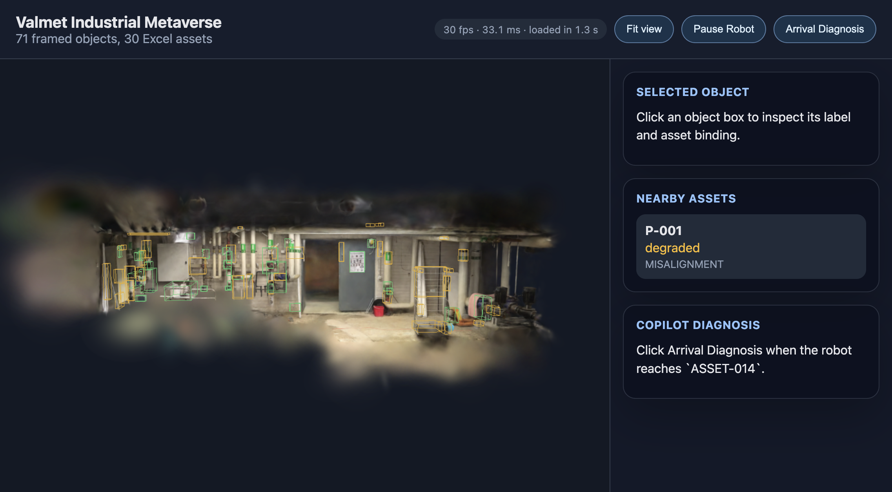

# 01 Render foundation (Tab 1)

## 1. Outcome

The real boiler-room splat now renders in the browser through Spark, the right way up, with the 67 equipment boxes, the robot path and the robot sitting on the scanned objects. The root cause was that no `SparkRenderer` was ever added to the scene. The app is now React Three Fiber + drei + zustand: the `<Canvas>` is mounted once, the splat is loaded once by a module-level promise, and HUD state (selection, pause, nearby assets, fps) lives in a zustand store, so clicks and pauses can't tear down the renderer. The camera fits itself to the floor and equipment bounds with damped, limited orbit controls. A compressed, cropped SPZ copy (9.3 MB instead of 118.6 MB) loads in about 1.3 to 2.1 s. **Frame rate is not at 60 fps**: it measured 23 to 31 fps in the Cursor browser on this Intel Mac (see section 7).

## 2. Changes

- `web/package.json`: added `@react-three/fiber` 9.8, `@react-three/drei` 10.7, `zustand` 5.1.
- `web/vite.config.js` (new): enables `@vitejs/plugin-react` (automatic JSX runtime).
- `web/src/main.jsx`: entry point only.
- `web/src/App.jsx` (new): header, side panels, splat loading overlay with byte progress, fallback/error banner, fps chip, "Fit view" button.
- `web/src/store.js` (new): zustand store (scene data, selection, running, nearby, splat load state, perf, view requests).
- `web/src/data.js` (new): fetch helpers and `loadSceneData()` moved out of the old `main.jsx`. `getOptionalJson` now rejects Vite's HTML fallback.
- `web/src/scene/Viewer.jsx` (new): the single memoised `<Canvas>` (`antialias: false`, `dpr [1, 1.5]`), WebGL2 fallback message.
- `web/src/scene/frame.js` (new): `DISPLAY_ROTATION`, `rawToDisplay`, `sceneBounds`, `floorHeight`.
- `web/src/scene/Splat.jsx` (new): `SparkRenderer` singleton per WebGL renderer, `SplatMesh` loaded once (SPZ from manifest, then raw PLY, then point cloud), progress reporting, `?lod=on&splats=N` overrides.
- `web/src/scene/PointCloudFallback.js` (new): the old sampled-PLY loader, now reading x/y/z by property name and reporting progress.
- `web/src/scene/Overlays.jsx` (new): all boxes as one merged `LineSegments` (drawn) plus one invisible `InstancedMesh` (picking). Two draw calls in total. Selection and hover recolour vertices with no rebuild.
- `web/src/scene/Robot.jsx` (new): path line and robot driven in `useFrame`. Nearby assets are pushed to the store only when the set changes (checked every 0.25 s). Still loops, as before (Tab 6 owns the mission).
- `web/src/scene/CameraRig.jsx` (new): bounding-sphere camera fit, drei `CameraControls` limits, "Fit view" transition.
- `web/src/scene/FpsMeter.jsx` (new): rolling 0.5 s fps and frame time into the store.
- `web/src/styles.css`: viewer container, loading overlay, banner, chip; `main` is now fixed to `100vh`.
- `web/scripts/compress-splat.mjs` (new): splat-transform to `web/public/assets/boiler_room.spz` plus `splat-manifest.json`.
- `web/scripts/sync-public.mjs`: skips unchanged copies (no 118 MB copy on every `npm run dev`).
- `docs/research/01-rendering.md` (new): research notes.

## 3. How to run and verify

```bash
cd web
npm install
node scripts/compress-splat.mjs   # once; writes public/assets/boiler_room.spz + splat-manifest.json (~15 s)
npm run dev                       # http://localhost:5173
```

You should see a bottom-centre loading card ("Loading boiler room scan..." with MB progress), then the boiler room splat with green (bound) and amber (unbound) boxes, the red path and the blue robot. The header chip shows fps, frame time and load time. Click a box to turn it blue and fill "Selected Object". Click empty space to deselect. "Fit view" flies back to the framed view.

Useful URL options: `?lod=on` turns on Spark level of detail, `&splats=150000` sets its budget. If `splat-manifest.json` is missing, the app loads the raw PLY instead.

In dev mode, `window.__r3f` (R3F state) and `window.__viewer` (`controls`, `camera`, `fit`, `fitView`) are exposed for debugging and scripted screenshots.

`npm run build` passes.

## 4. Contract changes

None. All generated files are still read in raw PLY frame. The viewer applies the single 180-degree X rotation on the `display-frame` group.

## 5. Research used

- Spark docs and type definitions (https://sparkjs.dev/docs/spark-renderer/). A `SparkRenderer` must be in the scene and the canvas should use `antialias: false`. This drove the `SparkLayer` component and the canvas settings.
- Spark's official R3F example (https://github.com/sparkjsdev/spark-react-r3f) and on-demand rendering docs. R3F recreates elements when `args` change. This drove holding the `SplatMesh` as a module singleton mounted with `<primitive>`.
- PlayCanvas splat-transform CLI reference. This drove the SPZ output with `--filter-nan`, `--filter-box` and `--filter-value opacity,gte,0.01`. `--filter-floaters` needs WebGPU, so it wasn't used.
- Camera fit \(d = r / \sin(f/2)\) with \(f = \min(f_v, f_h)\) (in `CameraRig.jsx`, `fitDistance`).

## 6. Evidence

Screenshot (Cursor browser, default view, 1137x628 window):



Compression (`web/public/assets/splat-manifest.json`):

| | File | Size | Splats |
|---|---|---|---|
| Before | `boiler_room_valid.ply` | 118.6 MB | 502,482 |
| After | `boiler_room.spz` | 9.3 MB (12.8x smaller) | 465,988 |

The crop box (raw frame) is `[-5.2, -1.8, -5.6]` to `[4.2, 1.5, -0.5]`, which is the 0.5 to 99.5 percentile splat bounds plus a margin. Splats with opacity below 0.01 are dropped. The compression takes about 15 s.

Load time: the HUD reported 1.3 s and 2.1 s (SPZ from the local dev server, including decode).

Performance, all measured in the Cursor embedded browser on an AMD Radeon Pro 5300M (ANGLE Metal), viewer about 780x550 CSS px:

| Setting | Result |
|---|---|
| Default (DPR 1.5, all 466K splats) | 23 to 31 fps; GPU time 19.1 ms per frame (p50, `EXT_disjoint_timer_query_webgl2`) |
| Splat hidden, boxes + robot only | 60 fps |
| DPR 1.0 / 0.75 | 39 / 43 fps |
| `maxStdDev` 2 | 28 fps |
| `maxPixelRadius` 128 / 48 / 16 | 25 / 26 / 31 fps |
| LoD on, budget 250K / 150K / 80K | 17 to 21 / 19 / 21 fps (worse, so LoD is opt-in) |
| CPU time inside `gl.render` | 0.22 ms; Spark does not re-sort while the camera is still |

## 7. Known issues and limitations

- **60 fps is not reached.** The splat pass costs about 19 ms of GPU time per frame on this machine, and the frame rate settles at 23 to 31 fps in the Cursor browser, which shares the GPU with the IDE. It may be better in a standalone Chrome window; that hasn't been measured. Neither splat count nor pixel radius alone explains the cost. The next things to try are DPR 1 by default, `--decimate` to about 250K splats, a tighter crop of the blurry outer splats, and on-demand rendering (`frameloop="demand"` with Spark's `onDirty`) when the robot is paused.
- **Not verified in the browser:** the "download exactly once after clicks and pauses" check (resource timing) and the second viewpoint screenshot. The browser was closed before these ran. Single loading is guaranteed by design (module-level `splatPromise`, memoised `Viewer` with no props, scene components that read state through `getState`/`subscribe`), but there's no recorded proof yet.
- The bounding-sphere fit is conservative for this wide, flat room, so the initial view has empty space above and below the scan.
- Line overlays use depth testing, so a dense splat in front of a box can partly hide its edges.
- The Vite dev server on port 5173 was restarted from the agent's shell to load the new `vite.config.js`. The original `npm run dev` in your terminal was stopped.
- The production bundle is 3.9 MB (Spark inlines its WebAssembly). Code splitting has not been done.

## 8. Notes for the next tabs

- Mount anything that uses raw PLY coordinates **inside** the `display-frame` group in `web/src/scene/Viewer.jsx`. Never pre-flip coordinates. Use `rawToDisplay` from `scene/frame.js` only for display-space maths (camera, bounds).
- Never pass changing props into `<Viewer>`, and don't subscribe the whole `SceneContent` to fast-changing store fields. Read per-frame state with `useStore.getState()` inside `useFrame`, or `useStore.subscribe` in an effect, as `Overlays.jsx` and `Robot.jsx` do.
- Don't create a second `SparkRenderer` or `SplatMesh`. Use `getSplat()` from `scene/Splat.jsx` if you need the mesh.
- Tab 6: the camera controls are drei `CameraControls` (`makeDefault`), so fly-to can use `controls.fitToBox` / `setLookAt(..., true)`. `Robot.jsx` is a placeholder to replace. Overlays recolour through the vertex `color` attribute, so status colours can be added in `baseColour`.
- Tab 5: put panels around `.viewer` in `App.jsx`. `SplatStatus` and `FpsChip` read from `store.splat` and `store.perf`.
- Tab 9: if the PLY or crop changes, rerun `node scripts/compress-splat.mjs`.
