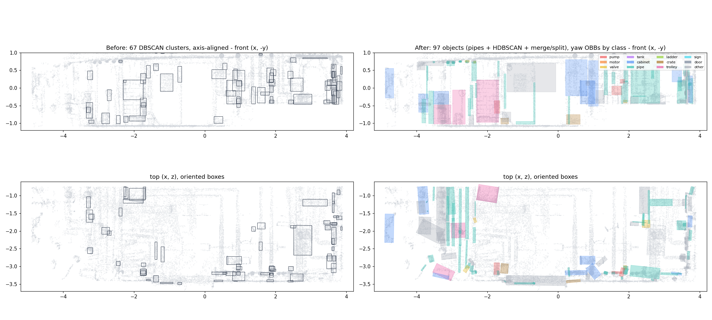
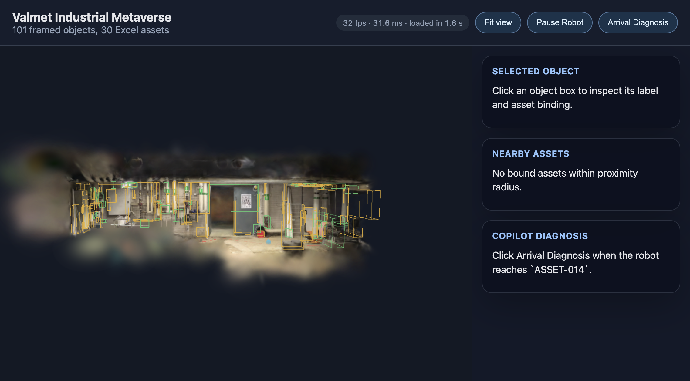
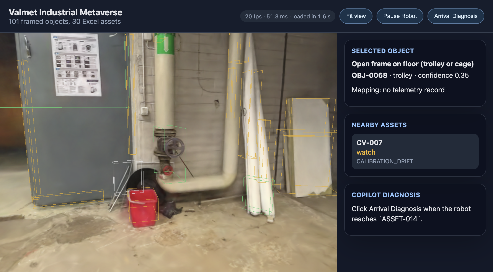

# 02 Segmentation and object quality (Tab 2)

## 1. Outcome

The pipeline is now split into modules and produces **101 framed objects**: 4 structure planes, 48 pipe segments and 49 equipment or clutter objects. The old output had 71: 4 planes and 67 single-eps DBSCAN clusters. 70 of them have real yaw-rotated OBBs instead of identity rotations.

- **Input points.** Splats are filtered by opacity and covariance, with statistical outlier removal and opacity-weighted 2 cm voxels. Colour clustering uses CIELAB.
- **Structure.** Walls must pass boundary and fill tests, so pipe rows are no longer deleted as walls.
- **Instances.** Pipes are extracted first (linear seeds plus cylinder fit), then HDBSCAN runs on what's left, followed by merge and split passes. On a 5,000-point sample, the silhouette score rose from 0.044 to 0.214 and noise fell from 26% to 17%.
- **Scale.** Calibrated from floor-to-ceiling distance with a 2.4-2.6 m prior: **1.2865 m/unit** (range 1.235-1.338).
- **IDs and mapping.** Object ids stay stable across reruns (97 of 97 matched on a rerun). `ASSET-014` / P-002 is bound to `OBJ-0015`, a pump-class object right next to the walkable floor. A close-up in the viewer, though, shows it's a handwheel valve assembly (see section 7).

## 2. Changes

- `pipeline/run.py`: now only the CLI and orchestration; adds `--previous`; writes the metrics file and the before/after image.
- `pipeline/config.py` (new): shared constants and the matplotlib cache directory.
- `pipeline/io_ply.py` (new): PLY header and memmap, moved unchanged.
- `pipeline/filtering.py` (new): `SplatCloud`, quaternion to rotation, covariance-axis normals, sRGB to CIELAB, `clean_splats` (opacity, covariance, SOR), `voxel_aggregate` (opacity-weighted).
- `pipeline/structure.py` (new): vectorised RANSAC, SVD refinement, histogram floor and ceiling seeds, wall boundary and fill tests, `scale` calibration.
- `pipeline/instances.py` (new): local PCA features, pipe seeds plus cylinder fit, HDBSCAN, edge absorption, oversize split, fragment and assembly merge, DBSCAN comparison report.
- `pipeline/classify.py` (new): per-object descriptors in metres, quality filter, heuristic class rules, pipe relations.
- `pipeline/geometry.py` (new): yaw OBB (rotating calipers), OBB-OBB 3D IoU (Sutherland-Hodgman), cylinder fit, eigen features.
- `pipeline/mapping.py` (rewritten): stable ids (Hungarian on IoU), reachable-floor estimate, procedural binding with three tiers.
- `pipeline/export.py` (new): object JSON, `boxes_front.png`, `before_after.png`, metrics.
- `pipeline/navigation.py` (new, **Tab 3 owns it**): `grid_path` moved unchanged from the old `run.py`.
- `pipeline/requirements.txt`: added `scikit-learn>=1.3` (1.7.2 installed in pyenv 3.10.13).
- `pipeline/README.md`: module table and run instructions.
- `data/derived/scene_objects.json`, `nav.json`, `floor_occ.png`, `diagnostics/*`: regenerated.
- `data/derived/baseline/` (new): the pre-Tab-2 outputs, kept for comparison.
- `data/derived/labels_override.json`: reset to empty (user decision); the old file is archived as `labels_override.legacy.json`.
- `web/public/data/derived/*`: re-synced with `node scripts/sync-public.mjs`. No web code changed.
- `docs/contracts.md`, `docs/labeling.md`: contract and policy updates (section 4).
- `docs/research/02-segmentation.md` (new): research notes plus an "as implemented" section.
- `docs/kt/media/02-*.png` (new): evidence images.

## 3. How to run and verify

```bash
python3 -m pip install -r pipeline/requirements.txt
python3 -m pipeline.run                 # about 16 s
cd web && node scripts/sync-public.mjs  # or just restart npm run dev (predev syncs)
```

The pipeline should print:

```
wrote 101 objects (30 bound assets) to data/derived/scene_objects.json
classes: {'pipe': 48, 'other': 29, 'cabinet': 8, 'valve': 4, 'pump': 3, 'trolley': 3, 'wall': 2, 'crate': 2, 'floor': 1, 'ceiling': 1}
stable ids: {'previous_objects': 97, 'matched': 97, 'new_ids': 0}; target: {'object_id': 'OBJ-0015', ...}
```

On the first run after Tab 2, `previous_objects` was 67 and only 7 ids matched, because the segmentation itself changed. Every run after that matches all 97.

- **Metrics:** `data/derived/diagnostics/segmentation_metrics.json` holds the filter counts, instance stats, DBSCAN vs new comparison, quality-filter drops, stable ids and mapping report.
- **Before/after image:** `data/derived/diagnostics/before_after.png`.
- **Viewer:** http://localhost:5173 shows "101 framed objects, 30 Excel assets".

## 4. Contract changes

All are documented in `docs/contracts.md`.

- **New top-level fields in `scene_objects.json`:** `scale_calibration` (with `reasoning`) and `pipeline`. `metres_per_unit` is now **1.2865** instead of 1.25.
- **OBB convention is written down:** `world = center + R @ (local * extent)`, with R row-major, its columns being the box axes, yaw only, and `extent` the full side lengths. `obb.yaw_deg` was added. This is the convention `web/src/scene/Overlays.jsx` already uses.
- **New class vocabulary:** `pump, motor, valve, tank, cabinet, pipe, ladder, crate, trolley, sign, door, other`, plus `floor, ceiling, wall`. The old `scene_object`, `valve_or_sensor`, `cabinet_or_tank` and `door_or_wall_fixture` are gone, and walls are now class `wall`, not `wall0`.
- **New `source` values:** `auto_hdbscan` and `pipe_fit`. `auto_dbscan` is legacy.
- **New `mapping_method`:** `procedural_fallback` (at most 0.25). Also new: `mapping_notes`.
- **`splat_count` now counts real splats** (it used to count voxels); `voxel_count` was added.
- **New optional fields:** `features`, `height_above_floor_m`, `segmentation_notes`, `stable_id_iou`, `cylinder` (pipes) and `plane` (structure). `relations` is now filled with `connected_pipe` entries (34 objects).
- **`nav.json`** gains `metres_per_unit`, and `path_length_m` uses it.
- **`labels_override.json`** is empty; the contract now says entries must be person-confirmed.

## 5. Research used

The full notes are in `docs/research/02-segmentation.md`.

| Source | Decision it drove |
|---|---|
| Kerbl et al. 2023 (3DGS), SuGaR, 2DGS | Σ = R S Sᵀ Rᵀ. The normal is the smallest-scale axis, read by name (verified on 27,351 floor-band splats, median \|n_y\| 0.851). Filter on opacity and the largest covariance axis. |
| PCL statistical outlier removal | k = 16, α = 2.0, dropping 3.7% of points. |
| Schnabel et al. 2007 (Efficient RANSAC) | Plane RANSAC plus refit on inliers (SVD). Cylinder fits for pipes, using a PCA axis instead of 2-point normal sampling because splat normals are noisy. |
| Weinmann et al. 2015 | Linearity, planarity and scattering at point level (pipe seeds) and object level (classes). A "tubular fraction" separates rails and loops from solid bodies. |
| Campello et al. 2013, scikit-learn HDBSCAN docs | Variable-density clustering on position plus Lab. Excess-of-mass selection with `max_cluster_size`, because plain excess-of-mass made a 10K-voxel blob and `leaf` left 47% as noise. |
| Freeman and Shapira 1975, Toussaint 1983 | Minimum-area rectangle on the x-z hull gives the yaw-only OBB. |
| CIELAB / sRGB (IEC 61966-2-1) | Colour distances in Lab, with L weighted at half. Delta E 15 is the merge limit. |
| scipy `linear_sum_assignment` | Stable ids by Hungarian matching on OBB IoU. |
| Rabbani 2006, Felzenszwalb 2004 | Reviewed, not used. HDBSCAN `leaf` re-clustering does the splitting instead. |

## 6. Evidence

Before/after (left: old DBSCAN axis-aligned boxes; right: new yaw OBBs coloured by class):



The viewer with the new file (101 framed objects, boxes aligned on the splat):



Close-up beside the door. The red bucket, the door edges, the rolled sheets, the leaning boards and a small floor frame (`OBJ-0068`, trolley) each get their own box. The green box around the handwheel valve on the insulated pipe is the P-002 target `OBJ-0015`:



Splat-colour crop of `OBJ-0015` with its OBB (`docs/kt/media/02-target-crop.png`).

Metrics:

| Metric | Before (DBSCAN) | After (Tab 2) |
|---|---|---|
| Objects total | 71 | 101 |
| Structure planes | 4 (the "walls" were at z = -3.11, in front of the back wall, and mid-room at z = -1.38, 0.96 units thick) | 4 (floor, ceiling, back wall z = -3.39, right wall x = 3.67) |
| Equipment and pipe objects | 67 | 97 (48 pipe, 29 other, 8 cabinet, 4 valve, 3 pump, 3 trolley, 2 crate) |
| Unclassified share | 41 of 67 `scene_object` (61%) | 29 of 97 `other` (30%) |
| Oriented boxes | 0 | 70 with yaw > 1 deg |
| Median size | 122 voxels | 89 voxels / 272 splats (pipes are now separate, smaller objects) |
| Fragments merged | 0 | 4 colour-compatible + 9 assembly merges; 7 pipe edges absorbed; 2 oversized clusters split |
| Quality filter drops | none | 11 too few splats, 14 floating and unsupported |
| Runtime | not measured | 16.5 s |

Clustering comparison on the same 32,745 candidate voxels:

| | DBSCAN eps 0.045 | Pipes, then HDBSCAN, merge and split |
|---|---|---|
| Clusters with at least 25 voxels | 106 | 122 |
| Noise fraction | 0.261 | 0.167 |
| Largest cluster (voxels) | 5,124 (whole right-hand pipe network) | 2,750 |
| Clusters over 1.5 units | 1 | 0 |
| Silhouette (5K sample) | 0.044 | 0.214 |

Filtering: 502,482 splats in. 212,749 dropped for opacity below 0.1, 19,358 for max sigma above 0.05, and 9,871 by SOR, leaving 260,504. These make 65,617 voxels with summed opacity of at least 0.3.

Scale: floor and ceiling planes are 1.9433 units apart (tilt 0.9 deg), giving 2.5 m / 1.9433 = 1.2865 m/unit. Floor plane RMS 0.007 units.

Mapping: 30 assets bound. 1 is `procedural_demo_target`, 6 `procedural_class_match` (4 valves, 2 pumps) and 23 `procedural_fallback` (to `other`).

Unit checks: yaw recovered exactly on a synthetic box; IoU at half overlap 0.3333 and at 45 deg 0.7071, both matching analytic values; cylinder radius 0.0498 for a true 0.05. Running the split modules before any algorithm change gave byte-identical JSON to the old `run.py`.

## 7. Known issues and limitations

- **The P-002 target is visually a valve, not a pump.** `OBJ-0015` is classed `pump` (confidence 0.4) from its shape, a red sub-part and its height. The close-up shows a handwheel valve assembly on a vertical insulated pipe. No real pump-looking object was found near the walkable floor. The other two `pump` objects (`OBJ-0089` and `OBJ-0096`, on the right-hand pipework at x 1.66-1.81) sit where the valid slice has no floor. They are bound to `ASSET-015` and `ASSET-013` by class match. Tab 8 should decide, through human review, whether to relabel it `valve` and keep P-002 here as a declared procedural target.
- **Classes are heuristic** and confidences honest (0.2-0.6). No motor, tank, ladder, sign or door was detected. The door is flush with the back wall, so the wall plane absorbs most of it, and the red expansion vessels in the photos aren't in the valid slice. 29 objects remain `other`.
- **23 of 30 asset bindings are `procedural_fallback` onto `other` objects** (confidence 0.2-0.25), because the scene has far fewer valve, pump and motor candidates than the workbook has assets.
- **Scale is an assumption** (a room-height prior), not a measurement.
- Some "pipes" are ceiling-level cable trays or beams running front to back (y ≈ -0.75), and some long thin `pipe_fit` segments may be rails.
- Partition-like vertical surfaces at x ≈ -2.4 to -2.6 that run the full depth are segmented as `pipe` or `other`, not structure, because they fail the room-boundary test.
- **Navigation output changed** because it now gets the 260,504 cleaned splats and the refined floor height (1.0719 instead of 1.0858). Before: 56 points, 3.67 m, goal x = -0.27. Now: 71 points, 4.29 units = 5.52 m, goal x = 0.48. That code is unchanged, and Tab 3 owns it.
- `reachable_floor` in `mapping.py` is only a coarse estimate for ranking binding candidates. It's not the planner.
- Not implemented: yaw snapping to the wall direction, eigenentropy neighbourhoods, and per-point HDBSCAN probabilities as box weights. Open3D was not installed (auto-review blocked it), so numpy and scipy equivalents are used.
- No pytest suite. Verification was by the unit checks and runs above.

## 8. Notes for the next tabs

- **Tab 3 (navigation):** `pipeline/navigation.py` is yours. `grid_path(points, floor_y, out_png)` is unchanged.
  - The call site in `run.py` now passes `cloud.xyz` (cleaned splats) and `structure["floor_y"]` (1.0719, the RANSAC+SVD floor, slightly different from the old 1.0858).
  - It then overwrites `nav["path_length_m"]` with the calibrated scale. The obstacle band is still hard-coded in units (0.12-1.6). Read `metres_per_unit` from `scene_objects.json` to convert real heights and the robot radius into units.
  - The target is `OBJ-0015` at OBB centre [-1.733, 0.532, -3.063], extent [0.158, 0.395, 0.332], on the back wall left of the door. `mapping.reachable_floor` puts it 0.05 units from walkable floor.
  - Approach from +z (the room side). The room's back wall is the plane with normal [0.008, -0.033, 0.999] and offset 3.392.
- **Tab 6 (3D interaction):** OBB rotations are real now. Use the documented convention, which is what `Overlays.jsx` already does.
  - Colour by `class` using the new vocabulary; `export.CLASS_COLOURS` has a palette that matches the diagnostics.
  - Pipes have a `cylinder` field if you want to draw tubes instead of boxes.
  - `relations[connected_pipe]` can drive "connected to" highlights.
  - Hide or dim `other` objects with confidence 0.2 by default to reduce clutter.
- **Tab 4 (backend):** handle `mapping_method = procedural_fallback` in the confidence reasons and cap confidence lower. For the remapped `Scene_Anchors`, use object `center` and `obb`.
- **Tab 8 (labels):** `labels_override.json` is empty, and the old entries are in `labels_override.legacy.json`. Don't restore them as `human`.
  - Ids are stable on rerun, so overrides keyed by the current `OBJ-xxxx` will stick.
  - First decisions to review: `OBJ-0015` (P-002 target, actually a valve) and the 23 fallback bindings.
- **Tab 9:** the pipeline takes about 16 s, needs scikit-learn (in `pipeline/requirements.txt`) and writes `segmentation_metrics.json` with the numbers for the technical note.
- Don't delete `data/derived/baseline/`; the before/after image and first-run id matching use it.
