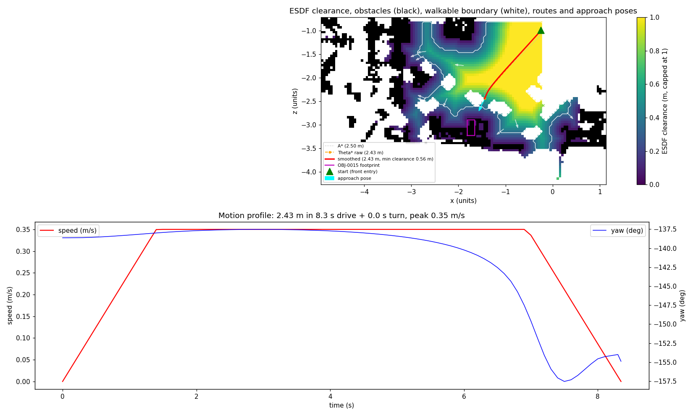
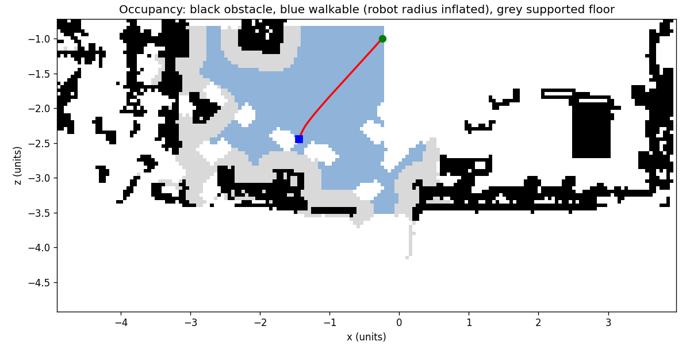
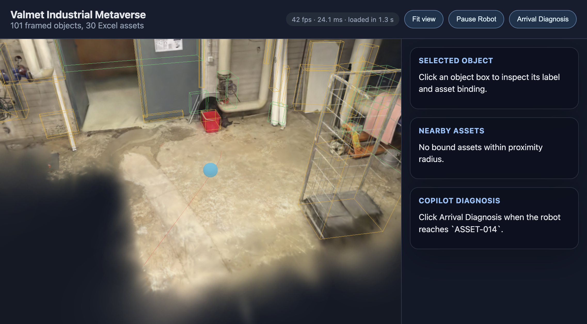

# 03 Navigation and motion math (Tab 3)

## 1. Outcome

The robot now drives a planned mission. It starts at the front entry of the walkable floor and stops at an approach pose 0.64 m in front of P-002 (`OBJ-0015`), already facing it. The old route went from the left-most to the right-most free cell and never reached the target.

- **Planner.** `pipeline/navigation.py` builds a floor grid with obstacles in metres and inflates it by the 0.3 m robot radius using a Euclidean distance transform. It plans with Theta* over an ESDF clearance cost.
- **Smoothing.** Theta* is followed by a cost-aware shortcut and a centripetal Catmull-Rom spline. Every spline sample is re-checked for collision.
- **Motion profile.** The route is exported as a curvature-limited trapezoidal motion profile: 85 samples at 0.1 s, with time, arc length, position, yaw and speed.
- **Default mission.** 2.43 m in 8.35 s, minimum clearance 0.555 m (0.255 m more than the robot radius), peak curvature 1.19 per metre. It ends facing the asset with a 1° final turn.
- **Other assets.** `nav_targets.json` holds an approach pose and a full precomputed mission for each of the 13 reachable bound assets. The other 17, mostly on the right-hand pipework, are honestly marked `reachable: false` because they are outside the valid floor slice.

## 2. Changes

- `pipeline/navigation.py`: rewritten. It contains:
  - `build_grid` (support, metric obstacle band, EDT inflation, ESDF, cost) and `front_entry`;
  - `approach_pose` (standoff, facing and drive-in) and `Planner` (Theta*/A*, supercover line of sight, cost-aware shortcut);
  - `catmull_rom` and `motion_profile`;
  - `plan_route` and `plan_mission`;
  - the PNG, ROS map and diagnostics writers;
  - `selftest()`, run with `python3 -m pipeline.navigation`.

  `grid_path` was removed.
- `pipeline/run.py`: the call site now runs `plan_mission(cloud.xyz, structure, objects, mpu, out_dir)` after asset binding. It writes `nav_targets.json` and prints the length, clearance, duration and reachable count.
- `pipeline/README.md`: the navigation row and outputs list.
- `data/derived/nav.json`: the new mission. It is a superset of the old shape.
- `data/derived/nav_targets.json` (new): approach poses and missions for every bound asset.
- `data/derived/nav_map.pgm` and `nav_map.yaml` (new): the ROS map_server occupancy map.
- `data/derived/floor_occ.png`: redrawn (obstacle, supported floor, walkable after inflation, route).
- `data/derived/diagnostics/nav_esdf.png` (new): an ESDF heatmap with the A*, Theta* and smoothed routes, the start, the approach poses and the target footprint, plus the speed and yaw profile.
- `docs/contracts.md`: the `nav.json` section is rewritten; `nav_targets.json`, `nav_map.*` and the `?target=` guidance were added.
- `docs/research/03-navigation.md` (new): research notes and decisions.
- `docs/kt/media/03-*.png` (new): evidence images.
- `web/public/data/derived/nav.json` and `floor_occ.png`: re-synced by `npm run dev` (`predev`). No web code was changed.

## 3. How to run and verify

```bash
python3 -m pipeline.navigation   # self-test, about 2 s
python3 -m pipeline.run          # full pipeline, about 17 s (navigation about 2 s of that)
cd web && npm run dev            # predev syncs nav.json into web/public
```

`python3 -m pipeline.navigation` prints:

```
empty grid: theta* 2.7536 == straight 2.7536; A* 2.9592
wall: LOS rejected, detour has 4 vertices
catmull-rom: interpolates 4 control points with 313 samples
trapezoid: area 1.9997 m == 2.0 m; duration 7.11 s == analytic 7.11 s; final turn 90.0 deg
navigation selftest passed
```

`python3 -m pipeline.run` should end with:

```
wrote path with 39 points, 2.43 m, min clearance 0.56 m, 8.3 s to data/derived/nav.json; approach poses for 13/30 assets in nav_targets.json
```

At http://localhost:5173 the red route runs from the front of the floor to the back wall and ends in front of the handwheel valve assembly (`OBJ-0015`) beside the red bucket. `curl "http://localhost:8000/api/scene/nav?target=ASSET-014"` returns the new file, because the backend reads it on each request.

If `npm run dev` fails inside a sandbox with `uv_interface_addresses`, run `npx vite --host 127.0.0.1` instead. `--host 0.0.0.0` enumerates network interfaces, which the sandbox blocks.

## 4. Contract changes

All are in `docs/contracts.md`, and everything is additive. The old keys `start`, `goal`, `path`, `path_length_units`, `path_length_m`, `cell_size`, `grid_origin`, `metres_per_unit` and `occupancy_png` keep their meaning.

- **New `nav.json` fields:**
  - `nav_version`, `target_object_id`, `grid_shape`, `diagnostics_png`, `targets_file`;
  - `start_name`, `start_pose`, `approach` (position, yaw, standoff, `drive_in`, clearance), `yaw_convention`;
  - `robot`, `cost_params`, `grid_stats`, `path_raw`, `path_shortcut`;
  - `samples[]` (`t`, `s`, `pos`, `yaw`, `speed`, `phase`) and `stats`.
- **`path` changes.** It is now the smoothed spline resampled every 0.05 units, with 39 points instead of 71. `start` and `goal` are the real start and approach pose.
- **Grid cells.** `grid_origin` is the corner of cell (0, 0), and cell centres are at +0.5 cell. The old code used the corners as path points.
- **Yaw convention.** `atan2(dx, dz)` in the raw frame. In display coordinates the heading is `pi - yaw`; the contract has the details.
- **New files.** `nav_targets.json`, plus the bonus `nav_map.pgm` and `nav_map.yaml`.
- **Backend.** `GET /api/scene/nav?target=` should build its response from `nav_targets.json` and never fabricate a path for an unreachable asset. Tab 4 owns the route; it is unchanged so far.

## 5. Research used

The full notes are in `docs/research/03-navigation.md`.

| Source | Decision it drove |
|---|---|
| scipy `distance_transform_edt`; Oleynikova et al. 2017 (Voxblox ESDF) | Collision test: `ESDF > r + cell/2` (EDT disc), replacing 4 diamond-shaped dilations. Clearance cost from the ESDF. Exact clearance check per sample. |
| Nav2 / costmap_2d inflation layer (`253 * exp(-k (d - r))`, default k = 10 /m) | Cost `c = 1 + 4 exp(-d / 0.15 m)`, a slightly gentler decay (k about 6.7 /m) so the route keeps to the corridor centre. |
| Hart et al. 1968 (A*); Patel (octile heuristic) | Octile heuristic in metres, admissible because every cell cost is at least 1. A* kept as the comparison baseline. |
| Daniel, Nash, Koenig, Felner 2010 (Theta*, JAIR 39, doi 10.1613/jair.2994) | Basic Theta* with the non-uniform cost extension: edge cost = length × mean cell cost along the supercover. |
| Amanatides and Woo 1987 | Supercover line-of-sight traversal; a corner crossing must clear both side cells. |
| Geraerts and Overmars 2007 | Greedy shortcut, accepted only if it doesn't raise the clearance cost, so shortcutting can't undo the centre-of-corridor preference. |
| Yuksel, Schaefer, Keyser 2011 (centripetal Catmull-Rom) | alpha = 0.5: no cusps or self-intersections, and it interpolates the waypoints. Collision re-check with polyline fallback. |
| Lynch and Park 2017 (time scaling); Bobrow et al. 1985 (velocity limit curve) | Speed cap `min(v_max, sqrt(a_lat/kappa))`, then forward/backward acceleration passes: an exact trapezoid on straight paths, slowing in curves. |
| ROS map_server format | PGM (254/0/205) plus YAML with metres resolution and origin. |

## 6. Evidence

The ESDF clearance map has the A* route (grey dotted, 2.50 m), the Theta* raw route (orange, 2.43 m) and the smoothed route (red). It also marks the start (green), the approach pose (cyan), the `OBJ-0015` footprint (magenta) and the other approach poses (white arrows). Below it is the speed and yaw profile:



Occupancy: black is obstacle, grey is supported floor, and blue is walkable after inflation by the robot radius:



Viewer close-up from the front entry towards the back wall. The red route crosses the open floor and ends in front of the handwheel valve assembly (`OBJ-0015`, the P-002 target) next to the red bucket. The blue sphere is the placeholder robot from Tab 1:



Viewer overview, default camera (60 fps with the splat on this frame): `media/03-viewer-overview.png`.

Numbers for the default mission (from `nav.json` `stats`):

| Metric | Before (old `grid_path`) | After (Tab 3) |
|---|---|---|
| Start | left-most free cell (-3.02, -1.47) | front entry (-0.24, -0.99) |
| End | right-most free cell (0.48, -2.57), not at any asset | approach pose (-1.44, -2.44) facing `OBJ-0015`, standoff 0.643 m |
| Path points | 71 grid steps | 39 (spline every 0.05 u), plus 85 timed samples |
| Length | 5.52 m | 2.43 m (Theta* raw 2.43 m, A* 2.50 m) |
| Robot radius respected | no (fixed 4-cell diamond dilation = 0.26 m) | 0.3 m disc + half-cell margin (inflation 0.332 m) |
| Minimum clearance | not measured | 0.555 m exact (margin 0.255 m), mean 1.23 m |
| Timing | none (frontend stepped 30 points/s) | 8.35 s: 1.4 s accelerate, cruise 0.35 m/s, decelerate to 0; peak curvature 1.19 /m |
| Final heading error | n/a | 1.0 deg (turn in place skipped below 1 deg) |

- **Grid.** 84 × 178 cells at 0.05 units. 2,060 obstacle cells and 3,136 supported floor cells. 1,626 walkable cells (6.73 m²) in the main 4-connected component; the other 7 components have 9 cells or fewer.
- **Planning effort.** Theta* expanded 25 nodes and A* 149. The whole navigation step, including 13 missions and the images, takes about 1.9 s.
- **Speed profile check.** The area under the exported speed samples is 2.4306 m, against a route length of 2.4313 m.
- **`nav_targets.json`.** 13 of 30 assets are reachable. All 13 missions are collision-free with spline smoothing (no fallback). Clearances run from 0.305 to 0.675 m and lengths from 2.36 to 3.73 m. 11 of the 13 drive straight in.
- **Tab 2 output untouched.** Rerunning the pipeline left `scene_objects.json` identical apart from `stable_id_iou` (97/97 ids matched).

## 7. Known issues and limitations

- **The route is short (2.43 m) because the valid floor slice is small** (6.7 m² walkable). The front-entry start was your choice: it reads as "robot enters the room". The old 5.5 m route was longer only because it ran edge to edge and never reached the target.
- **17 of 30 bound assets are unreachable.** They are 1.0 to 4.2 m from the walkable floor (the right-hand pipework at x > 1, and objects high on the left wall). This is a property of the corrupted PLY, not of the planner. If an intact PLY arrives, rerun `python3 -m pipeline.run`.
- **P-002's approach pose is 0.643 m from the footprint**, inside the 0.5 ± 0.15 m tolerance, rather than exactly 0.5 m. The closer candidates have an unscanned floor hole (about x -1.4, z -2.3) behind them, so the robot couldn't drive straight in. `drive_in` is preferred over an exact standoff.
- **`ASSET-012` and `ASSET-016`** have no drive-in cell, so their missions end with a 51° and 39° turn in place.
- **Unknown (unscanned) floor is treated as not walkable, but it is not an obstacle for clearance.** The front-entry start sits on the edge of the scanned data (z about -0.99), because the valid slice ends there.
- **The obstacle band (0.12 to 1.8 m) and the robot radius depend on the assumed scale** (1.2865 m/unit, from the room-height prior).
- **The placeholder `web/src/scene/Robot.jsx` still loops through `nav.path` at 30 points per second.** With 39 points instead of 71 it now loops about every 1.3 s. Tab 6 replaces it with `samples`.
- **`nav_targets.json` is 487 KB** (pretty-printed, 13 full missions). The web app doesn't load it yet, and `web/scripts/sync-public.mjs` doesn't copy it.
- **No pytest suite.** Verification is `selftest()` plus the pipeline run. Tab 9 can wrap `selftest` in pytest.
- **Vite was restarted on 127.0.0.1:5173** from the agent shell for the screenshot. Your earlier `npm run dev` terminal had already exited.

## 8. Notes for the next tabs

### Tab 6 (3D interaction and mission)

**Animation**
- Animate from `nav.samples`. Interpolate `pos` linearly and `yaw` along the shortest arc by `t`, and use `phase` for the state machine: `drive` is en route, then `turn`, and `arrived` starts the diagnosis.
- Approaching = the last 1.5 s of `drive`, where `speed` is falling.
- Scrubbing is `t`-based. Don't animate by path index.

**Heading**
- Inside the `display-frame` group, `rotation.y = yaw` with the model's forward on local +z and its up flipped to -y.
- Outside the group, `rotation.y = Math.PI - yaw` on display coordinates.

**Dispatch**
- "Dispatch to [asset]" can use `nav_targets.json` → `targets[].mission`. Add it to `web/scripts/sync-public.mjs`, or fetch it from Tab 4's route.
- Disable the dispatch button when `reachable` is false, and show "outside scanned floor (X m away)" using `distance_to_walkable_m`.

**Minimap**
- `floor_occ.png` covers the full grid extent. Use `grid_origin`, `grid_shape` and `cell_size` to place it.
- The image includes axes and a title, so for a clean minimap, render `nav_map.pgm` or draw the grid yourself.

**Proximity spec** (formulas, raw frame)
- **Distance.** Use the horizontal distance from the robot to the asset's OBB footprint, in metres:
  - `q = R^T (p - c)` and `d = mpu * hypot(max(|q_x| - e_x/2, 0), max(|q_z| - e_z/2, 0))`, with `R`, `c`, `e` from `obb`.
  - This is `footprint_distance` in `navigation.py`.
  - Use the footprint, not the OBB centre: big objects would otherwise light up late. Use horizontal, not 3D: elevated valves would never be "near".
- **Field of view.**
  - `f = (sin yaw, cos yaw)` in x-z, and `u = normalize(c_xz - p_xz)`.
  - The asset is in view when `dot(f, u) >= cos(fov / 2)`, with fov = 90° for the scan cone. Use the cone only for the "scanned" log event, not for the highlight.
- **Hysteresis.**
  - Per asset: when inactive and `d < enter`, it becomes active. When active and `d > exit`, it becomes inactive.
  - Log the "asset scanned" event once per mission, the first time it is active and in view.
  - Check at 10 Hz, by brute force over the bound objects (30 of them). A KD-tree only pays off above roughly 10^4 objects.
- **Thresholds**, simulated on the current mission:
  - With the handoff's enter 1.2 m / exit 1.5 m, only P-002 (6.1 s) and CV-006 (7.2 s) light up.
  - **Recommended: enter 1.6 m / exit 2.0 m.** Six assets light up in sequence: P-002 4.9 s, CV-001 5.2 s, CV-006 5.8 s, CV-008 6.4 s, CV-005 6.8 s, CV-002 7.6 s. That gives the "nearby assets as it moves" moment.
  - With 3D closest-point distance and a 90° cone at 1.2 m, only P-002 fires.

### Tab 4 (backend)
- Serve `?target=` from `nav_targets.json`. Merge the matching `targets[]` entry's `approach` and `mission` keys over the `nav.json` top level, and set `target_asset_id` and `target_object_id`.
- If the target is unreachable, return the entry with `reachable: false` (or 404), never a made-up path.

### Tab 8 (labels)
- If `OBJ-0015` is relabelled `valve`, nothing here changes: approach poses are keyed by `asset_id` → `object_id` from `scene_objects.json`.
- If the P-002 binding moves to a different object, rerun `python3 -m pipeline.run`, or the mission will point at the old object.

### Tab 9 (release)
- Navigation adds about 2 s to the pipeline run.
- Add `python3 -m pipeline.navigation` to the smoke test.
- Report these in the technical note: length 2.43 m, minimum clearance 0.555 m, duration 8.35 s, 13/30 reachable.

### Everyone
- Don't edit `PARAMS` in `navigation.py` without rerunning the pipeline and checking `stats.min_margin_m > 0` and `smoothing_fallback == false`.
