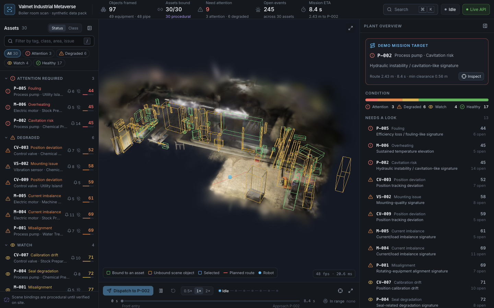
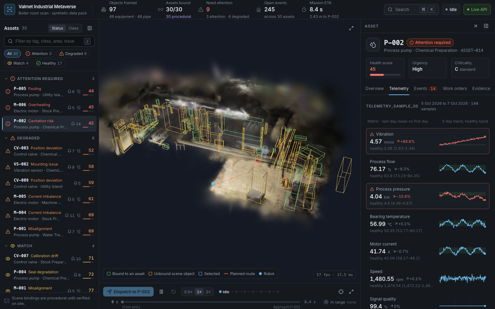
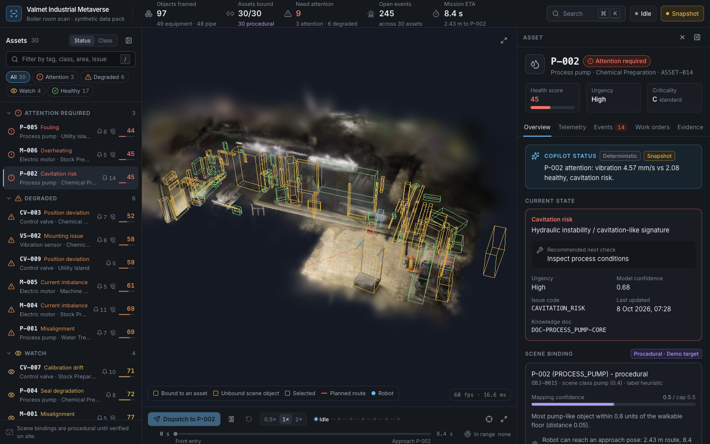
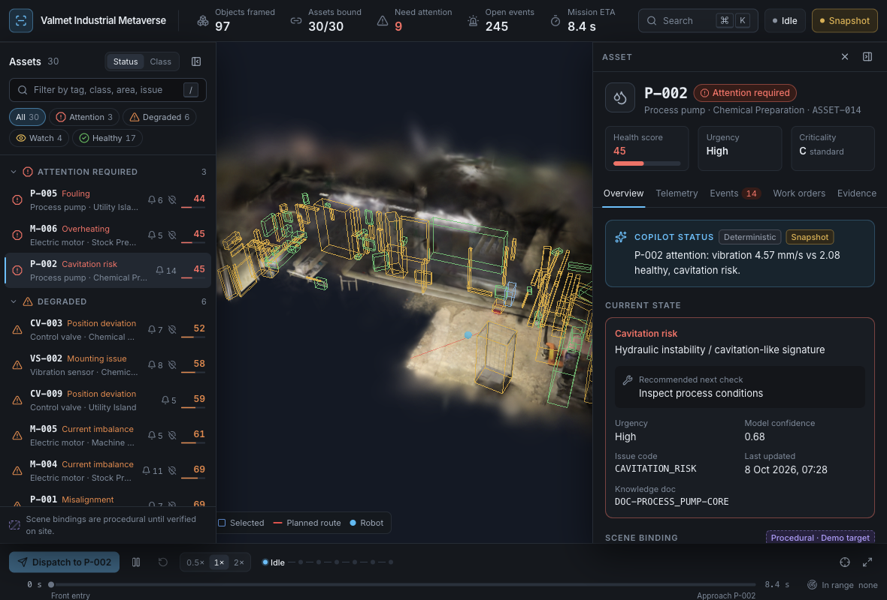

# 05 UI shell and design system (Tab 5)

Status: done. The shell is built and was verified in the browser at 1180x800, 1440x900 and 1920x1080, live and in offline snapshot mode. The research note, the `fg-faint` contrast fix, the keyboard pass and a formal frame-rate measurement are complete.

## 1. Outcome

The prototype header and side panel are replaced by a dark industrial product shell around the unchanged Tab 1 `Viewer`:
- a top bar with a KPI strip, a Cmd+K command palette, a mission-state chip and backend status;
- a left asset tree, grouped by status or class, with filters and counts;
- a tabbed right inspector (Overview, Telemetry, Events, Work orders, Evidence);
- a bottom mission dock.

Every panel shows real workbook data from the FastAPI backend. When the backend is down, the app falls back to a verbatim snapshot of the API in `web/public/data/api/`.

Collapsing panels, full-screen mode and selection never remount the canvas or reload the splat. This is proven in the browser: same WebGL renderer, same canvas, same splat object (465,988 splats), and zero splat requests across 11 layout and selection changes.

## 2. Changes

- `web/package.json`: added `tailwindcss` 4.3.5, `@tailwindcss/vite`, `radix-ui` 1.8.1, `cmdk` 1.1.1, `lucide-react`, `clsx`, `@fontsource-variable/inter`, and a `snapshot` script.
- `web/vite.config.js`: Tailwind plugin.
- `web/src/styles.css`: rewritten.
  - A Tailwind `@theme` holds the tokens: surfaces, text, accent, six status tones plus soft variants, the type scale (2xs to 2xl), radius, shadows, easing and animations.
  - It also holds the shell grid (`.shell` with `data-rail`, `data-inspector` and `data-fullscreen`), drawer mode below 1280 px, cmdk styles, skeleton and hatch styles, `prefers-reduced-motion` handling and focus rings.
  - The Tab 1 classes (`.viewer`, `.viewer-canvas`, `.splat-loading`, `.splat-banner`, `.progress`) are kept.
  - Convention: a bare `.grid` defaults to `minmax(0,1fr)`, which prevents long IDs from widening panels.
- `web/src/store.js` (additive):
  - new state: `selectedAssetId`, `backend` (checking, online, static or offline), `dataEpoch`, `anchors`, `openEvents`, the `ui` slice and the `mission` slice;
  - new actions: `selectAsset`, `setBackend`, `setUi`, `toggleUi`, `setMission`;
  - `setSelectedId` now derives `selectedAssetId`, and `setSceneData` seeds the mission from `nav`;
  - in dev mode the store is exposed as `window.__store`.
- `web/src/data.js`:
  - `apiOrSnapshot` tries the backend first, then the snapshot;
  - fetchers: `fetchAssets`, `fetchAsset`, `fetchTelemetry`, `fetchEvents`, `fetchAnchors`, `fetchOpenEventCounts`, `fetchCopilot` (adds `snapshot: true` when served from the snapshot) and `searchApi`;
  - `checkHealth` and `startHealthPoll` poll every 15 s;
  - `useResource(key, load)` is a cached async hook keyed by `dataEpoch`;
  - `loadSceneData` no longer fetches assets.
- `web/scripts/snapshot-api.mjs` (new): writes `web/public/data/api/` (2.4 MB: 30 assets, 245 open events, 60 deterministic copilot answers).
- `web/src/App.jsx`: rewritten.
  - It holds the grid shell, the data loading (`useAppData`) and the global shortcuts.
  - The viewer chrome has the full-screen and reopen-panel buttons, a box and route legend, and the fps chip (moved into the viewer).
  - `SplatStatus` is kept.
- `web/src/ui/status.js` (new):
  - tone class map `TONES`, with literal Tailwind strings;
  - `CONDITIONS`, mapped from the workbook `condition_state`, each with its own icon;
  - helpers: `MAPPING`/`mappingOf`, `ASSET_CLASSES`, `humanize` and the number/date formatters.
- `web/src/ui/primitives.jsx` (new): Button, IconButton, Tooltip/TooltipProvider, Kbd, StatusDot, StatusIcon, StatusPill, Badge, MappingBadge, IdChip, SectionTitle, Card, Field, Skeleton, SkeletonRows, EmptyState, ErrorState, Meter and Sparkline (SVG with the p10-p90 band, day ticks and a last-value dot).
- `web/src/ui/selectors.js` (new): `useAssetIndex`, `useAnchorIndex`, `sortAssets` and `usePlantKpis`.
- `web/src/ui/TopBar.jsx` (new): brand, KPI strip (objects framed, assets bound, need attention, open events, mission ETA), search trigger, mission chip, backend chip and `FpsChip` (exported).
- `web/src/ui/AssetRail.jsx` (new):
  - group by status or class; filter chips with counts; text filter (`/` focuses it);
  - collapsible groups and arrow-key row navigation;
  - row indicators: open-event count, an unreachable marker from `/api/scene/anchors`, and the health score.
- `web/src/ui/inspector/` (new):
  - `Inspector.jsx` holds the tabs and the asset header (health, urgency, criticality), and exports `INSPECTOR_TABS`;
  - `OverviewTab.jsx` shows the copilot `status_line`, current state, scene binding (with mapping confidence against the 0.5 cap, reachability and a procedural warning), identity and documents;
  - `TelemetryTab.jsx` has one sparkline row per metric with the healthy band, last-day mean and delta %, and flags values outside the band. It takes an optional `renderDetail(metric)` prop for Tab 7;
  - `EventsTab.jsx` lists events in priority order with a status filter;
  - `WorkOrdersTab.jsx` lists Maintenance_History rows with totals;
  - `EvidenceTab.jsx` shows the arrival-diagnosis `evidence[]` grouped by kind, with "Cited" badges, and links claim chips to their evidence rows;
  - `CopilotSlot.jsx` is the minimal answer card (generation badge, confidence with reasons, observations, hypotheses, safe checks, caveats). **Tab 7 replaces it and must keep the props `{answer, onEvidence}`**;
  - `PlantOverview.jsx` is shown when nothing is selected: demo target card, condition bar, a list of flagged assets, and a by-class table;
  - `ObjectCard.jsx` is shown for unbound scene objects.
- `web/src/ui/MissionDock.jsx` (new): Dispatch button (disabled until Tab 6), play/pause preview, restart, speed 0.5x/1x/2x, a 7-state stepper, a timeline slider bound to `mission.t` (disabled while idle), fit view, full screen, and "In range" chips from `store.nearby`.
- `web/src/ui/CommandPalette.jsx` (new): a cmdk dialog that matches assets locally, plus `/api/search` results (issues, events, docs), plus commands.
- `docs/contracts.md`: added the "Frontend static snapshot" section.
- `_analysis/cdp_png.py` (new helper): decodes the newest CDP `Page.captureScreenshot` response into a PNG.
- Closing pass:
  - `fg-faint` is lightened to #6b788a and kept for icons, borders and dots; all its text uses moved to `fg-subtle`;
  - the command palette is now a Radix `Dialog` around cmdk `Command`, with a visually hidden title and focus returned to the opener;
  - the asset tree uses a roving tabindex, so it is one Tab stop;
  - below 1280 px the top bar hides the KPI sub-lines and the brand subtitle.
- `docs/research/05-ui-ux.md` (new): sources, the design spec and the contrast table.

## 3. How to run and verify

```bash
cd backend && python3 -m uvicorn app.main:app --port 8000      # or the one already running
cd web && npm install && npm run dev                            # http://localhost:5173
npm run snapshot                                                 # with the backend up; refreshes offline data
npm run build                                                    # passes (bundle 4.05 MB, was 3.9 MB)
```

In the Cursor sandbox, Vite must run outside the sandbox. `uv_interface_addresses` is blocked, so use `npx vite --host 127.0.0.1 --port 5173 --strictPort` with full permissions.

Shortcuts:

| Key | Action |
|---|---|
| Cmd/Ctrl+K | Command palette |
| `[` / `]` | Toggle the rail / inspector |
| `F` | Full screen |
| `Esc` | Exit full screen, or clear the selection |
| `/` | Focus the asset filter |
| Space | Play/pause the route preview |

For scripted screenshots: `Emulation.setDeviceMetricsOverride`, then `window.__store.getState().selectAsset('ASSET-014')` and `setUi({inspectorTab:'telemetry'})`, then `Page.captureScreenshot`, then `python3 _analysis/cdp_png.py docs/kt/media/<name>.png`. `browser_take_screenshot` crops to the panel size, so use the CDP capture instead.

## 4. Contract changes

- Backend API: none.
- New frontend-only fallback: the files in `web/public/data/api/` (see `docs/contracts.md`, "Frontend static snapshot").
- The store contract for Tab 6 is in section 8.

## 5. Research used

Full notes with sources, the design spec and the WCAG contrast table are in `docs/research/05-ui-ux.md`. Decisions applied:
- ISA-101 style: grey baseline, with saturated colour only for abnormal states.
- Every status has an icon as well as a colour (WCAG 1.4.1).
- Radix gives keyboard and ARIA for free (tabs, toggle groups, tooltips, dialog).
- Sparklines follow Tufte: word-sized, a normal band and a last-value dot.
- Motion tokens are 120/200/320 ms with Material-style standard and emphasized easing.

## 6. Evidence

Screenshots in `docs/kt/media/`:
- `05-1440-default.png`, `05-1440-overview.png`, `05-1440-telemetry.png`, `05-1440-evidence.png`, `05-1440-palette.png`, `05-1440-fullscreen.png`;
- `05-1920-default.png`, `05-1920-telemetry.png`, `05-1920-fullscreen.png`, `05-1920-palette.png` (the last was saved but not visually reviewed).




Data shown live:
- **KPIs:** 97 objects framed (49 equipment, 48 pipe); 30/30 assets bound, all procedural; 9 need attention (3 attention, 6 degraded); 245 open events; ETA 8.4 s over 2.43 m to P-002.
- **P-002 telemetry:** vibration 4.57 mm/s (+88.8%) and pressure 4.04 bar (−10.6%), both flagged outside the healthy band.

Single-load proof (in the browser, via `Runtime.evaluate`):

```json
{"hits":0,"sameGl":true,"sameCanvas":true,"sameSplat":true,"splatState":"ready","numSplats":465988}
```

The canvas resized correctly: 760x768 in the normal layout, 1048 or 1152 wide with one panel closed, 1440x768 with both closed, and 1440x900 in full screen.

Horizontal-overflow check: every inspector tab and the plant overview have `scrollWidth == clientWidth` (391 px).

**Offline (static) mode.** A second Vite on port 5174 with `VITE_API_URL=http://127.0.0.1:9` gives `backend: "static"`, 30 assets, open-event counts for 30 assets, the "Snapshot" chip, and copilot answers marked Snapshot:



**Narrow screen, 1180x800.** The rail (288 px) and inspector (392 px) are `position: fixed` drawers over a 1180 px canvas. The KPI strip fits with no overflow (`scrollWidth == clientWidth`, 573 px) after hiding the sub-lines:



**Keyboard**, checked by script in the browser:
- The DOM tab order is top bar, rail, viewer chrome, inspector, dock. No element has a positive tabindex, and every focusable control has an accessible name.
- The asset tree went from 45 Tab stops to 1 (roving tabindex), so the rail has 6 stops in total.
- Cmd+K opens the palette with focus in its input. The dialog has the title "Command palette". After Esc, focus returns to the search button; before the fix it went to `body`.
- The Esc chain: the first Esc leaves full screen, the second clears the selection.
- Opening and closing the palette logs no console warnings.
- Focus rings come from the global `:focus-visible` rule (a 2 px accent outline with a 2 px offset).

**Frame rate**, measured with a 10 s `requestAnimationFrame` sample in the Cursor browser (emulated DPR 1, Canvas DPR clamp `[1, 1.5]`, no selection):

| Viewport | Canvas | Mean fps | p50 frame | p95 frame |
|---|---|---|---|---|
| 1440x900, shell | 760x768 | 59.6 | 16.7 ms | 17.4 ms |
| 1920x1080, shell | 1168x948 | 44.3 | 17.1 ms | 33.6 ms |
| 1920x1080, full screen | 1920x1080 | 35.6 | 33.0 ms | 33.9 ms |
| Native window 1137 px wide, DPR 1.5 (5 s) | 1705x744 | 60.2 | 16.7 ms | 17.2 ms |

Tab 1 measured 23 to 31 fps with a viewer of about 780x550 CSS px at DPR 1.5. The shell's smaller canvas, and the GPU no longer being shared with as many IDE panes, account for most of the gain. Splat cost scales with canvas pixels: about 1.1 Mpx holds 44 fps and 2.1 Mpx holds 36 fps.

## 7. Known issues and limitations

- Native Tab key presses couldn't be driven from the agent's browser tool, because its key events are synthetic DOM events. The tab order was checked from DOM order and the tabindex values instead, and is worth one manual run-through.
- At 1920x1080 in full screen the splat drops to about 36 fps. If the recording needs 60, record at 1440x900 or lower the Canvas DPR (Tab 6 or Tab 9).
- `/api/search` takes about 2 s for some queries, so palette results lag. Showing a loading row would help.
- The Dispatch, restart and timeline controls are disabled until Tab 6 writes `mission.state` and `mission.t`. The speed toggle writes `mission.speed`, but nothing reads it yet.
- The viewer legend colours are hard-coded to match `scene/Overlays.jsx` and `scene/Robot.jsx`. If Tab 6 recolours boxes by status, update `LEGEND` in `App.jsx`.
- Selecting an asset highlights its box (blue) but doesn't fly the camera to it; that is Tab 6's job.
- The bundle is 4.05 MB, with no code splitting (Tab 9).
- I couldn't stop the earlier Vite process (pid 8574) from the sandbox. Vite was restarted outside the sandbox on 127.0.0.1:5173. The backend on port 8000 was already running from `backend/`, started by an earlier tab, with no API key.

## 8. Notes for the next tabs

**Tab 6 (mission):**
- Write `useStore.getState().setMission({state, t})`. `state` is one of `MISSION_STATES` from `store.js`: `idle`, `dispatched`, `en_route`, `approaching`, `arrived`, `diagnosing`, `report`.
- The dock, the stepper, the top-bar chip and the ETA KPI then update automatically.
- Read `mission.speed` (0.5, 1 or 2), and react to `mission.t` changes from the timeline slider for scrubbing.
- `mission.duration` and `targetAssetId` are seeded from `nav.stats.duration_s` and `nav.target_asset_id`.
- Fly-to on selection: subscribe to `selectedId` (it is still the object id).
- Keep `store.nearby` as an array of bound scene objects; the dock's "In range" chips use it.
- Don't move `<Viewer/>` out of `<main className="viewer">` in `App.jsx`.

**Tab 7 (copilot UI):**
- Replace `ui/inspector/CopilotSlot.jsx`, keeping the props `{answer, onEvidence(id)}`.
- The Evidence tab already resolves IDs to rows (`#evidence-<id>`).
- Detail charts can attach through the `TelemetryTab` prop `renderDetail(metric)`.
- Use `fetchCopilot` and `useResource` from `data.js`. Answers served from the snapshot carry `snapshot: true`, and `GenerationBadge` shows it.

**Everyone:**
- Tailwind only sees literal class strings, so add tones through `TONES` in `ui/status.js`, never as `text-status-${x}`.
- Rerun `npm run snapshot` after any backend, workbook or pipeline change.
- `fg-faint` is never used for text. Use `fg-subtle` (at least 4.5:1 on every surface) or brighter.
- To test offline mode without stopping the backend, run a second Vite: `VITE_API_URL=http://127.0.0.1:9 npx vite --host 127.0.0.1 --port 5174 --strictPort`.
