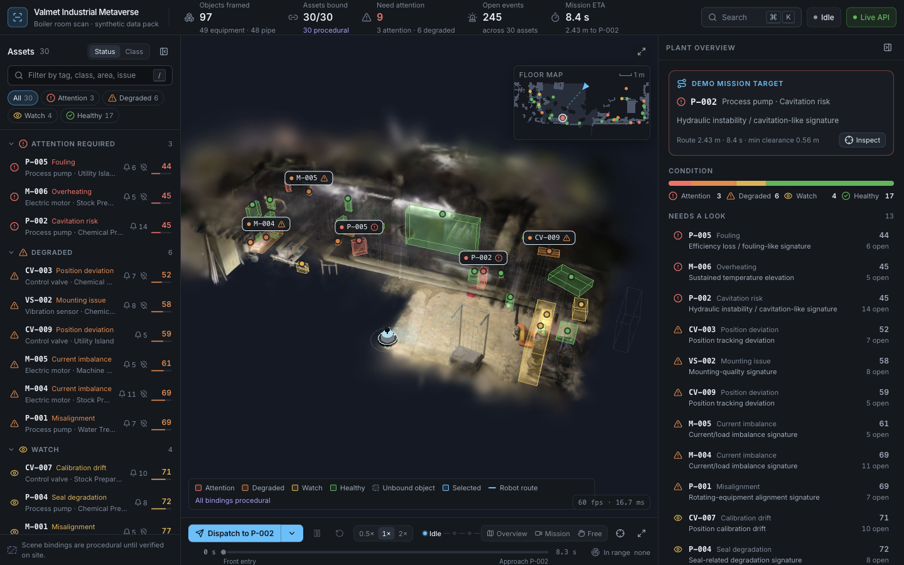
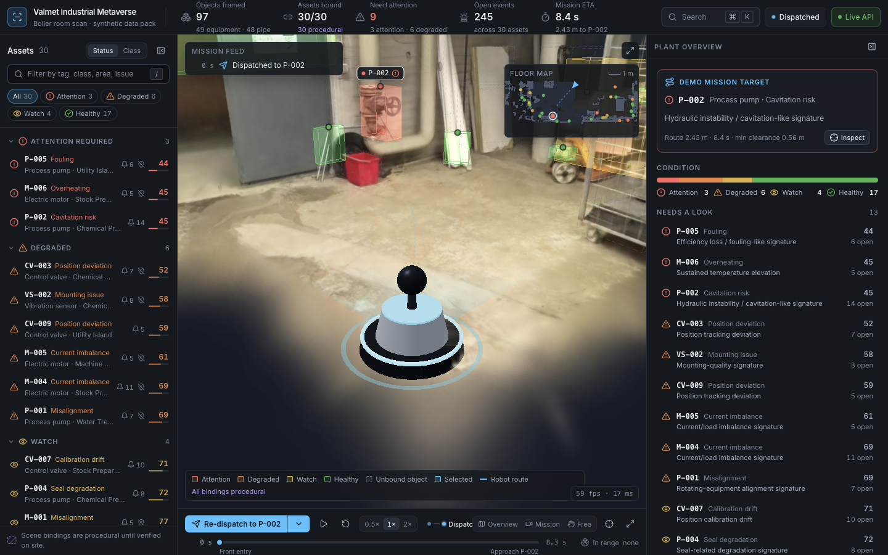
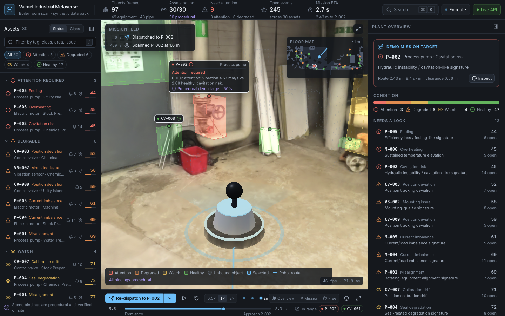
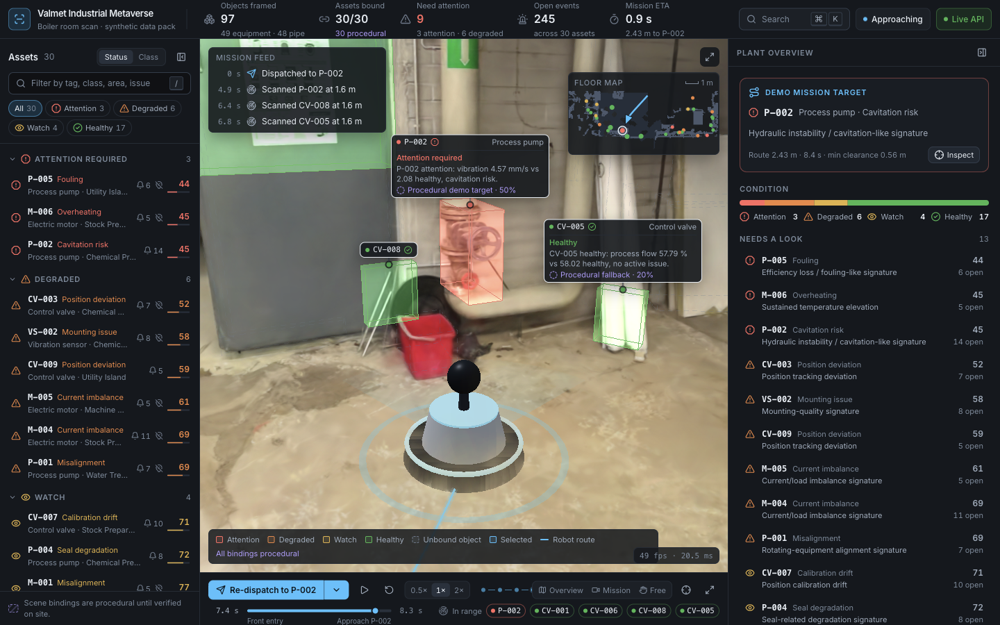
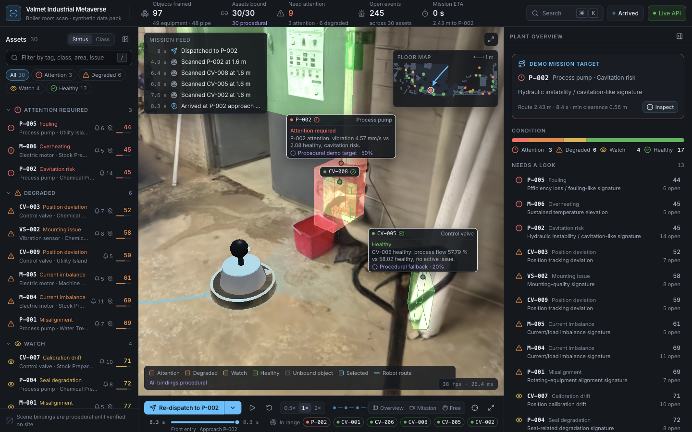
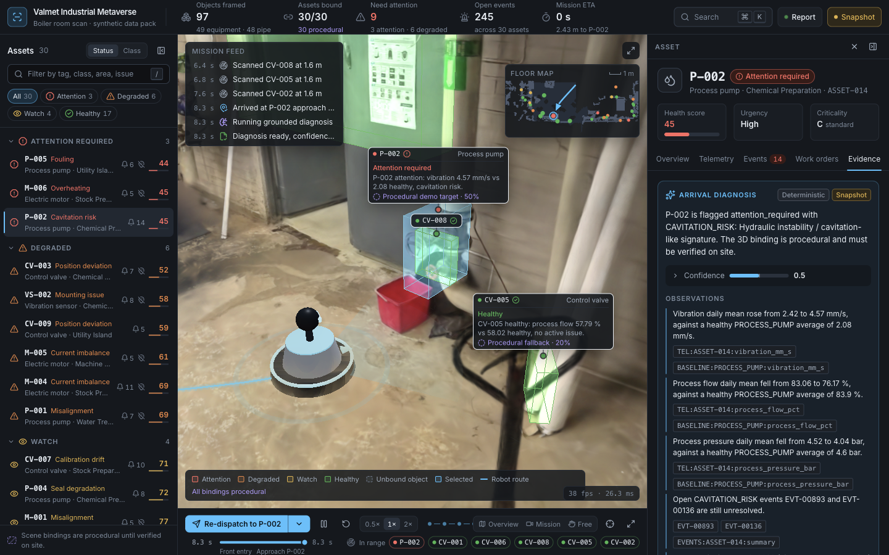

# Tab 6: 3D interaction, mission flow and robot

Status: done. A full mission is verified live and offline, the post-fix screenshot sequence `06-1` to `06-7` is captured, 10 s fps samples are taken, and `docs/contracts.md` documents the new public files and store fields.

## 1. Outcome

- The robot now runs one real mission from `nav.json` timed samples: Idle → Dispatched (0.6 s pre-roll) → En route → Approaching (last 1.5 s of drive) → Arrived (0.5 s hold) → Diagnosing (at least 1.2 s) → Report. It never loops.
- On arrival it fetches the `arrival_diagnosis`, selects P-002, and opens the inspector on Evidence.
- Overlays are coloured by Excel status and dimmed where they add clutter.
- 3D labels are decluttered: they step from card to tag to dot.
- The camera has three modes: Overview, Mission (follow the robot) and Free.
- There is also a minimap, a mission feed, a dispatch target menu, and palette commands.

## 2. Changes

New:
- `web/src/scene/mission.js`: pure maths, with no three.js import:
  - `sampleAt` (binary search, shortest-arc yaw) and `stateAt`;
  - `footprintDistance` and `inFov`, using the Tab 3 formulas;
  - the hysteresis tracker, entering at 1.6 m and exiting at 2.0 m;
  - `simulateMission` (a 10 Hz timeline computed once per dispatch) and `activeAt`;
  - `navForTarget`, which merges a `nav_targets.json` mission over `nav.json`, the same merge as `?target=`.
- `web/scripts/check-mission.mjs`: a Node check of `mission.js` against the real data (`node scripts/check-mission.mjs`).
- `web/src/scene/missionRuntime.js`: the shared per-frame clock and pose (`runtime`). Only MissionDriver writes it; the robot, overlays, labels, camera and minimap read it.
- `web/src/scene/MissionDriver.jsx`: the state machine, mounted in the Canvas.
  - It writes `mission.t` to the store at 10 Hz. Any other change to the store's `t` is treated as a slider scrub.
  - It honours `mission.speed`, and `running` acts as pause; pausing also holds the arrival and diagnosis timers.
  - It sets `nearby`, writes the feed, fetches `status_line` per asset as it comes into range, and runs the arrival diagnosis hook.
- `web/src/scene/Labels.jsx`, in two parts:
  - `LabelProjector` (inside the Canvas) projects at 30 Hz, chooses the level of detail, and places labels greedily by priority (selected, target, in range, abnormal, near). It also clamps labels at the viewer edges and treats `[data-label-occluder]` chrome as occupied.
  - `LabelLayer` (DOM, mounted in `App.jsx` `.viewer`) holds the nodes, which are moved only by `transform`.
- `web/src/ui/Minimap.jsx`: a canvas inset drawn from `nav_map.pgm` and `.yaml`, cropped to known cells. It shows the route, the travelled part, the robot with its heading, and status-coloured asset dots (click to select), redraws at 15 Hz, and has a 1 m scale bar.
- `web/src/ui/MissionFeed.jsx`: an `aria-live` log of dispatch, scanned (field-of-view events), arrived, diagnosing and report entries.
- `docs/research/06-3d-interaction.md`: the research note. Decisions: no outline post-processing pass, a custom label layer, exponential damping, and the Spark depth facts.

Changed:
- `web/src/scene/Robot.jsx`: rewritten.
  - A procedural robot sized to the 0.3 m radius, with heading and a 90° scan sector.
  - A pulse ring, plus Line2 lines for the dashed route ahead (width 2, opacity 0.7), the glow and the travelled trail (`instanceCount`).
  - When idle, it is parked at the start pose.
- `web/src/scene/Overlays.jsx`: rewritten as 3 draw calls.
  - An additive instanced fill, which is also the pick target.
  - Solid RGBA edges for bound objects and dashed edges for unbound ones.
  - Colours by status come from `STATUS_HEX`; pipes and `other` objects with confidence at or below 0.2 are dimmed.
  - Hover, selection plus ghosting, in-range highlighting, and the target pulse on arrival (steady under reduced motion).
  - It exports `obbMatrix` and `obbCorners`.
- `web/src/scene/CameraRig.jsx`: adds fly-to on selection (`fitToBox` on the display-space OBB, minimum size 0.6), the Overview preset, a damped follow camera (`FOLLOW`), and arrival framing (`ARRIVAL`). A drag or wheel switches the mode to `free`.
- `web/src/scene/Viewer.jsx`: mounts MissionDriver and LabelProjector, adds a directional light, and supports a `?dpr=` override.
- `web/src/store.js`:
  - new fields: `baseNav`, `navTargets`, `statusLines`, `ui.cameraMode`, and `mission.{feed, runId, diagnosisAt}`;
  - new actions: `dispatchMission(assetId)`, `restartMission()`, `pushFeed()`, `setStatusLine()` and `setCameraMode()`.
- `web/src/data.js`: adds `cachedResource` (shares the `useResource` cache, so the Evidence tab shows the prefetched diagnosis instantly), `loadNavTargets` and `loadNavMap` (a P5 PGM and YAML parser).
- `web/scripts/sync-public.mjs`: also copies `nav_targets.json`, `nav_map.pgm` and `nav_map.yaml`.
- `web/src/ui/status.js`: adds `STATUS_HEX` and `statusHexOf`, mirroring the CSS tokens.
- `web/src/ui/MissionDock.jsx`:
  - a Dispatch/Re-dispatch split button with a target menu: 13 reachable targets, and 17 disabled ones labelled "outside scanned floor (X m)";
  - working pause, reset, speed and scrub controls (scrubbing is enabled from en route onwards);
  - the camera-mode toggle.
- `web/src/App.jsx`: loads `navTargets`, mounts the LabelLayer, minimap and feed (the feed also shows in full screen), and has a new legend built from `STATUS_HEX`.
- `web/src/ui/CommandPalette.jsx`: adds a "Send robot to" group, camera commands, and Pause/Reset mission.
- `web/src/ui/TopBar.jsx`: the mission chip tooltip no longer mentions the looping preview.
- `web/src/ui/inspector/OverviewTab.jsx`: adds a "Send robot" button for reachable assets.
- `web/src/styles.css`: adds the `.labels3d` / `.label3d*` rules (level of detail through `data-lod`, edge shift through `--shift`).

## 3. How to run and verify

```bash
cd web && node scripts/check-mission.mjs   # all checks pass; reproduces Tab 3's order
cd web && npm run build                    # passes (bundle 4.12 MB)
cd web && npx vite --host 127.0.0.1 --port 5173 --strictPort
# offline: VITE_API_URL=http://127.0.0.1:9 npx vite --host 127.0.0.1 --port 5174 --strictPort
```

Click Dispatch in the dock. The robot drives about 8.35 s, assets light up and get cards, the feed logs scans, then the camera frames P-002, the box pulses, and the inspector opens Evidence with the diagnosis.

Scripted checks used in the browser (dev mode exposes `window.__store`):
- `__store.getState().dispatchMission()`, then poll `mission.state` / `mission.t`.
- `toggleRunning()` pauses; the state must not change while paused.
- A label check compares every visible `.label3d[data-visible=true]` body rect against `[data-label-occluder]` rects, the canvas rect and each other.

## 4. Contract changes

No JSON or API changes. `docs/contracts.md` gains two frontend sections:
- "Frontend public derived files": `nav_targets.json`, `nav_map.pgm` and `nav_map.yaml`, plus the files that were already copied;
- "Frontend store": `baseNav`, `navTargets`, `statusLines`, `ui.cameraMode`, `mission.{feed, runId, diagnosisAt}`, the actions, and the `runtime` read rule.

## 5. Research used

See `docs/research/06-3d-interaction.md`.

## 6. Evidence

`check-mission.mjs`: all checks pass.
- Interpolation, short-arc yaw and clamping are correct.
- Integrated length is 2.431 m.
- Enter times reproduce Tab 3 exactly: P-002 4.9 s, CV-001 5.2 s, CV-006 5.8 s, CV-008 6.4 s, CV-005 6.8 s, CV-002 7.6 s.
- Every reachable target yields a mission (13/13), and an unreachable one yields null.

Live mission at 1440x900 with the backend online, logged every 100 ms:

| Moment | What happened |
|---|---|
| 0 s | Dispatched |
| +0.55 s | En route |
| Mission time 4.93 / 5.26 / 5.81 / 6.47 / 6.80 / 7.67 s | The six assets above come into range, in order |
| 6.8 s | Approaching |
| 8.347 s | Arrived |
| +0.6 s | Diagnosing |
| +1.24 s | Report: ASSET-014 selected, Evidence tab open |

- The feed logged 4 scans (the ones inside the field-of-view cone: P-002, CV-008, CV-005, CV-002), plus arrived, diagnosing and "Diagnosis ready, confidence 50%".
- All 6 `status_line` answers were fetched.

**Re-verification of the late fixes** (second live run, 1440x900, backend online):

| Fix | Check | Result |
|---|---|---|
| Label occluders | Visible label bodies vs the feed, minimap and legend rects, at en route, approaching, arrival and in the overview (20 labels) | 0 overlaps; P-002's card now sits clear of the feed (`06-3`) |
| Label edge clamp | Label bodies vs the canvas rect, same frames | 0 outside; 0 label-label overlaps |
| Follow camera lift | Visual (`06-3`, `06-4`) | The camera looks up past the robot to P-002 and the shelf |
| Arrival framing | Visual (`06-5`) | The robot stands left of P-002 and doesn't block the box |
| Pause holds arrival and diagnosis | Pause at `arrived`, poll 6 x 500 ms; same at `diagnosing`; also at en route t = 5.64 s | The state and t never changed while paused; resume reaches the report |
| New robot body, brighter route | Visual | Base, body, sensor head; the dashed route ahead is readable |

**Frame rate**, 10 s `requestAnimationFrame` samples, 1440x900, emulated DPR 1, canvas 760x768:

| Scene | Mean fps | p50 frame | p95 frame |
|---|---|---|---|
| Idle, overview camera | 59.9 | 16.6 ms | 17.5 ms |
| Full mission (dispatch to diagnosing, follow camera) | 44.5 | 16.9 ms | 50.0 ms |

The mission mean is above 30 fps, so the DPR default is unchanged (Canvas clamp `[1, 1.5]`); `?dpr=1` remains as an override. The p95 comes from the close follow-camera frames, where splat fill cost rises.

**Offline run** (Vite on port 5174, `VITE_API_URL=http://127.0.0.1:9`): `backend: "static"`. The mission went through dispatch, 4 scans, arrived and diagnosing to "Diagnosis ready, confidence 50% (snapshot)". All 6 status lines came from the snapshot, ASSET-014 was selected and Evidence was open, with Deterministic and Snapshot badges.

Screenshots in `docs/kt/media/`:









## 7. Known issues and limitations

- In the follow camera, CV-001 and CV-006 come into range but are off-screen, so only the minimap and dock chips show them.
- The feed logs only "scanned" (in range and inside the field-of-view cone) events, so CV-001 and CV-006 never get a feed row by design.
- The close follow view dips (p95 50 ms) because splat fill cost rises near the camera. `?dpr=1` is available.
- In one early scripted run, a pause didn't hold and the mission ran to diagnosing. It didn't reproduce in 5 later pause checks after the browser tab was locked against user input, so it was most likely a stray click or Space on the shared tab. Worth one manual check during recording.
- Native Tab-key order is still unverified by a person (carried over from Tab 5). The expected stop order, read from the DOM after a report, is:
  - Search, then "Group assets by", collapse rail, filter assets, "Filter by condition", and the asset tree (one roving stop);
  - the mission feed rows (each scan is a button), then viewer full screen;
  - the inspector: clear selection, collapse, the tab list (one stop), then the report and evidence chips;
  - the dock: Dispatch, target menu, pause, reset, speed (one stop), camera (one stop), fit view, full screen, timeline, then the "In range" chips.

## 8. Notes for the next tabs

- **Tab 7:**
  - The Evidence tab opens automatically on report.
  - The diagnosis is prefetched through `cachedResource('copilot:<id>:arrival_diagnosis')`, so `useResource` with the same key resolves instantly.
  - `store.statusLines[assetId]` holds the HUD sentences, and `mission.feed` holds the log entries `{id, t, kind, assetId, text}`.
- **Tab 8:**
  - Labels live in `scene/Labels.jsx`; `labelNodes` is keyed by `object_id`.
  - A review mode can reuse `CameraRig`'s `flyTo` (exposed as `window.__viewer.flyTo` in dev).
  - Overlays export `obbCorners`.
- **Everyone:**
  - Read per-frame mission state from `runtime` in `scene/missionRuntime.js`, never from the store.
  - Write `mission.t` only to scrub.
