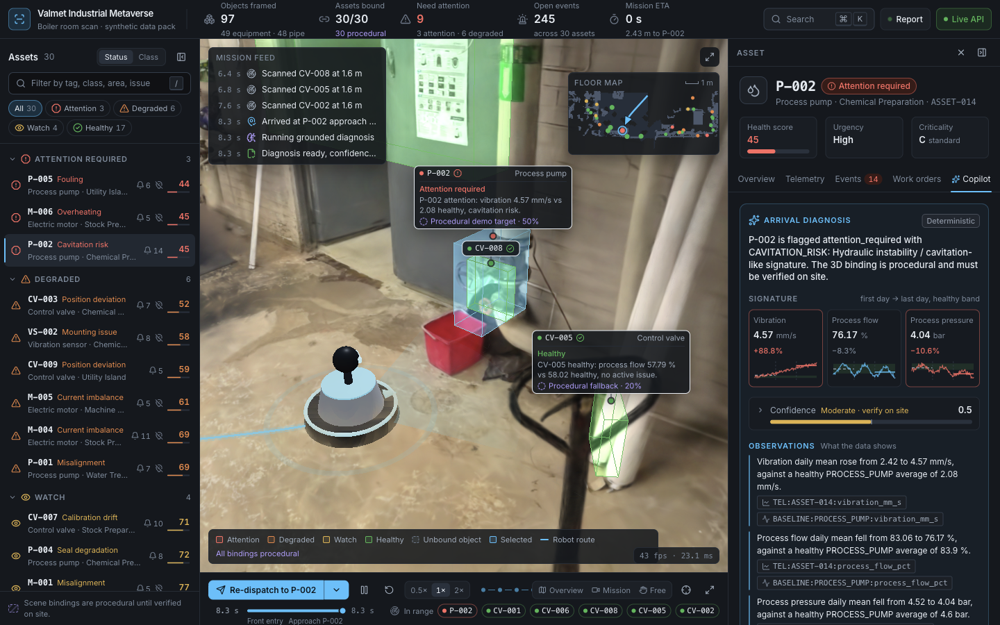
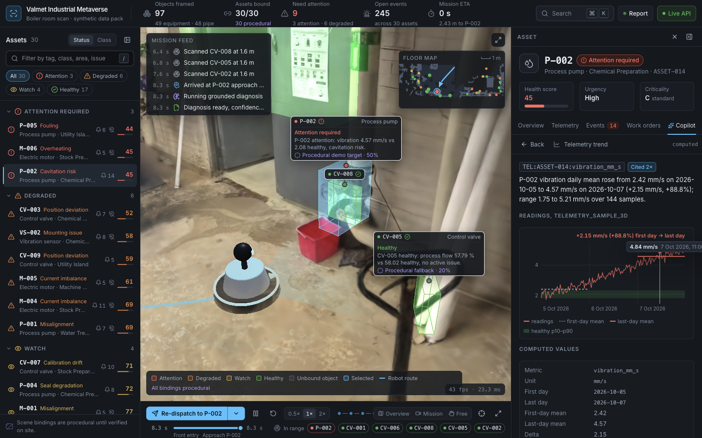

# Tab 7: Copilot and data experience in the UI

Status: **PARTIAL**. Everything is built: the build passes, pytest passes, and the mission check passes. In the live browser, the arrival report and every evidence chip are verified. Not yet verified in the browser: chat streaming, the work-order draft form, the 3D search highlight, the Telemetry tab detail rows, the offline (snapshot) run and fps. The user stopped the tab here, so those checks are the first job of whoever resumes.

## 1. Outcome

- **Copilot tab.** The inspector tab id `evidence` is now labelled **Copilot** and shows four things:
  - the full diagnosis report card;
  - an on-demand editable work-order draft;
  - an asset-scoped chat with suggestions taken from `Builder_Questions`;
  - the collapsed 40-item evidence bundle.
- **Arrival.** The mission still opens this tab automatically. The report shows:
  - the summary and generation badges;
  - a 3-chart "Signature" strip (vibration, flow, pressure, each against its healthy band);
  - a confidence meter with the reasons expandable;
  - Observations and Hypotheses as separate sections, with evidence chips on each claim;
  - a safety callout that quotes `DOC-FIELD-SAFETY`;
  - a validation trace.
- **Evidence drawer.** Each chip opens the drawer over the inspector body, showing:
  - a chart for telemetry and baselines;
  - field tables for events, cases, work orders, data-quality issues, state and mapping;
  - the full text for documents;
  - "Show in 3D" and fly-to chips for asset IDs;
  - which claims cite the item.
- **Search in 3D.** The command palette can light up matching assets in 3D, and a dismissible chip in the viewer lists them.

## 2. Changes

New:
- `web/src/ui/copilot/ReportCard.jsx`: `ReportCard`, the compact `AnswerCard` for chat replies, and `GenerationBadge` (moved here; still re-exported from `CopilotSlot.jsx`).
- `web/src/ui/copilot/EvidenceDrawer.jsx`: the drawer, `RecordTable`, and `AssetLink` (select plus fly-to).
- `web/src/ui/copilot/TelemetryChart.jsx`: the SVG detail and compact charts, plus `ChartLegend`, `isOutsideBand` and `unitOf`.
- `web/src/ui/copilot/CopilotChat.jsx`: the chat. It keeps per-asset history in memory, paces the reveal of validated deltas, and has a Stop button.
- `web/src/ui/copilot/WorkOrderDraft.jsx`: the editable draft form. Its only outputs are Copy and Download JSON.
- `web/src/ui/copilot/evidence.jsx`: evidence kind metadata and icons, `kindOfId`, `EvidenceChip`, and an evidence registry keyed by asset and ID, so the drawer can resolve chips from any answer.
- `web/src/ui/copilot/questions.js`: `SUGGESTED_QUESTIONS` (Q-01 to Q-06 and `safety`) and `SNAPSHOT_CHAT_ASSETS`. The snapshot script imports it too.
- `backend/app/routes/workbook.py`: `GET /api/workbook/builder-questions`. Its models (`BuilderQuestion`, `BuilderQuestionsResponse`) are in `backend/app/models.py`.
- `docs/research/07-copilot-ux.md`: the research note.

Changed:
- `web/src/ui/inspector/CopilotSlot.jsx`: now delegates to `ReportCard`. Props are kept, plus the optional `activeId` and `onDraft`.
- `web/src/ui/inspector/EvidenceTab.jsx`: rewritten as the Copilot tab. Retry works by remounting.
- `web/src/ui/inspector/Inspector.jsx`: the tab label is now Copilot with a sparkle icon, and the drawer is mounted over the tab body.
- `web/src/ui/inspector/TelemetryTab.jsx`: rows are expandable buttons with the detail chart. The first out-of-band metric opens by default. `renderDetail(metric, data, tone)` still overrides the chart.
- `web/src/data.js`: adds `fetchBuilderQuestions`, `fetchWorkOrderDraft` (with snapshot fallback) and `streamCopilot`, a POST SSE reader with snapshot fallback.
- `web/src/store.js`: adds `ui.evidenceId`, `highlight` and `flyRequest`, and the actions `openEvidence`, `closeEvidence`, `setHighlight` and `focusAsset`.
- `web/src/scene/CameraRig.jsx`: flies to the selection when `flyRequest` changes.
- `web/src/scene/Overlays.jsx`: highlighted assets glow and the others ghost. It repaints on `highlight` changes.
- `web/src/scene/Labels.jsx`: highlighted assets get label priority 2 at the tag level of detail.
- `web/src/ui/CommandPalette.jsx`:
  - a "Highlight N matching assets in 3D" command, using `/api/search` `asset_ids` or local matches;
  - a "Clear 3D highlight" command;
  - local matching now uses the backend's stop words and plural rule.
- `web/src/App.jsx`: the `HighlightChip` in the viewer (normal and full screen). The Esc chain is now: drawer, then full screen, then highlight, then selection.
- `web/src/styles.css`: the `slide-in` animation token.
- `web/scripts/snapshot-api.mjs`: also writes `builder_questions.json`, the 7 ASSET-014 question answers and the ASSET-014 draft. The snapshot was regenerated (2.60 MB, 67 deterministic answers).
- `backend/tests/test_routes.py`: the new route is added to the GET list, plus `test_builder_questions`.
- `docs/contracts.md`: the new route, the snapshot files, and the store fields and actions.

## 3. How to run and verify

```bash
cd backend && python3 -m pytest -q -p no:asyncio        # 95 passed
cd web && npm run build                                  # passes, bundle 4.16 MB (was 4.12)
cd web && node scripts/check-mission.mjs                 # all checks pass
cd web && npm run snapshot                               # with the backend up; regenerates offline data
cd web && npx vite --host 127.0.0.1 --port 5173 --strictPort
# offline: VITE_API_URL=http://127.0.0.1:9 npx vite --host 127.0.0.1 --port 5174 --strictPort
```

What you should see:
- Click Dispatch. After about 10 s, P-002 is selected and the Copilot tab shows the report.
- Click any chip, for example `TEL:ASSET-014:vibration_mm_s`. The drawer slides in with the chart and its "+2.15 mm/s (+88.8%)" annotation. Back, or Esc, closes it.
- Click "Draft work order" under the report. The editable draft appears, labelled "Draft · not submitted".
- Click a suggestion chip in the chat. The answer streams, then becomes a validated card with chips.
- Press Cmd+K, type "pumps needing attention" and choose "Highlight 2 matching assets in 3D". The matching boxes glow and the chip appears at the bottom of the viewer.

## 4. Contract changes

- **New route:** `GET /api/workbook/builder-questions` returns `{questions: [{question_id, builder_question, capability_focus, priority}]}`.
- **New snapshot files:**
  - `builder_questions.json`;
  - `copilot/ASSET-014.question.<Q-01..Q-06|safety>.json`;
  - `work_orders/ASSET-014.draft.json`.
- **Store:** `ui.evidenceId`, `highlight` and `flyRequest`, and the actions `openEvidence`, `closeEvidence`, `setHighlight` and `focusAsset`.
- **No changes** to existing response shapes.

## 5. Research used

See `docs/research/07-copilot-ux.md`.

| Source | Decision |
|---|---|
| Cognite Atlas AI docs and the September 2026 blog | Citations for operators, plus a collapsed trace (generation, model, validation errors, attempts). Asset-scoped chat. Asset IDs fly the camera. |
| Perplexity teardowns | Chips at the claim, with the kind icon first. The full source list is collapsed. |
| GodUI citation anatomy; VS Code issue 195814 | Chips are real buttons with accessible names. Disclosures use `<details>`. |
| Microsoft HAX G2 and Pattern 10C | Confidence band wording, the cap marker on the meter, and explicit badges for fallbacks and snapshots. |
| Siemens Maintenance Copilot and Teamcenter SLM; Siemens Industrial Copilot case study | The draft is editable and never submitted (Copy and Download only). Context is visible ("Scope: P-002"). |
| Workbook DOC-FIELD-SAFETY and DOC-RAG-GUIDE | Safety callout. Observations are kept separate from hypotheses ("possible cause, to verify on site"). |

## 6. Evidence

**Live mission**, at 1440x900 with the backend online:
- State timings: dispatched 0 s, en route 0.63 s, approaching 7.51 s, arrived 9.06 s, diagnosing 9.58 s, report 10.89 s.
- After the report: `ASSET-014` is selected and the tab is `evidence`. The report rendered with 18 chips (15 unique) and 3 signature charts.

**Drawer sweep** (scripted clicks):
- All 40 bundle rows opened the drawer with the matching ID and no "not in bundle" state.
- All 15 unique report chips opened correctly.
- Per kind:
  - TEL and BASELINE showed a chart and a values table. BASELINE also showed 4 asset-link chips, the peers ASSET-015 and ASSET-018.
  - DOC showed the quoted text.
  - EVT, WO, DQ, STATE, MAP and ASSET showed "Show in 3D".
- Hovering the vibration chart read out "4.84 mm/s, 7 Oct 2026, 11:00" from the real series.

**Backend:**
- pytest: 95 passed (93 before, plus the builder-questions GET and its test).
- All 7 suggested questions return `validation.ok: true` in deterministic mode. The trend question is phrased "What do the telemetry trends show?", because "vibration, flow and pressure" returned only vibration from the keyword router.
- The SSE wire format was checked with curl. Each block is `event: <name>\ndata: <json>\n\n`, which matches the parser in `streamCopilot`.

**Screenshots:**




## 7. Known issues and limitations

- **Not verified in the browser.** Code is written and builds, but these were never exercised in the browser:
  - chat streaming, the Stop button and the paced reveal;
  - the work-order draft form, Copy and Download;
  - the palette highlight, the viewer chip and the Overlays/Labels highlight;
  - the expandable rows in the Telemetry tab;
  - the full offline (5174) run;
  - the fps check against Tab 6's 59.9 fps idle.
- **Tooltip clipping.** The chart hover tooltip clips at the right edge of the drawer (visible in `07-2`). The clamp in `TelemetryChart.jsx` assumes a 130 px tooltip; measure it, or flip it to the left side.
- **Paced streaming.** Deterministic answers arrive in one burst, so the chat reveals the already-validated chunks at 28 ms each. This is presentation only; nothing unvalidated is shown. With an LLM key, the first chunk still waits for the full validated answer (Tab 4 design).
- **Offline chat** works only for the 7 suggestions on ASSET-014. Free text, or another asset, shows "Chat needs the live API". The offline work-order draft exists only for ASSET-014.
- **Chat history** is in memory only and is lost on reload. Switching tabs while an answer is streaming aborts it (it shows "Stopped.").
- **Confidence band labels** ("Low, verify before acting" below 0.4, "Moderate, verify on site" below 0.7) are UI wording, not backend output. The cap marker is drawn only when a reason starts with "Capped".
- **The LLM path** (`generation: llm`, `cached`, `deterministic_fallback` badges) is wired up but not exercised: no API key.
- **Node warning.** `node scripts/snapshot-api.mjs` prints a harmless `MODULE_TYPELESS_PACKAGE_JSON` warning, because it imports `src/ui/copilot/questions.js`.

## 8. Notes for the next tabs

- **Resume Tab 7 first**, or fold it into Tab 9:
  - run the unverified checks in section 7;
  - capture `07-3-chat`, `07-4-draft`, `07-5-highlight`, `07-6-telemetry-detail` and `07-7-offline`;
  - fix the tooltip clamp;
  - take a 10 s fps sample.
- **Scripted checks.** In dev mode, the store is `window.__store`:
  - `getState().openEvidence(id)` opens the drawer;
  - `setHighlight({query, assetIds})` lights up assets;
  - `focusAsset(id)` selects and flies.
  - Evidence chips have `aria-label="Open evidence <id> (...)"`. The drawer is `section[aria-label="Evidence <id>"]`.
- **Tab 8 (labels):** relabelling changes `MAP:` evidence and the confidence cap automatically. Rerun `npm run snapshot` afterwards so the offline answers match.
- **Tab 9:**
  - the Copilot tab is the demo's money shot: dispatch, wait for arrival, open a TEL chip, open a CASE chip, ask the Q-03 suggestion, draft the work order;
  - record at 1440x900;
  - add `07-*` screenshots to `docs/media/`.
- **Don't** rename the `evidence` tab id (the arrival hook uses it). **Don't** compute new numbers in the UI: charts and labels only format `trends`, `baselines` and `evidence.values`.
