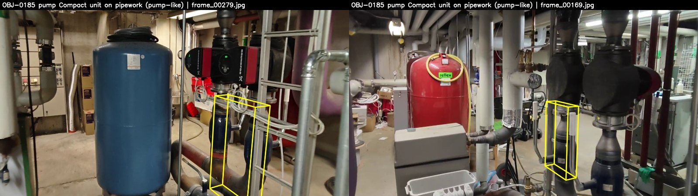
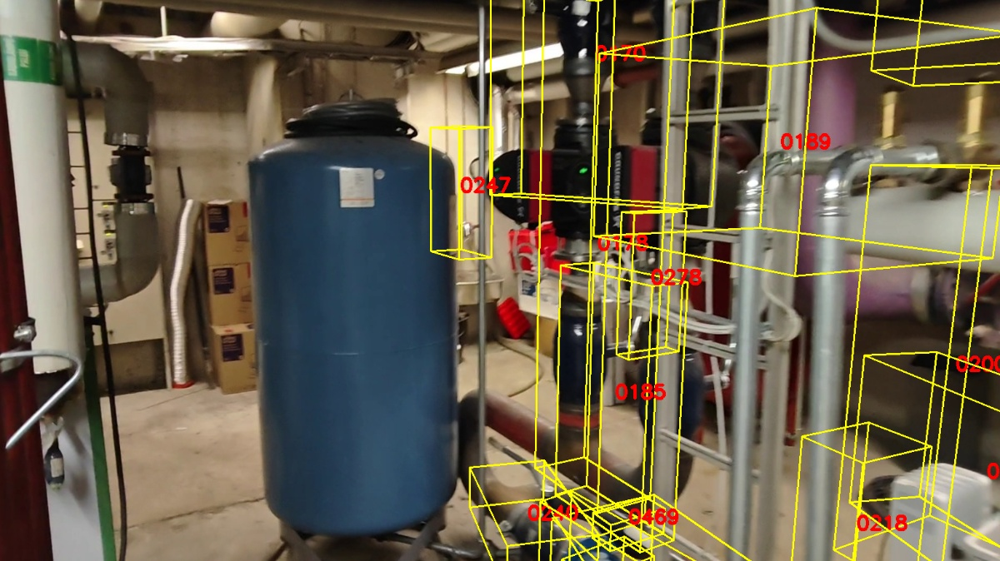
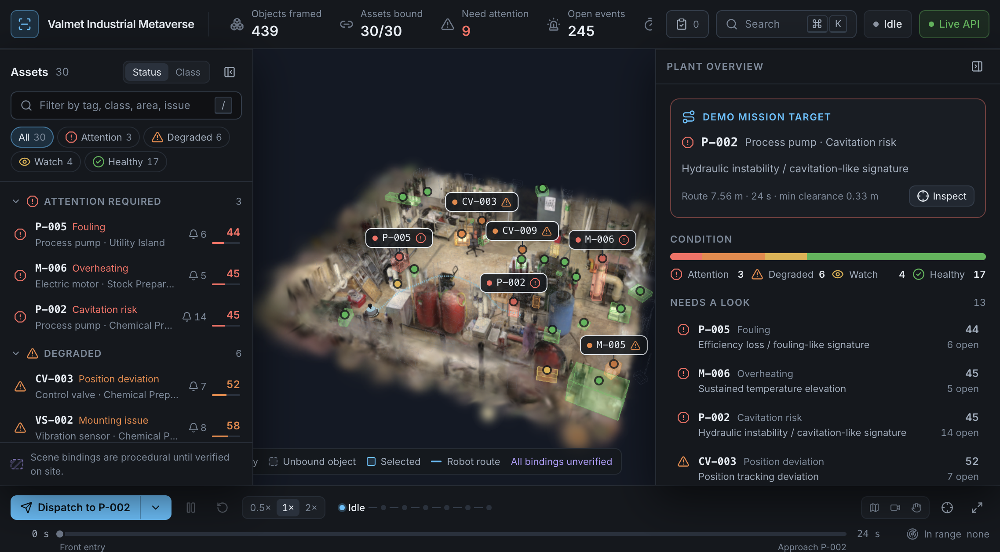
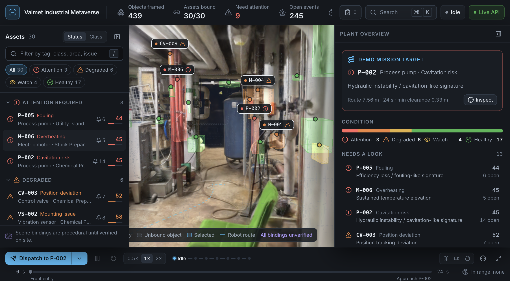
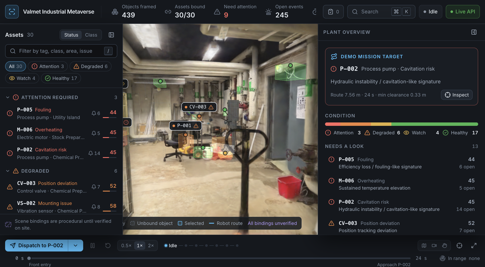
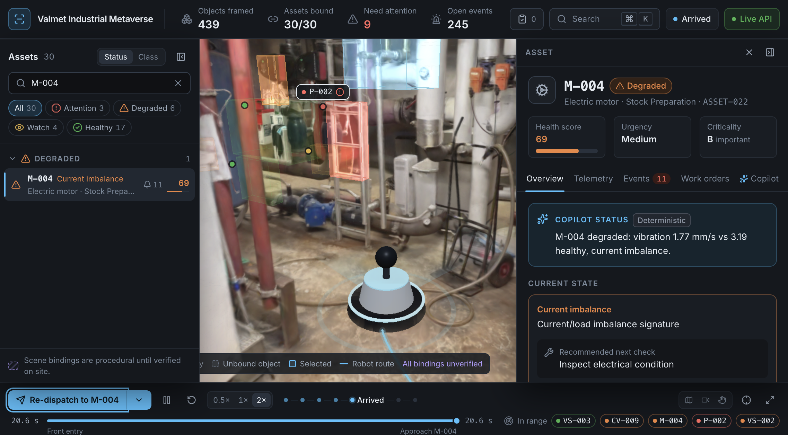
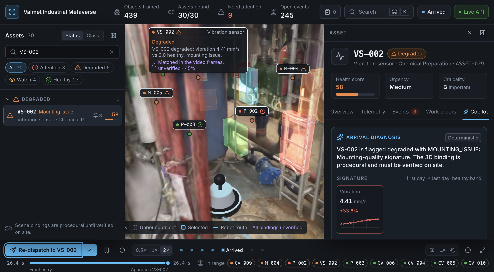
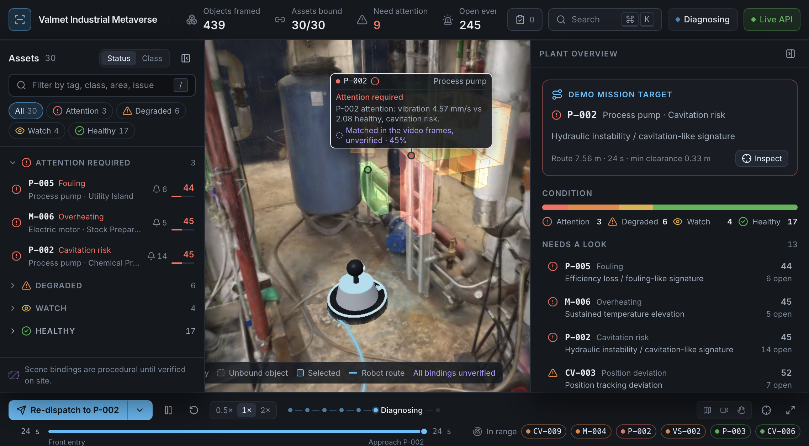
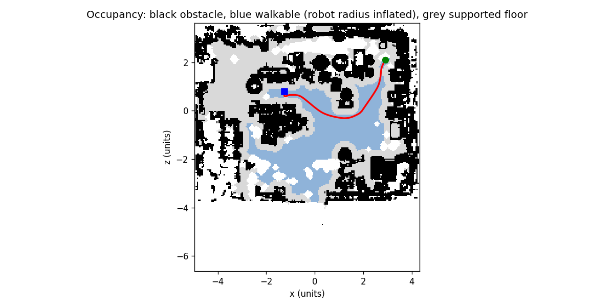

# 10 Intact organiser splat `Equipment Room.ply` (Sat 7 Nov 2026, 14:00)

**Outcome:** the app now runs entirely on the intact organiser splat `Equipment Room.ply`, which covers the whole room. Both halves of the room render in the app. P-002, M-004 and VS-002 are bound to real pump hardware seen in the video, and the robot reaches all three in the browser.

This replaces the damaged `Industrial Boiler Room (1).ply` and its 502,482-row slice. It also supersedes the Brush video splat from [09-full-room-splat.md](09-full-room-splat.md). That splat is now used only to place the video cameras, as evidence.

## The new file

| Measure | Value |
|---|---|
| File | `Equipment Room.ply`, 395,651,019 bytes, `Generated by EGS` |
| SHA-256 | `83d8c7d99316c08c9719cfc2c5a6b9d1903b89847780e2458adc662c79f32955` |
| Splats | 1,676,481, all plausible, 0 NaN/Inf (`_analysis/validate_ply.py`) |
| Properties | Same 59 as before (3DGS, SH degree 3) |
| Extent (1-99 %) | x -4.84 to 4.16, z -3.76 to 3.49 (the old slice stopped at z = -0.8) |

**Frame:**
- The frame is close to the old `ply_raw` frame but not identical. A similarity ICP from the old slice gives scale 1.0365, rotation 0.84° and translation (0.17, 0.07, -0.15), with a median residual of 1.5 cm.
- Every derived artefact was therefore regenerated natively. Nothing was warped into the old frame.
- **Scale:** the pipeline's own floor-to-ceiling fit gives 1.2374 m/unit, against 1.2865 / 1.0365 = 1.241 predicted from the ICP. The aligned video cameras sit a median 1.62 m above the floor, a plausible handheld height.

## Results

| Measure | Old slice | Equipment Room.ply |
|---|---|---|
| Objects framed | 101 | 441 (439 instances) |
| Walkable floor | 6.7 m² | 17.4 m² |
| Assets with an approach pose | 13 / 30 | 23 / 30 |
| Default mission to P-002 | 2.43 m, 8.35 s | 7.56 m, 24.0 s, min clearance 0.33 m |
| Video cameras on blocked nav cells | n/a | 3 / 373 (0.8 %) |
| Viewer splats (spz) | 466K, 9.3 MB | 1.5M, 29.2 MB |
| Overview fps (1440 px panel) | 59.6 | 60 |

**Video-to-splat alignment:**
- `align_to_ply_raw.py solve` against the new file gives scale 0.7246, yaw 270.75° and plan correlation 0.79 (mirrored 0.44), with a median residual of 7.9 cm. Against the old slice it was 0.45.
- The result is written to `data/derived/splat_alignment.json`.

## Asset bindings from video evidence

The geometric classifier calls 44 objects "pump", but the video shows that most of them are boxes, trolleys or tanks. The procedural bindings were:
- P-002 on a green chair (OBJ-0180);
- M-004 on a wire trolley (OBJ-0268);
- VS-002 on the side of a chest freezer (OBJ-0265).

`_analysis/project_objects.py` draws each box onto the COLMAP-posed video frames. Three bindings are now pinned in `data/derived/labels_override.json` with `mapping_method: video_evidence` (confidence 0.45):

| Asset | Object | What the video shows | Reachable |
|---|---|---|---|
| P-002 (ASSET-014) | OBJ-0185 | Body of an inline circulator pump, beside the blue expansion tank | yes, 0.39 units |
| VS-002 (ASSET-029) | OBJ-0247 | Motor head directly above that pump (red head in frame 277, black insulated head in frame 170); the sensor itself is not visible | yes, 0.38 units |
| M-004 (ASSET-022) | OBJ-0189 | Motor head of the neighbouring inline pump in the same group | yes, 0.18 units |

- P-002 and VS-002 share AREA-04 in `Asset_Master`, so the sensor sits on P-002's motor.
- A first M-004 pick, the red circulator head OBJ-0303 on the south wall, was dropped: it is 1.6 units from the walkable floor.
- `video_evidence` is a new method, with a 0.5 confidence cap in the backend and the badge "Unverified · Video evidence" in the UI. A person should still confirm these bindings in review mode (Tab 8).




## Browser verification (Vite and uvicorn, live API)

- The overview shows the whole room from above at 60 fps. The new `CeilingCutaway` fades out splats above 78% of the room height, but only while the camera is above the ceiling.
- Inside views are photoreal on both halves: the north pump group and the south side with its door and pallet jack.
- **Dispatch to M-004:** the button reads "Dispatch to M-004" (so the `MissionDock.jsx` fix is verified), and the robot arrives in 20.6 s.
- **Dispatch to VS-002:** the robot arrives in 26.4 s, and the arrival diagnosis renders.
- **Default P-002 mission:** the robot arrives in 24 s, then diagnosing starts.
- `node scripts/check-mission.mjs` passes all checks; its proximity order is re-baselined to the new route. `check-review-queue.mjs` passes. `pytest` passes 111 tests. `vite build` passes.

| | |
|---|---|
|  |  |
|  |  |
|  |  |



## Changes

| File | Change |
|---|---|
| `pipeline/run.py` | `--ply` defaults to `Equipment Room.ply` |
| `pipeline/mapping.py` | Override entries may carry `mapping_method: video_evidence` (`PINNED_METHODS`); label suffix "video evidence"; selftest case |
| `backend/app/confidence.py` | `video_evidence` cap 0.5 with its own reason |
| `backend/app/copilot.py` | The deterministic binding sentence names the actual mapping method |
| `backend/tests/*` | Three tests no longer hard-code old-scene facts (P-002 method, ASSET-003 unreachable) |
| `backend/cache/ASSET-014_arrival_diagnosis.json` | Re-warmed; cites OBJ-0185 |
| `web/scripts/compress-splat.mjs` | Input `Equipment Room.ply`, output `equipment_room.spz`, crop box `[-5.2,-1.7,-4.2, 4.5,1.7,3.8]` (99.1% of splats) |
| `web/scripts/sync-public.mjs`, `web/src/scene/Splat.jsx` | PLY fallback `/assets/equipment_room.ply` |
| `web/src/scene/CeilingCutaway.jsx`, `Viewer.jsx` | Ceiling cutaway (Spark `SplatEdit` plane SDF, multiply to zero opacity) when the camera is above the ceiling |
| `web/src/ui/status.js` | `video_evidence` mapping label and badge |
| `web/scripts/check-mission.mjs`, `check-review-queue.mjs` | Re-baselined to the new scene; the plane count is read from the data |
| `_analysis/align_to_ply_raw.py` | Floor, ceiling and m/unit come from `--calibration-from` instead of hard-coded old-slice values |
| `_analysis/check_camera_path.py` | New: counts video cameras that fall on blocked nav cells |
| `data/derived/*`, `web/public/*` | Regenerated; the previous state is backed up in `data/derived/baseline_pre_equipment_room/` |

## Rerun

```bash
python3 _analysis/validate_ply.py "Equipment Room.ply"
python3 -m pipeline.run --ply "Equipment Room.ply" --out-dir data/derived      # about 4 min
python3 _analysis/align_to_ply_raw.py solve --target "Equipment Room.ply" --splat _analysis/brush_out/full/export_30000.ply \
  --calibration-from data/derived/scene_objects.json --scale-min 0.5 --scale-max 1.0 --icp-max 0.1 --out data/derived/splat_alignment.json
python3 _analysis/check_camera_path.py data/derived data/derived/splat_alignment.json
python3 _analysis/project_objects.py OBJ-0185 OBJ-0189 OBJ-0247 --out data/derived/diagnostics/evidence
cd backend && python3 -m app.cache --warm ASSET-014 && cd ../web && node scripts/compress-splat.mjs && node scripts/sync-public.mjs && npm run snapshot
```

## Open items

- 7 assets are still unreachable: CV-001, CV-011, CV-012, M-001, M-005, PT-002 and PT-003. Their procedural objects lie 1.2–3 units from the walkable floor. Rebinding them from video evidence (as above) or in review mode is the fix.
- The other 24 bindings are still procedural, and the classifier's `pump` class is mostly wrong. The SAM 3 or vision-model labelling from `docs/research/09-recovery-plan.md` remains the way to improve the classes.
- `segmentation_metrics.json` `mapping.human_pinned` counts every pinned binding, including the 3 video-evidence ones.
- **Deletable to free disk (not deleted):**
  - Brush checkpoints `_analysis/brush_out/full/export_05000` to `_25000.ply` (about 1.6 GB); keep `export_30000.ply` for the alignment;
  - `_analysis/brush_out/aligned_5k.ply` (249 MB);
  - `_analysis/.conda_pkgs/` (2.2 GB);
  - the old `web/public/assets/boiler_room.spz` and `boiler_room_valid.ply` (128 MB), which `vite build` still copies into `dist/`.
