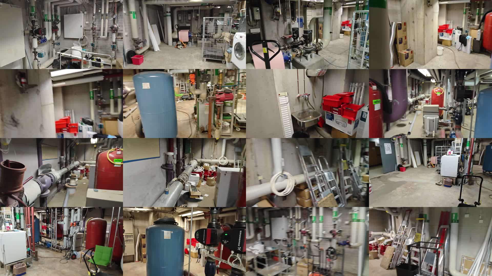
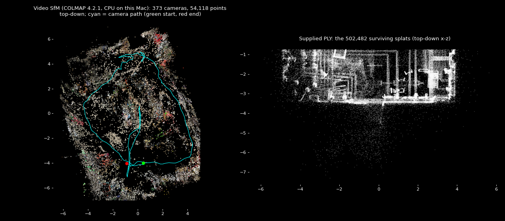

# 09 Recovery and improvement plan (Sat 7 Nov 2026, deadline Sun 8 Nov 10:00)

This report answers the five problems raised after the first full demo run, with evidence gathered on this machine and on live web pages on 7 Nov 2026. Every claim is either:
- **measured here**, with a command you can rerun;
- **verified** on the linked page today; or
- marked **estimate** or **unverified**.

## TL;DR

| # | Problem | Root cause (verified) | Fix | Cost |
|---|---|---|---|---|
| 1a | The room renders on one side only | The supplied PLY is physically damaged. From byte 118,587,392 to the end of the file, the bytes are not splat data. Only 502,482 of 1,506,136 splats (33%) survive. | Rebuild the splat from the boiler-room video (section 4). Also ask the organisers for an intact file. | 3–5 h, mostly unattended |
| 1b | Clicking any pump sends the robot to P-002 | The Dispatch button always sends `mission.targetAssetId`, which is set to ASSET-014 at load and never follows the selection (`web/src/ui/MissionDock.jsx:45`). Also, only 13 of 30 assets have a reachable approach pose, because the damaged scan has a tiny floor. | One-line fix now. The full-room rebuild then makes the other pumps reachable. | 10 min |
| 2 | "Broken PLY records" | Confirmed, and it can't be repaired from this file. The missing splat parameters are not anywhere in it. | Retrain from the video. Repair in place is not possible. | — |
| 3 | Mislabelled and missing objects | There is **no ML model**. Objects come from geometry: RANSAC planes, cylinder fits, HDBSCAN on position + CIELAB colour, then hand-written size and colour rules. 29 of 97 objects are `other`, and the VLM labeller has never run. | Add 2D foundation-model detection on the video frames (SAM 3 text prompts), lifted onto the splat using the camera poses from section 4. A VLM check is the cheap fallback. | 6–8 h |
| 4 | Can the video help? | **Yes, and the hard part is done.** COLMAP 4.2.1 on this Mac registered **all 373 frames into one model**: 54,118 points at 0.89 px reprojection error, with the camera path looping the whole room. The undistorted dataset is zipped and ready for training. | The video gives you a whole-room splat **and** camera poses that make photo-based labelling possible. | Training on a Kaggle GPU: about 1–1.5 h |
| 5 | The "3D layout" target | Your screenshots didn't reach me, so I worked from the brief and the two reference videos. SpatialLM, the obvious model, only knows 59 household furniture classes, needs CUDA, and its weights are non-commercial. | Build a layout mode from data the pipeline already has: walls and floor planes, oriented boxes coloured by class, label cards and a top-down view. | 3–4 h |

Training a detector on a Kaggle or Roboflow dataset is **not** worth it in one day (section 6).

---

## 1. Why the room is one-sided and every click goes to P-002

### 1.1 The PLY is damaged at the storage level (measured here)

The header declares 1,506,136 vertices × 59 float32 properties (236 bytes each) plus a 1,503-byte header. That comes to 355,449,599 bytes, **exactly** the file size, so the file is not truncated. The damage is in the content.

```
python3 - <<'EOF'   # reproduce: rows around the break
import numpy as np
a=np.memmap("Industrial Boiler Room (1).ply",dtype="<f4",mode="r",offset=1503,shape=(1506136,59))
print(a[502481,:6]); print(a[502483,:6])
EOF
# row 502481: [ 1.017  0.685 -3.15  -2.762 -4.978 -3.48 ]   <- a real splat
# row 502483: [ 5.5e-16 1.7e+26 -2.5e-24 6.6e+03 1.4e+14 4.4e-25 ]  <- garbage
```

Forensic facts:
- **The break is at file offset 118,587,392, which is exactly 28,952 × 4096.** That is a filesystem page boundary, in the middle of splat 502,482. A parser bug or a training bug would break on a row boundary, not a page boundary.
- **Every 4 KiB page after the break starts with a 32-bit counter that rises by exactly 0x1000 per page** (0x31E18000, 0x31E19000, 0x31E1A000, …), followed by structured descriptor-like words. These are self-addressed pages of storage or memory filler. They are not compressed or encrypted splats, and they don't come from another file: there are no MP4, ZIP, PNG or PLY markers.
- **Byte entropy rises from 6.9–7.3 bits per byte in the valid region to 7.92 after the break**, with zlib ratio 0.984. There is nothing to decode.

The Spark and splat-transform readers both read properties by name, so the unusual `rot_1, rot_2, rot_3, rot_0` header order is **not** a problem ([Spark ply.rs](https://raw.githubusercontent.com/sparkjsdev/spark/main/rust/spark-lib/src/ply.rs), [splat-transform read-ply.ts](https://raw.githubusercontent.com/playcanvas/splat-transform/main/src/lib/readers/read-ply.ts)).

**Conclusion:** the surviving 33% of splats are one spatially contiguous part of the room (the file is spatially ordered), which is why you see "one side". No PLY tool can restore the other 1,003,654 splats, because their parameters aren't in the file.

**Action, 10 minutes, today:**
1. Re-download the PLY from the official source, ideally on a second machine.
2. Run `python3 _analysis/validate_ply.py "<file>"`. If it reports more than 502,482 plausible rows, you have an intact file. Rerun `python3 -m pipeline.run --ply <file>` and section 4 becomes optional.
3. Post the offset finding (byte 118,587,392, page-aligned) on the Since AI Discord.

Don't wait for the answer; start section 4 in parallel.

### 1.2 The dispatch bug (verified in the code)

The Mission Dock's primary button:

```45:45:web/src/ui/MissionDock.jsx
              onClick={() => dispatchMission(mission.targetAssetId)}
```

`mission.targetAssetId` is seeded from `nav.json` (`target_asset_id = ASSET-014`) in `web/src/store.js:99-106`. Selecting an asset (`selectAsset`, `store.js:157-170`) changes `selectedAssetId` but never the mission target. So "Dispatch" always goes to P-002. The Target menu, the Cmd+K "Send robot" action and the inspector's "Send robot" pass an explicit id and work.

**Fix:**
- Dispatch with `selectedAssetId ?? mission.targetAssetId`.
- Label the button with the selected asset's tag.
- Disable it, with a tooltip, when `navForTarget` has no route.

`dispatchMission` already returns `false` for unreachable targets.

**The deeper reason:** `data/derived/nav_targets.json` has approach poses for only **13 of 30** assets:
- reachable: CV-001/002/005–012, P-002, P-004, P-006;
- unreachable: P-001, P-003, P-005, all six motors, all transmitters and all vibration sensors.

That's because the damaged scan only contains about 2.6 square units of floor. Once the full room is rebuilt (section 4), the same pipeline will produce approach poses for most assets with no code change.

---

## 2. Can the PLY be "corrected"?

**Only the readable part.** Your `_analysis/validate_ply.py` already writes the clean 502,482-row slice the app uses. The useful cleaning steps for any splat (old or new) are:

| Step | Tool (verified flags) | Why |
|---|---|---|
| Drop NaN/Inf and zero quaternions | `splat-transform in.ply -N out.ply` ([README](https://github.com/playcanvas/splat-transform)) | Prevents GPU sort or NaN artefacts |
| Crop to the room | `-B x,y,z,X,Y,Z` (box) or `-S x,y,z,r` (sphere) | Removes far floaters, which helps both fps and the floor/obstacle maps |
| Remove floaters | `-F` (keep splats that add to a solid voxel); `-C --seed-pos x,y,z` (keep only the cluster connected to a seed point) | Cleaner occupancy grid for navigation |
| Opacity filter | `-V opacity,gt,<logit>` | Same idea as the pipeline's opacity filter |
| Smaller file for the web | `out.sog`; `-H 1` keeps SH band 1 only | SOG is about 15–20× smaller than PLY ([SOG doc](https://developer.playcanvas.com/user-manual/gaussian-splatting/formats/sog/)) |
| Check the result | `--stats json null` (per-column min, max, NaN and Inf counts) | A gate before every web deploy |
| Manual cleanup | SuperSplat editor: box or sphere select, invert, Delete ([docs](https://developer.playcanvas.com/user-manual/supersplat/editor/editing-splats/)) | 10 minutes of hand-trimming fixes what automatic filters miss |

**Can the video repair the old PLY instead of retraining?** No, not in any useful sense:
- **Retraining is unavoidable.** The 1M missing Gaussians must be optimised against images, which *is* training.
- **The warm-start shortcut doesn't save time.** Brush uses an `init.ply` if one is present ([Brush 0.3 notes](https://github.com/ArthurBrussee/brush/releases)). But the old splat's coordinate frame is unknown, so you'd first have to register it to the new camera poses, and that costs more time than training from scratch.
- **The old splat is still worth something** as a sanity check: the new reconstruction should line up with the valid half after a similarity transform.

---

## 3. Which "model" labels the structure today, and with what data?

Read from `pipeline/run.py`, `pipeline/classify.py`, `pipeline/label_vlm.py` and `data/derived/scene_objects.json`.

**Detection: no learned model.** The pipeline runs these steps in order:
1. Read the PLY.
2. Filter by opacity and covariance, then remove outliers statistically.
3. Average into 2 cm voxels, weighted by opacity.
4. Fit planes with RANSAC and refine them with SVD (floor, ceiling, walls).
5. Seed pipes from PCA linearity and fit cylinders to them.
6. Cluster the rest with HDBSCAN on position + CIELAB colour.
7. Merge fragments and split oversized clusters.
8. Fit yaw-only oriented boxes with rotating calipers.

**Classification:** hand-written rules in `classify.py:150-205` on:
- size in metres;
- eigen-features (linearity, planarity);
- height above the floor;
- Lab chroma and hue;
- tubular fraction;
- distance to the nearest pipe.

**Labels today:**
- Sources: `heuristic` for 97 objects, `structure` for 4. The VLM labeller (`pipeline/label_vlm.py`, OpenAI Responses API) has **never run**: there is no `data/derived/crops/` and no `vlm_labels.json`.
- Classes: 48 pipe, 29 other, 8 cabinet, 4 valve, 3 pump, 3 trolley, 2 crate, plus floor, ceiling and 2 walls.
- Asset mapping: 23 of 30 bound assets are `procedural_fallback` onto `other` objects.

**Data available:** only the 502,482 surviving splats. That's position, scale, rotation, opacity and colour (SH) per splat, with no images and no camera poses. Most of the room's equipment simply isn't in the data. The video frames show red expansion vessels, red/black inline circulator pumps, a blue tank, ladders, a pallet truck, a washing machine, a sink, crates and cabinets (montage below); most of those are missing from the valid slice.



**Why rules mislabel:** the ceiling is low. A handwheel valve on an insulated pipe has the size and red fraction of a "pump" under the current rules, which is how the P-002 target `OBJ-0015` ended up as a pump. More rules won't fix that; appearance has to come from images.

---

## 4. Using the boiler-room video (measured here)

### 4.1 What the video is
- 1920×1080, H.264, 30 fps, 111.8 s, 3,352 frames, measured with `ffprobe`.
- A handheld walk through the **whole** room, with some motion blur.
- This is the standard input for structure-from-motion (SfM) plus 3D Gaussian Splatting.

### 4.2 Frame selection (done and measured)
`_analysis/extract_sharp_frames.py` keeps the sharpest frame of every 10, scored by variance of the Laplacian on a 480 px grey copy, and writes it at 1600 px.

```bash
python3 _analysis/extract_sharp_frames.py "Industrial Boiler Room (1).mp4" _analysis/sfm_frames --every 10 --width 1600
# 28 s on this Mac. 3,352 frames read, 335 kept.
# Median sharpness of the kept frames is 1,031, against 824 for all frames.
```

The frames are in `_analysis/sfm_frames/`.

### 4.3 Camera poses with COLMAP 4.2.1, CPU, on this Mac (done and measured)

COLMAP 4.2.1 (29 Sep 2026, [release](https://github.com/colmap/colmap/releases)) has an Intel-Mac CPU build on conda-forge ([files](https://anaconda.org/conda-forge/colmap/files?version=4.2.1)). It is installed in a project-local environment:

```bash
CONDA_PKGS_DIRS="$PWD/_analysis/.conda_pkgs" conda create -y -p "$PWD/_analysis/.colmap_env" --override-channels -c conda-forge colmap=4.2.1
C=_analysis/.colmap_env/bin/colmap      # prints: COLMAP 4.2.1 ... without GPU support
$C feature_extractor --database_path W/db.db --image_path W/images --ImageReader.single_camera 1 \
   --ImageReader.camera_model OPENCV --FeatureExtraction.use_gpu 0 --FeatureExtraction.max_image_size 1024 \
   --SiftExtraction.max_num_features 4096
$C sequential_matcher --database_path W/db.db --FeatureMatching.use_gpu 0 --SequentialMatching.overlap 15
$C mapper --database_path W/db.db --image_path W/images --output_path W/sparse
$C image_undistorter --image_path W/images --input_path W/sparse/0 --output_path W/undist --output_type COLMAP
```

I checked every flag above against `colmap <cmd> -h` and the [CLI docs](https://colmap.github.io/cli.html).

**Results:**

| Run | Frames | Registered | 3D points | Mean reprojection error | Wall time on this Mac |
|---|---|---|---|---|---|
| Test (first 80 frames) | 80 | 80 / 80 (model 1) | 16,722 | 0.85 px | 3.1 min |
| Full, first try | 335 | 320, split into 2 models (165 + 155) | 51k | 0.88–0.90 px | 10.3 min |
| Full + 38 bridge frames | 373 | **373 / 373, one model** | **54,118** | **0.89 px** | 12.1 min (reused earlier features and matches) |

**Why the first full run split, and the fix.** The split happened at a fast pan about 52 s into the video, between kept frames 155 and 156 (`docs/kt/media/09-sfm-break-fast-pan.jpg`). Two smaller breaks were at 290–293 and 322–324. At each break I added the sharpest of every 3 source frames as `frame_<k>_<nn>.jpg`, which sorts between the neighbours so sequential matching links them, and reran. All frames then registered in a single model.

The images now have two camera entries: the bridge frames were added in a second extraction run. gsplat's parser handles several cameras.

**Coverage.** The camera path is a closed loop around the whole room. The supplied PLY covers one strip:



**Ready to upload:**
- `_analysis/sfm_full/undist/`: undistorted PINHOLE images plus `sparse/0/*.bin`.
- `_analysis/sfm_full/boiler_undist_colmap.zip`: the same, zipped (254 MB).

COLMAP 4.x writes `frames.bin` and `rigs.bin` alongside the usual files. Use gsplat, whose parser reads through `pycolmap.Reconstruction`, and pin `pycolmap` to 4.2.1 on Kaggle. The original Inria `convert.py` and nerfstudio's COLMAP wrapper are known to break on new COLMAP versions ([Inria #1255](https://github.com/graphdeco-inria/gaussian-splatting/issues/1255), [nerfstudio #3733](https://github.com/nerfstudio-project/nerfstudio/issues/3733); reported by the research pass, not opened by me).

### 4.4 Training the splat: needs an NVIDIA GPU, so use Kaggle or Colab

Running 3DGS training locally isn't practical:
- **gsplat, LichtFeld Studio and Postshot need CUDA** ([gsplat](https://github.com/nerfstudio-project/gsplat), [Postshot](https://www.jawset.com/)).
- **Brush supports macOS and AMD GPUs** ([README](https://raw.githubusercontent.com/ArthurBrussee/brush/main/README.md)). But 0.3.0 ships no Intel-Mac binary ([releases](https://github.com/ArthurBrussee/brush/releases)), and Rust isn't installed here. It would be a source build (`cargo run --release`) onto a 4 GB Radeon Pro 5300M, which is a fallback only.

**Primary route: one Kaggle notebook with a T4 GPU.** Kaggle sessions run up to 12 hours ([Kaggle docs](https://www.kaggle.com/docs/notebooks)).
1. Upload `_analysis/sfm_full/boiler_undist_colmap.zip` as a private Kaggle dataset. It holds the undistorted PINHOLE images plus `sparse/0`. Then `pip install pycolmap==4.2.1`.
2. `pip install gsplat` (kernels compile on first use), then clone gsplat's `examples/` and install its requirements.
3. Train:
   ```bash
   python simple_trainer.py mcmc --data_dir /kaggle/input/boiler/undist --data_factor 1 \
       --result_dir /kaggle/working/out --save_ply
   ```
   - The `simple_trainer.py default|mcmc` invocation is verified ([docs](https://docs.gsplat.studio/main/examples/colmap.html)).
   - Run `--help` first to confirm the exact boolean flag syntax and the MCMC Gaussian cap.
   - **Use MCMC capped at about 1M Gaussians.** gsplat's own evaluation ([eval](https://docs.gsplat.studio/main/tests/eval.html)) shows:
     - "mcmc (1 mill)" reaches higher PSNR than default 3DGS (29.18 vs 29.00) with 1.98 GB of training memory;
     - default 3DGS at 30k steps takes 35m49s on a TITAN RTX.
     
     A 1M-splat scene is also what the Radeon 5300M can draw.
   - **Estimate:** a T4 is slower than a TITAN RTX, so allow 45–90 min for 30k steps.
   - **Download the 7k-step PLY as soon as it appears**, as insurance against a dropped session.
4. **Fallback if COLMAP or the Kaggle setup fails:** KIRI Engine accepts a ≤1080p, ≤3 min video and returns a 3DGS PLY. Its API is `POST /api/v1/open/3dgs/video` ([docs](https://docs.kiriengine.app/3dgs-scan/video-upload/)); the Pro plan was reported at $17.99/month (not verified by me). You get no camera poses, so section 5's photo lifting would need the step in 4.5.

### 4.5 Coordinate frames: the step most likely to bite

**The problem.** gsplat's COLMAP parser normalises the scene by default. It applies a similarity from the cameras, then a PCA axis alignment, then an optional 180° flip so that +z is up. It stores the combined matrix as `parser.transform` ([colmap.py](https://raw.githubusercontent.com/nerfstudio-project/gsplat/main/examples/datasets/colmap.py)). The exported PLY is in that **normalised, z-up** frame. Our pipeline assumes **y-down** (`pipeline/config.py: UP = [0, -1, 0]`).

**The recipe:**
1. On Kaggle, after training, save `parser.transform` and `parser.camtoworlds` with `np.save`. Both are in the PLY's frame.
2. Locally, rotate the PLY from z-up to y-down with a +90° rotation about X: `splat-transform in.ply -r 90,0,0 out.ply` ([flags](https://github.com/playcanvas/splat-transform)). Apply the same 4×4 matrix to the saved camera poses.
3. Check the sign: the floor must end up at **max y**, which is what `pipeline/structure.py:82` expects. If it's at min y, use `-r -90,0,0`.
4. Run `python3 -m pipeline.run --ply <new.ply>`. Scale calibration (floor-to-ceiling distance with a 2.4–2.6 m prior), structure, instances, mapping and navigation all rerun automatically. The CLI already takes `--ply` (`pipeline/run.py:110`).
5. For the web: `splat-transform new.ply -N -F room.sog`, then point `web/public/assets/splat-manifest.json` at it.

---

## 5. Better extraction and labelling (problem 3)

### 5.1 What the field does now: "geometry or a 2D foundation model proposes, multi-view voting lifts to 3D"

All of these are verified on their pages today:

- **[SAM 3](https://github.com/facebookresearch/sam3) (Meta, November 2025; SAM 3.1 in March 2026).**
  - Text-prompted segmentation of *every* instance of a noun phrase.
  - Available in Hugging Face transformers as `Sam3Model` / `Sam3Processor`. The [docs](https://huggingface.co/docs/transformers/main/en/model_doc/sam3) show computing image features once and then looping over many text prompts, which is exactly our case of about 30 class phrases per frame.
  - The weights are **gated**: request access on [huggingface.co/facebook/sam3](https://huggingface.co/facebook/sam3) **now**.
- **[Carveout](https://raw.githubusercontent.com/smallfly/Carveout/main/README.md) (v0.2.0, September 2026, GPL-3.0)** does this whole job for trained splats: render views, run SAM 3, lift masks onto Gaussians, export an oriented box and label per object.
  - Measured on an RTX 5090: 73 prompts × 40 views in 5.0 min, lift in 114–168 s.
  - It needs Ubuntu 22.04 with an RTX 4090/5090, has no headless mode and is unmaintained, so it **won't run on Kaggle or this Mac**. Copy its algorithm, not its install.
- **[segment-3gs](https://raw.githubusercontent.com/risenW/segment-3gs/main/README.md) (MIT)** has the simplest working lift. Project splat centres into the frame, keep those inside the mask within a depth band, and vote across views. It also renders "recolour + dim the rest" and "isolate selected" views, which is the reference-video look.
- **[FlashSplat](https://github.com/florinshen/FlashSplat) (ECCV 2024)** solves mask-to-Gaussian assignment as a linear program in about 30 s, if you want the optimal version.
- **The approach used by OpenMask3D, Open-YOLO 3D and ConceptGraphs** is already summarised in `docs/research/08-labelling.md`. Agreement across views is the strongest signal: Open-YOLO 3D went from 16.3 mAP with 1 view to 24.7 with 40.

### 5.2 Recommended pipeline for tomorrow

Use **real video frames** rather than renders: they're sharper than the splat, and after section 4 their poses are exactly the splat's training cameras.

1. **SAM 3 pass (Kaggle T4, the same notebook as training).**
   - About 170 frames (every second kept frame) × about 30 phrases, with image embeddings computed once per frame.
   - Phrases, taken from what the video shows: `centrifugal pump`, `inline circulator pump`, `electric motor`, `valve`, `handwheel valve`, `pressure gauge`, `red expansion vessel`, `blue pressure tank`, `boiler`, `insulated pipe`, `electrical cabinet`, `control panel`, `junction box`, `ladder`, `step ladder`, `cardboard box`, `plastic crate`, `pallet truck`, `trolley`, `wire cage cart`, `washing machine`, `sink`, `bucket`, `door`, `fire extinguisher`, `warning sign`, `cable reel`, `shelf`, `chair`, `wooden board`.
   - Add 2 negative controls, such as `car` and `bed`, to set the score threshold from data.
   - Time each step on 5 frames first. **Estimate:** about 30–45 min in total.
   - Save, per frame: masks as RLE, scores and phrases.
2. **Lift (locally on CPU; numpy only).** For each frame *i*, with intrinsics K and world-to-camera pose [R|t] in the splat frame:
   - project each splat centre: x_c = R X + t, (u, v) = K x_c / z;
   - build a z-buffer at quarter resolution from splats with opacity > 0.5: D(u, v) = min z;
   - call a splat **visible** if z ≤ D(u, v)·(1 + τ), with τ ≈ 0.04;
   - for each mask *m*, take the visible splats inside it, P_m, and keep the largest DBSCAN component (this removes background bleed-through).
3. **Merge across views into instances.** Use union-find on mask pairs with the same class phrase and an overlap coefficient |P_a ∩ P_b| / min(|P_a|, |P_b|) ≥ 0.3. This is the view-consensus idea from MaskClustering ([README](https://raw.githubusercontent.com/PKU-EPIC/MaskClustering/main/README.md)).
   - Keep instances seen in **at least 2 views**.
   - Class: the majority by score-weighted vote.
   - `class_confidence` = mean score × min(1, views / 5).
4. **Box and merge with the geometry.**
   - Reuse `pipeline/geometry.py` (yaw-only minimum-area box).
   - Keep the RANSAC structure and the pipe cylinders. Where a SAM 3 instance overlaps a pipe cylinder by more than 50%, the SAM 3 label wins; valves and pumps are often mis-fitted as pipe ([LongTail3D](https://github.com/PointCloudYC/LongTail3D)).
   - Write `source: "sam3_lift"` and keep the contract.
5. **Optional VLM check.** Send 2 photo crops per object, with the projected box outlined, to `pipeline/label_vlm.py`. Use a strict enum schema; the design is already in research note 08.

**Fallback if SAM 3 access or the GPU fails.** Project each existing geometric box into its 2 best video frames, as described in research note 08, and classify those **photo** crops with the VLM. This needs only CPU and an API key. It fixes mislabelling, though not missing objects.

**What to expect:** Carveout's results suggest SAM 3 plus lifting finds hundreds of instances in a dense interior (641 objects in its large test scene). For this room, more than 100 credible, *named* equipment objects plus the pipe network is a realistic target (estimate).

---

## 6. Datasets: what exists, and whether to train

| Dataset | What it is | Verdict |
|---|---|---|
| [EDF R&D boiler-room point cloud](https://challengedata.ens.fr/challenges/79) (verified) | LiDAR of EDF Lab Saclay's boiler room: 2.1 billion points, 67 scanner stations, per-point labels for beams, cable trays, civils, gratings, guardrails, HVAC, ladders, piping and supports. Login required. | Closest domain, but it's per-point semantic classes with **no pumps or valves**, and LiDAR geometry differs from splats. Good for citing on a slide, not for tomorrow. |
| [Roboflow "pipe joints & valve"](https://universe.roboflow.com/-hayfu/pipe-joints-valve-bwnkm) (verified) | 4.1k images; the published model version uses 1,817 | Small, unclear labels, not boiler rooms |
| PSNet5, KU fittings, CLOI, Industrial3D (listed by the research pass, not opened by me) | Point clouds of plant pipework, pumps and tanks | Long download and training cycle, with a domain gap |

**Verdict:**
- In under a day, zero-shot SAM 3 plus multi-view voting beats fine-tuning.
- The public photo sets are small and not boiler rooms.
- The 3D sets are LiDAR scans with per-point semantic labels rather than objects.
- Any fine-tune would still need your own labelled frames.

If a phrase fails, draw 5–10 boxes on your own frames and use them as SAM 3 **image exemplar** prompts; the [SAM 3 README](https://raw.githubusercontent.com/facebookresearch/sam3/main/README.md) supports this.

---

## 7. The "3D layout" view and UI fixes (problem 5)

**Your images didn't reach me.** The plan below targets the layout style the brief and reference videos describe: every object as its own coloured, boxed and labelled asset, plus a structural layout.

**SpatialLM 1.1 isn't worth it** ([README](https://raw.githubusercontent.com/manycore-research/SpatialLM/main/README.md), verified):
- It outputs exactly this kind of layout (walls, doors, windows, oriented boxes).
- But it needs CUDA 12.4 plus torchsparse and flash-attn builds, expects z-up point clouds in metres, and its weights are CC-BY-NC.
- Its object vocabulary is 59 furniture categories. Its own zero-shot score for `cabinet` is 11–15 F1.
- Its *output format* is still a good schema to copy.

**Build it from what we have** (3–4 h):
1. **Layout mode toggle.** Fade the splat (`SplatMesh.opacity`), then show:
   - floor and ceiling quads, and wall slabs from the RANSAC planes;
   - each object as a translucent box plus edges, coloured by class;
   - pipes as tubes from `cylinder`;
   - `CSS2DObject` label cards on short leader lines.

   Add an orthographic top-down "floor plan" camera (camera-controls handles both camera types and has `fitToBox`; [repo](https://github.com/yomotsu/camera-controls)). This mirrors Matterport's Inside / Dollhouse / Floor plan modes ([support](https://support.matterport.com/s/article/Matterport-Viewing-Modes-3D-Dollhouse-360-and-Video?language=en_US)).
2. **Show objects lit up inside the photoreal splat**, like the reference video. Spark 2.4.0 (installed) has `SplatEdit` with SDF shapes `BOX | ELLIPSOID | CYLINDER | …` and blend modes `MULTIPLY | SET_RGB | ADD_RGBA` (checked in `node_modules/@sparkjsdev/spark/dist/types/SplatEdit.d.ts`; [docs](https://sparkjs.dev/docs/splat-editing/)):
   - selection: an `ADD_RGBA` box at the object's oriented box to light it up;
   - isolate mode: an inverted `MULTIPLY` to dim everything else;
   - a class-colour overlay: `SET_RGB` per object.
3. **Frame rate on the Radeon 5300M.** Every setting below is confirmed in the installed `SparkRenderer.d.ts`; the values come from [sparkjs.dev/docs/performance](https://sparkjs.dev/docs/performance/):
   - pixel ratio 1;
   - `maxStdDev: Math.sqrt(5)`;
   - `lodSplatScale` about 0.6;
   - `lodRenderScale` 2–3;
   - render on demand through `onDirty`;
   - load the new full-room SOG with `lod: true`.
4. **Status colours.** ISA-101 says to keep normal states grey and reserve red and amber for abnormal states ([ISA HP-HMI](https://www.isa.org/getmedia/06130a38-f7af-4b35-8c9c-2c34f25c1977/The-High-Performance-HMI-Overview-v2-01.pdf)). Use the class colour only in layout mode and the status colour on the mission route.
5. **Dispatch UX.** Fix the bug in 1.2. Grey out unreachable assets in the target menu, with the reason ("no walkable approach in scan"). After the rebuild, most will become reachable.

---

## 8. Timeline: Saturday 09:00 → Sunday 10:00

The gates are hard: if a gate fails, take its fallback and don't sink more time.

| When | Work | Owner | Gate or fallback |
|---|---|---|---|
| 09:00–09:30 | Fix the dispatch bug (1.2). Re-download the PLY and run `validate_ply.py`. Post on Discord. **Request SAM 3 access on Hugging Face.** Create a Kaggle account with phone verification for GPU. | person + agent | If the re-downloaded PLY is intact, run the pipeline on it and skip 4.4 |
| 09:30–10:00 | **Already done:** COLMAP, undistortion and the zip (section 4.3). Upload `boiler_undist_colmap.zip` to Kaggle as a private dataset. | person | — |
| 10:30–12:00 | Train gsplat on Kaggle; save the 7k-step PLY and `parser.transform` / `camtoworlds`. In parallel: start the SAM 3 pass in a second notebook cell once access is granted. | person runs the notebook the agent writes | **Gate G1 (12:00): does a full-room splat render?** If not, upload the video to KIRI Engine (4.4) |
| 12:00–13:30 | Rotate to y-down, clean, SOG. `python3 -m pipeline.run --ply new.ply`. Navigation reruns. Check the floor, the scale and the approach poses in the viewer. | agent | If the splat is fine but the pipeline breaks, keep the old splat for navigation and use the new one for visuals only |
| 13:30–17:30 | Lift SAM 3 masks (5.2), merge with pipes and structure, regenerate `scene_objects.json`, re-run mapping so P-002 binds to a real pump | agent | **Gate G2 (17:30): do the lifted objects beat the geometric ones in a side-by-side?** If not, use the VLM fallback on photo crops |
| 17:30–21:00 | Layout mode, SplatEdit highlight, perf settings, label cards, dispatch UX | agent | — |
| 21:00–23:00 | Full mission run-through, offline cached diagnosis, fps check, bug fixes | person + agent | — |
| Sun 06:00 | **Code freeze** | | |
| 06:00–08:30 | Record the ≤5-minute video, finish slides and the technical note with the measured numbers | person | |
| 08:30–09:30 | Submit; keep 30 minutes of buffer | person | |

**What Claude can and can't do here:**
- **Can:** run COLMAP, ffmpeg, the pipeline, the lifting script and splat-transform locally; write the Kaggle notebook; edit the app; and call a VLM if a key is set.
- **Can't:** run CUDA training or SAM 3 on this Mac. Those steps happen on Kaggle, where you press Run and download the outputs.

---

## 9. Risks

| Risk | Likelihood | Mitigation |
|---|---|---|
| SAM 3 access not granted in time | Medium | Fallback in 5.2 (VLM on photo crops). Grounding DINO plus SAM 2 through transformers is not gated (unverified for this setup). |
| Kaggle GPU quota or session drop | Low–medium | Download the 7k-step PLY early. RunPod L4 is about $0.59/h (reported by the research pass). |
| The floor of the new splat is noisy | Medium | Run `-F` and `-C` floater removal before the pipeline. The pipeline's RANSAC floor plus histogram seeds already tolerate noise. |
| Scale is still an assumption | Certain | Keep the floor-to-ceiling prior, state it on a slide, and cross-check with a door (about 2.0 m) in the new splat |
| The new splat is heavier in the browser | Medium | SOG, `lod: true`, and the Spark settings in 7.3 |

## Sources

**Not opened by me**, so treat them as reported: the Matterport, ISA-101, RunPod pricing, KIRI pricing, LongTail3D, Inria #1255 and nerfstudio #3733 links. They came from the research pass and only support secondary points.

All checked live on 7 Nov 2026:
- COLMAP [releases](https://github.com/colmap/colmap/releases), [CLI](https://colmap.github.io/cli.html), [conda-forge files](https://anaconda.org/conda-forge/colmap/files?version=4.2.1); pycolmap on [PyPI](https://pypi.org/project/pycolmap/)
- gsplat [COLMAP example](https://docs.gsplat.studio/main/examples/colmap.html), [parser source](https://raw.githubusercontent.com/nerfstudio-project/gsplat/main/examples/datasets/colmap.py)
- Brush [README](https://raw.githubusercontent.com/ArthurBrussee/brush/main/README.md), [releases](https://github.com/ArthurBrussee/brush/releases)
- splat-transform [README](https://github.com/playcanvas/splat-transform); SOG [format spec](https://developer.playcanvas.com/user-manual/gaussian-splatting/formats/sog/); gsplat [evaluation](https://docs.gsplat.studio/main/tests/eval.html)
- Spark [docs](https://sparkjs.dev/docs/) and the local 2.4.0 type definitions
- SAM 3 [transformers docs](https://huggingface.co/docs/transformers/main/en/model_doc/sam3), [repo](https://github.com/facebookresearch/sam3)
- [Carveout](https://raw.githubusercontent.com/smallfly/Carveout/main/README.md), [segment-3gs](https://raw.githubusercontent.com/risenW/segment-3gs/main/README.md), [SpatialLM](https://raw.githubusercontent.com/manycore-research/SpatialLM/main/README.md)
- [KIRI video upload API](https://docs.kiriengine.app/3dgs-scan/video-upload/), [Kaggle notebooks](https://www.kaggle.com/docs/notebooks)
- [EDF boiler-room challenge](https://challengedata.ens.fr/challenges/79), [Roboflow pipe joints & valve](https://universe.roboflow.com/-hayfu/pipe-joints-valve-bwnkm)
- Earlier notes in this folder: `02-segmentation.md`, `06-3d-interaction.md`, `08-labelling.md`
